# MySQL 接入与历史迁移设计

当前口径补充：本文件记录早期迁移设计，其中历史数据已在2026-10-23按用户要求清空。当前数据库、CLI和网页时间按用户确认统一北京时间，版本为`0002_beijing_time`；早期UTC约定以[北京时间统一调整说明](北京时间统一调整说明.md)为准，历史数量不代表当前记录。

日期：2026-10-23。状态：基础结构及任务/日志接入已完成。本机正式库为 `taobao_automation`；91 条历史任务、4,231 条历史事件已导入并逐条核对，任务查询已切换。采集业务与采集明细历史导入仍待后续阶段。

## 1. 本次边界与结论

MySQL 部署在本机，作为后续正式查询来源；已核实本机服务版本为 8.4.13。任务、事件、结构化采集结果和文件索引入库。命令行输出、本地运行日志、人工反馈流程继续保留。图片、视频、截图、HTML、原始导出保留为文件。Web 实时显示留到后续阶段，本次设计预留事件查询能力。

前期完成只读数据盘点及本设计。盘点结果见 [本地盘点报告](../workspace/output/reports/mysql_planning_20261023/盘点报告.md)，机器明细见同目录 `inventory.json`，251 个被盘点文件的大小、修改时间和 SHA-256 见 `source_manifest.json`。本阶段命令只在原 `run.log` 末尾追加本轮日志，其他盘点源内容保持不变。正式导入前需暂停采集，重新盘点并核对清单。

当前可用基线：91 条任务、3 条搜索记录、1 个列表批次的 46 条商品记录、29 条详情入口记录、1 个详情商品的 8 个模块批次、100 条评价、4 个问题及 19 条回答、3,467 条结构化事件。目录中的副本和进度文件不重复计为业务数据。

盘点重要限制：

- 7 个曾打开的商品中，只有 1 个保留详情资料目录。其余 6 个仅迁移现有记录，不制造详情，也不据任务成功状态推定详情完整。
- 现有商品整体 `complete_with_warnings`，SKU 为 `partial`：20 项候选，19 项价格已采集，1 项价格不可确认，20 张 SKU 图已下载。不得转换成 SKU 全部成功或以 0 填补缺失价格。
- 100 条评价均采用 `fingerprint_occurrence` 标识。保留批次内身份，不宣称跨批次精确去重。
- `run.log` 有 1,685 个物理行、762 个可识别日志头；日志格式没有统一任务编号与时区。多行异常应合并为日志条目，不能每行伪造一条事件。
- JSON 同时存在版本 1、版本 2 及未声明版本的格式，需按来源类型和版本分别解析。

## 2. 数据关系

已有代码中，每个详情模块都有独立 `batch_id`，整次采集汇总另有 `summary` 批次编号。保留这些编号，增加“整次商品采集”这一层，避免错误地把 8 个模块合成一个原批次。

```mermaid
erDiagram
    tasks ||--o{ task_events : "运行事件与日志"
    tasks ||--o{ collection_runs : "商品采集"
    products ||--o{ collection_runs : "历次运行"
    collection_runs ||--o{ collection_steps : "所选模块及状态"
    collection_steps ||--o{ collection_batches : "模块实际批次"
    tasks ||--o{ collection_batches : "列表或独立模块"
    collection_batches ||--o{ list_observations : "列表商品观察"
    collection_batches ||--o{ sku_observations : "SKU观察"
    collection_batches ||--o{ review_observations : "评价观察"
    collection_batches ||--o{ question_observations : "问题观察"
    question_observations ||--o{ answer_observations : "回答"
    products ||--o{ product_current_sections : "各模块最新有效结果"
    collection_batches ||--o{ product_current_sections : "有效批次指针"
```

旧模块没有整次汇总时，`run_id`、`step_id` 可空，保留其原任务和模块批次，不补造原来不存在的整次运行记录。历史任务与事件标记 `origin=historical`，不会进入当前待执行队列，不重新触发人工操作。

## 3. 建议表结构

以下为首版逻辑表和关键列；现已生成并执行独立验证库迁移，实际全部字段、类型、备注及命名约束见 [完整字段字典](数据库字段字典.md)。所有业务数据应能通过关联追溯来源；未知关联允许为空并记录原因。`id` 如无特别说明为内部自增整数，平台编号与原任务/批次编号另列保存。自查补充的采集范围、执行归属、导入可见性等列和规则见第 10 节。

建表和以后改表均须遵守项目固定要求：表和每个字段写入数据库原生中文备注，交付完整字段字典，并同步维护 [数据库表关系说明](数据库表关系说明.md)。现已完成 23 张实际表、276 个字段、47 个外键的元数据核对；数据库备注不是仅保存在代码注释中。

### 3.1 任务、商品和采集组织

| 表 | 关键字段 | 约束与用途 |
|---|---|---|
| `tasks` | `id`（保留原 32 位任务编号）、`name`、`status`、`started_at`、`finished_at`、`message`、`origin`、`execution_key?`、`owner_pid?`、`owner_process_started_at?`、`last_event_sequence` | 完整保留成功、失败、取消、需人工处理等原状态；历史记录不补造执行归属；恢复仅核对同执行资源的失效任务 |
| `task_events` | `id`、`task_id?`、`task_sequence?`、`run_id?`、`batch_id?`、`event_type`、`level`、`logger_name?`、`step`、`message`、`state`、`occurred_at?`、`recorded_at`、`time_raw`、`time_basis`、`details`、`origin`、`event_key` | 普通日志和结构化事件共用查询入口；`event_key` 唯一，用于失败补写与导入去重；有任务时 `(task_id,task_sequence)` 唯一 |
| `products` | `id`、`platform`、`platform_product_id`、`display_title?`、`title_source_batch_id?` | 唯一 `(platform, platform_product_id)`；标题是显示缓存，原历史值留在批次/观察记录，不相互覆盖 |
| `collection_runs` | `id`、`source_run_key`、`task_id?`、`product_id`、`status`、`started_at?`、`finished_at?`、`warnings`、`error` | 对应已有 `collection_summary`；汇总编号作唯一 `source_run_key` 保留 |
| `collection_steps` | `id`、`run_id`、`module`、`requested`、`status`、`continuation_allowed`、`started_at?`、`finished_at?`、`warnings`、`blocking_issues` | 唯一 `(run_id,module)`；未启用、未开始和被前序阻断均有独立表示 |
| `collection_batches` | `id`、`platform`、`source_batch_key`、`task_id?`、`run_id?`、`step_id?`、`product_id?`、`module`、`status`、`scope`、`scope_key`、`coverage_status`、`captured_at?`、`observed_at?`、`confirmed_at?`、`derived_from_batch_id?`、`visibility`、`source_url?`、`schema_version?`、`summary`、`result_payload` | 保留每个原模块批次；执行完成不等于覆盖全部；列表批次没有单一 `product_id`；商品信息、规格组等扩展保留；来源通过 `import_row_mappings` 追溯 |
| `product_current_sections` | `product_id`、`section`、`scope_key`、`batch_id`、`published_at?`、`publication_basis` | 唯一 `(product_id,section,scope_key)`；批次必须属于同商品、同适用模块与采集范围；最新有效结果与最后尝试分开 |

一个任务可以采多个商品，一个商品可以有多次采集，一个模块步骤可以有多个重试批次。`source_batch_key` 对已知平台按 `(platform,module,source_batch_key)` 唯一；缺失时使用带来源标记的导入键，不能伪装成原批次编号。

### 3.2 搜索、详情和明细

| 表 | 关键字段 | 约束与用途 |
|---|---|---|
| `search_records` | `id`、`task_id?`、`product_id?`、`record_type`、`keyword?`、`page_number?`、`sort_label?`、`status`、`source_url?`、`captured_at?`、`payload` | `record_type` 区分搜索与详情入口；入口打开不等于采集完整；后续如查询规模增加再拆表 |
| `list_observations` | `id`、`batch_id`、`product_id?`、`slot_index`、`product_index`、`title`、`price_text`、`price_value?`、`price_label?`、`sales_text?`、`shop_name?`、`location_text?`、`ad_status`、`identity_status`、`field_states`、`payload` | 唯一 `(batch_id,slot_index)`；不按商品 ID 去重，保留重复展示位置；身份不明也允许保存 |
| `sku_observations` | `id`、`batch_id`、`position`、`platform_sku_id?`、`sku_name`、`properties`、`price_text?`、`price_value?`、`price_label?`、`currency?`、`price_status`、`stock_status`、`combination_confirmed`、`image_status`、`captured_at?`、`payload` | 唯一 `(batch_id,position)`；`prices`、确认依据和数量等保存在 `payload`；不能把 SKU 名称当稳定全局身份 |
| `parameter_observations` | `id`、`batch_id`、`position`、`name`、`name_raw`、`value`、`status`、`payload` | 唯一 `(batch_id,position)`，允许同名参数，不按名称覆盖 |
| `review_summaries` | `batch_id`、`count_raw`、`count_value?`、`count_lower_bound?`、`count_is_exact`、`positive_rate_raw?`、`positive_rate_percent?`、`period_raw?`、`tags`、`payload` | 模糊数量不写成精确总数；标签及计数先存 JSON，需要按标签统计时再拆子表 |
| `review_observations` | `id`、`batch_id`、`position`、`review_key`、`platform_review_id?`、`identity_method`、`identity_exact`、`author?`、`date_raw?`、`sku_text?`、`content`、`append_reviews`、`captured_at?`、`payload` | 唯一 `(batch_id,review_key)` 及 `(batch_id,position)`；追评、媒体和身份不确定性全部保留 |
| `question_observations` | `id`、`batch_id`、`position`、`question_key`、`platform_question_id?`、`identity_method`、`identity_exact`、`question`、`author?`、`date_raw?`、`answers_complete`、`answer_stop_reason`、`captured_at?`、`payload` | 唯一 `(batch_id,question_key)` 及 `(batch_id,position)`；预览回答不变成正式回答 |
| `answer_observations` | `id`、`question_id`（内部外键）、`position`、`answer_key`、`platform_answer_id?`、`identity_method`、`identity_exact`、`author?`、`content`、`date_raw?`、`sku_text?`、`captured_at?`、`payload` | 唯一 `(question_id,answer_key)` 及 `(question_id,position)`；标签、媒体等保存在扩展结构 |

商品标题、销量与规格组等已有 `product_info`、`groups` 数据保存在 SKU 批次的 `result_payload`，不因 SKU 未完整发布而丢失。完整源值保留在原始文件，数据库 JSON 不承担原文件逐字节还原职责。

### 3.3 文件、检查点与导入管理

| 表 | 关键字段 | 约束与用途 |
|---|---|---|
| `file_assets` | `id`、`root_key`、`relative_path`、`size_bytes?`、`sha256?`、`content_type?`、`width?`、`height?`、`duration_seconds?`、`availability`、`verified_at?` | 唯一 `(root_key,relative_path)`；路径基于配置的数据根目录；同哈希不同路径不自动删除或合并 |
| `media_references` | `id`、`task_id?`、`batch_id?`、`sku_observation_id?`、`review_observation_id?`、`question_observation_id?`、`answer_observation_id?`、`role`、`position`、`source_url?`、`file_asset_id?`、`download_status`、`payload` | 有具体明细时最多指定一种明细外键，且须与批次所属关系一致；无明细时可关联任务或批次。支持主图、SKU 图、详情图、评价/回答媒体、截图和 HTML |
| `collection_checkpoints` | `id`、`batch_id`、`checkpoint_type`、`checkpoint_key`、`source_sequence?`、`payload`、`updated_at?` | 唯一 `(batch_id,checkpoint_type,checkpoint_key)`；保存评价 `seen`、图片逐项状态、阶段和复用信息；导入不意味着自动续跑 |
| `import_runs` | `id`、`started_at`、`finished_at?`、`status`、`scope`、`counts`、`manifest_sha256`、`parser_version` | 每次预览和正式导入有独立记录；所有表的入库数量可核对 |
| `import_sources` | `id`、`import_run_id`、`root_key`、`relative_path`、`sha256`、`size_bytes`、`source_kind`、`schema_version?`、`parse_status` | 记录本次使用的源文件版本；相同路径内容变更视为新源版本 |
| `import_row_mappings` | `id`、`source_id`、`source_record_key`、`logical_key`、`target_table`、`target_key`、`payload_fingerprint`、`result` | 来源定位和目标映射；同一记录不同副本合并到一个目标，映射仍分别保留 |
| `import_issues` | `id`、`import_run_id`、`source_id?`、`source_record_key?`、`severity`、`code`、`message`、`resolution?` | 冲突、格式不兼容、未知关联及缺失文件均可追踪；不能静默丢弃 |

共 22 张逻辑表，按现有数据职责划分，不另建多店铺、用户权限、消息队列、分析报表等未实现业务。规格选项、追评、标签、多种价格展示先使用 JSON，待实际查询需要时再拆分。

## 4. 字段映射与来源优先级

| 当前来源 | 对应入库位置 | 关键处理 |
|---|---|---|
| `storage/database/ecommerce.sqlite3: tasks` | `tasks` | 原 ID、状态、时间、结果说明原样映射；91 条全部保留 |
| `logs/taobao/*.jsonl` | `task_events` | `time→occurred_at/time_raw`，`event→event_type`，`state/step/progress` 分别保存；来源文件＋行号作稳定来源键 |
| `logs/run.log` | `task_events` | `event_type=log`，保留级别、模块、多行正文与原始时间；无可靠任务 ID 时 `task_id=NULL`；不按正文强行判断属于哪个任务 |
| `output/raw/taobao_search/*.json` | `search_records` | 搜索成功或失败、关键词、来源、截图关联保留；没有商品记录不补造商品列表 |
| `output/raw/taobao_detail_open/*.json` | `search_records`、`products`、`media_references` | `record_type=detail_open`；`checked_at` 映射记录时间；保留 `product_fields_collected`，不把入口打开当作详情已采集 |
| `output/raw/taobao_products/*.json` | `collection_batches`、`list_observations`、`products` | 批次原编号保留；`items` 为结构化明细，口径、排序和加载摘要留在批次扩展；`raw_items` 等完整证据通过原文件追溯；CSV 只作核对 |
| 商品根 JSON 的 `collection_summary` 及历史 `collection_summary.json` | `collection_runs`、`collection_steps` | 同一汇总编号只建立一条运行、8 个步骤；历史汇总与商品根分区互相核对 |
| 历史 `sku_details.json` | `collection_batches`、`sku_observations`、`collection_checkpoints` | `product_info/groups/summary` 保留；`skus[].price_value` 解析为定点数；`price_status` 和缺失原因独立保存 |
| 历史 `parameters.json` | `collection_batches`、`parameter_observations` | `items[].index/name/name_raw/value/status` 对应明细，来源与诊断保留在扩展 |
| 历史 `review_summary.json` | `collection_batches`、`review_summaries` | `review_count.raw/value/lower_bound/is_exact`，`positive_rate.raw/percent/period_raw`，`tags` 全部保留 |
| 历史 `reviews.json`＋`reviews-progress.sqlite3`＋评价明细 JSON | `collection_batches`、`review_observations`、`collection_checkpoints` | `reviews.json` 定义范围和状态；SQLite/导出 JSON 比较后只导一份；`seen` 与模板过滤统计另存检查点 |
| 历史 `questions.json`＋`questions-progress.sqlite3`＋问答明细 JSON | `collection_batches`、`question_observations`、`answer_observations` | 保留问题与回答层级、各自身份、数量口径、完成状态；不以显示总数替代实际采集数量 |
| 历史 `video/main_images/detail_images.json` 及各模块图片信息 | `collection_batches`、`file_assets`、`media_references` | 源链接与本地文件分开；`image_results`、失败原因、复用批次写入检查点；媒体不存数据库二进制 |
| `history_record_file`、`progress_record_file`、`files[].file/history_file`、截图和 HTML 清单 | `file_assets`、`import_sources`、映射或媒体引用 | 历史文件与最新副本都是物理文件，但不各生成一份业务明细 |

正式结果优先读取模块历史元数据及其登记明细；商品根 JSON 用于核对当前发布指针和范围；中断且没有导出时，以已提交的进度库恢复“已采集的部分记录”。出现不同源内容冲突时记录差异，禁止根据文件修改时间直接判定哪个更正确。`sku_progress.json` 和 `sku_details.json` 同批次不重复入库。

当前列表、入口涉及的已知平台商品 ID 合并后共 51 个；其中仅 1 个有详情目录。其余商品可以有商品身份记录与列表/入口记录，不等于拥有详情。

## 5. 类型、时间和查询索引

- 使用 InnoDB、`utf8mb4`。平台 ID、任务 ID、原批次编号采用区分大小写的标识列；不要依赖默认文本排序规则决定身份是否相等。
- 平台商品/SKU/评价/问答编号用字符串，不经浮点转换，不根据负数规格值或名字过滤候选。
- 价格建议 `DECIMAL(20,6)`，百分比使用适当精度定点数；从原始数字文本或确定的解析值转换，保留原文，不能补 0、静默截断或把未知当无库存。
- 时间列建议 `DATETIME(6)`，应用统一写 UTC，并保留 `time_raw` 与时间依据。界面转北京时间。没有时区的旧日志先保留原文、令 UTC 列为空；可按原时间文本筛选，待明确时区后再进行可追溯修正。导入时间另列，不替代采集时间。
- 常用查询列单独建索引，扩展 JSON 不整体建立索引。首版索引：任务 `(execution_key,status)`、`(status,started_at)`；事件唯一 `(task_id,task_sequence)`、`(occurred_at,id)`、`(level,occurred_at,id)`；批次 `(product_id,module,scope_key,captured_at,id)`；搜索 `(keyword,captured_at,id)`；列表 `(product_id,batch_id)`、`(shop_name,batch_id)`；SKU `(batch_id,price_value)`；评价/问题 `(batch_id,position)`；回答 `(question_id,position)`；文件 `sha256`；导入映射 `logical_key`。唯一索引已满足查询时不重复创建同前缀普通索引。
- 评价正文首版支持按商品/批次分页及文字包含查询；不宣称已有全文搜索。中文全文检索、销量排行分析等有明确需求后再设计。

类型依据见 [MySQL 8.4 数据类型文档](https://dev.mysql.com/doc/refman/8.4/en/data-types.html)。扩展 JSON 与可查询列的取舍参考 [MySQL JSON 文档](https://dev.mysql.com/doc/refman/8.4/en/json.html)。

## 6. 最新有效结果的发布规则

1. 每个模块都写历史批次和实际状态。部分、失败、中断结果可查询，但不替代原完整结果。
2. 只有模块满足既有完整性规则时，才在同一短事务内发布同一 `scope_key` 下的 `product_current_sections`。确认无视频、无参数、无评价等是对应范围的有效空结果，允许替代旧结果；未采集或失败不允许。达到数量上限可作为该限定范围的有效结果，不能覆盖另一范围的完整采集结果。
3. SKU 为 `partial` 即使允许流程继续，也不能发布成完整 SKU。本次现有商品没有完整 `sku_details` 分区，只导入部分批次与商品信息，不制造完整指针。
4. 有原根 JSON 的有效分区时，优先恢复其既有发布关系，校验与历史批次一致。没有可信发布关系时，仅保留历史或报告候选，不因导入顺序自动认定“最新”。
5. 各模块分别显示采集时间与来源批次；商品显示标题的缓存更新必须记录来源。`product_info` 与完整 SKU 如需同时发布，保持现有整体发布语义。
6. 媒体先保存、核对文件，再提交数据库引用。文件和数据库没有共同事务；数据库提交失败保留文件与待补写记录，不能报告全部成功。部分文件不得提前成为完整模块的当前结果。
7. 历史批次引用其独立历史目录中的文件，不引用以后会被替换的“最新副本”。最新副本可登记为额外文件，不能取代历史原件的关联。

## 7. 日志、故障和未来 Web

统一事件入口产生一个事件编号，并复用现有 logging 的终端与文件输出。采集进度从分散 `print` 逐步接入，不能简单抓取 stdout 将普通查询输出和交互回答都存成运行日志。避免事件入口再次触发数据库日志，形成递归或双份记录。

普通事件先写带唯一事件键的本地结构化流水，再由进程内有界队列串行写库，正常退出等待刷新；队列满或异常退出的未写库事件保留在本地流水，按唯一事件键补写。现有文本 `run.log` 继续保留，不能仅靠其格式恢复新事件的上下文。采集结果、重要状态与发布操作同步确认入库。MySQL 启动前不可用则不启动任务；执行中失败保留检查点并在安全检查点暂停，待入库状态明确展示，不重放提交/上传等业务操作。

后续 Web 使用按任务、事件游标分页的历史接口，并可增加 SSE。任务事件使用 `task_sequence` 作游标，发生时间用于展示，`recorded_at` 记录入库时间；单独的导入标记防止历史事件被当成实时控制消息。写同一任务的事件时，在同一短事务内锁定其任务行、分配序号、插入事件并提交；补写同一事件复用唯一 `event_key`，不重复占用已提交事件。不能仅假定全局自增 ID 按提交顺序可见，进程内队列也不能替代跨进程数据库约束。无任务的旧日志只提供历史查询，首版不为它们构建实时流。SSE 不承担确认、取消或恢复执行，控制动作仍走独立且校验当前提示编号的流程。

新增事件应记录任务、步骤与时间依据，旧文本日志不补造关联。数据库密码、Cookie、令牌不写事件；签名媒体链接和详细堆栈限制在本地原始数据/受控字段，Web 推送仅提供需要展示的字段和安全摘要。首版日志不自动过期删除；按真实增长再确认保留周期和轮转策略。

## 8. 导入、验证与回退

### 8.1 导入步骤

1. 停止新采集，确认当前任务结束；备份 SQLite、采集目录、媒体、日志和配置。登录资料不作为业务导入源。
2. 重新生成源文件清单，确认本轮基线与新变化。预览导入数量、源格式、冲突和缺失项。
3. 按任务→商品身份→运行/步骤/批次→明细→文件引用→当前指针候选→事件的顺序写入。按批次使用短事务，评价/问答可分块提交并记录导入检查点；预览、未完成导入对正式查询不可见。导入根记录关联 `import_run_id`，批次初始 `visibility=staging`；验收通过后才在最终事务内提交导入状态与指针，已有有效记录不因一次重复导入而变成不可见。
4. 记录每个来源文件和源记录映射。目标唯一键以原任务/批次/批次内身份为主，不以“本次 import_run_id”或整个文件哈希作为去重边界。同一内容重跑计为跳过，来源变化或目标冲突明确报告。追加日志使用稳定文件身份及行号/记录起始位置识别旧条目；追加内容导致文件哈希变化时不重复导入旧行，原位置内容改变则报告冲突。日后日志轮转需另记录文件代次。
5. 导入只新增历史，不恢复任务、不发送控制命令、不执行浏览器操作、不重新下载媒体。
6. 核对通过后才切换正式查询来源。旧 SQLite 和文件继续保留，稳定运行并经确认后再讨论清理。保存本次文本日志导入的截止位置，切换后的新事件只从带事件键的结构化流水写入或补写，避免将同一条新事件再次从 `run.log` 导入。若需回退到旧程序后又切回 MySQL，以独立切换记录登记旧程序产生的新日志区间，防止遗漏这段期间的日志。

### 8.2 当前基线验收

| 项目 | 预期结果 |
|---|---|
| 任务 | 91 条；成功 29、失败 20、取消 36、需人工处理 6；无未结束任务 |
| 搜索/入口 | 搜索 3 条、详情入口 29 条；原状态、字段采集标记不变 |
| 列表 | 1 批 46 条，原位置、价格、广告识别和字段状态一致，CSV 同为 46 行 |
| 商品身份 | 已确认来源合并后 51 个商品 ID；仅 1 个拥有当前详情目录；另 6 个曾打开商品的详情目录缺失需报告 |
| 详情运行 | 1 次汇总、8 个步骤、8 个模块原批次；9 个历史目录，不把汇总和 SKU 进度副本算成新模块批次 |
| SKU | 20 条，价格已采 19、不可确认 1，20 张图；状态仍为 `partial`，不创建完整 SKU 当前指针 |
| 参数/概览 | 2 个参数、7 个评价标签；原数量模糊性、统计口径保留 |
| 媒体 | 历史模块 5 张主图、14 张详情图、20 张 SKU 图、1 个视频；物理副本不重复生成采集结果 |
| 评价 | 100 条，SQLite 和历史 JSON 逐条内容一致；指纹身份不升级成精确身份 |
| 问答 | 4 个问题、19 条回答；SQLite 和历史 JSON 逐条内容一致，层级与完成状态一致 |
| 结构化事件 | 45 个 JSONL 文件共 3,467 条，原任务关系、步骤、状态和顺序可追溯 |
| 文本日志 | 1,685 行形成的多行日志记录可回查，762 个可识别日志头；未关联条目明确保留为空 |
| 文件 | 本轮 67 次已登记引用检查涉及 47 个不同历史文件，缺失/大小/哈希不符均为 0；正式迁移时复查当前副本及全部引用 |
| 幂等/异常 | 重复导入业务行不增加；冲突可见；中断可从导入检查点重试；不修改旧状态或旧文件 |
| 命令行/故障 | 输出和人工交互继续可用；断库不报假成功；本地日志仍可读取；恢复补写不重复 |
| 采集范围 | 当前评价标为限定 100 条且未确认到底；问答保留限定 50 题、实际 4 题、可见末尾已确认；二者不显示为平台全量 |
| 切换边界 | 同一新事件经结构化补写和文本日志核对仍只入库一次；未完成导入不进入正式查询 |
| 并发与归属 | 同任务事件序号不漏读；恢复一个浏览器资源的遗留任务不影响另一个仍存活的任务 |
| 备注与关系文档 | 所有项目表、所有字段的数据库中文备注齐全；完整字段字典、22 张业务表关系说明与实际表结构、约束一致；框架迁移版本表单独登记，不混入业务表数量 |

“采满默认上限”与“平台所有数据已采完”分别保留，不能因模块 `complete` 就显示平台总量已全部采完。验收不仅对数量，还对关键字段、顺序、身份依据、来源哈希和文件关联。

### 8.3 切换与回退

实现阶段先在独立验证库完成导入与查询核对，再停采集切换；不要让 SQLite、MySQL 长期各自接受正式写入。切换前失败可继续使用未改动的旧程序与旧资料；切换后若已新增 MySQL 数据，回退前必须先备份并处理新增结果，不能直接退回旧 SQLite 造成记录丢失。

备份同时覆盖 MySQL 和文件目录，并验证至少一次恢复。数据库回退涉及的是已完成的数据写入和状态，不能通过回放浏览器任务恢复。

## 9. 分阶段实施顺序

1. 数据基础（已完成验证阶段）：创建本机 `taobao_automation_verify` 独立验证库、专用运行账号和独立迁移账号，连接参数由 TOML/环境变量提供。正式库 `taobao_automation` 留待业务接入与迁移验收后使用；程序不以 root 运行。
2. 存储与事件：集中数据库访问，采用 SQLAlchemy + PyMySQL、Alembic 有序迁移；任务与事件先接入，保留终端、本地日志、原有锁和验证守卫。
3. 采集与导入：逐模块实现结构化写入与历史导入，覆盖部分结果、指针发布及故障补写。
4. 查询与切换：实现商品、批次、任务事件、评价问答基础查询，执行验收后切换。Web 实时页面单独安排。

连接健康检查参考 [SQLAlchemy 连接池文档](https://docs.sqlalchemy.org/en/20/core/pooling.html)，结构迁移参考 [Alembic 官方教程](https://alembic.sqlalchemy.org/en/latest/tutorial.html)。依赖版本在实施时核对兼容性，不在设计稿中假定已经安装。

实现时同步更新 `agent.md` 中“SQLite 为准”的规则、Settings、任务执行器、采集存储入口、CLI/Web 查询及使用指南。当前本设计不改变既有规范或声明未实现命令可用。

## 10. 对照代码自查后的补充

本节补足原方案未具体规定的边界，不增加逻辑表，不扩展到 Web 实时页面或多机任务系统。字段、数据库约束及基础验证已落地；任务事件流水、控制降级、任务/日志导入和历史查询已接入，采集业务发布及采集明细导入仍待后续阶段。

### 10.1 执行状态与数据覆盖范围分开

现有评价逻辑达到 100 条便写 `status=complete, stop_reason=limit_reached, end_confirmed=false`；问答本次则为限定 50 题、实际 4 题、`stop_reason=stable_bottom, end_confirmed=true`。因此批次增加以下可查询列，不能只放在扩展 JSON 后再靠提示文字判断：

- `collection_mode`、`requested_limit`、`answer_limit`、`selection_filter`、`sort_label`：保留原采集请求及选择条件。
- `stop_reason`、`end_confirmed`、`completion_evidence`：保留实际停止依据。
- `coverage_status`：可为 `limit_reached`、`visible_end_confirmed`、`manual_count_confirmed`、`confirmed_empty`、`incomplete`、`unknown`；人工确认与程序确认的依据分别保留，即使已到可见末尾，也不宣称获得平台隐藏或未提供的数据。
- `scope_key`：由有版本号的规范化采集条件生成，包含模块、模式、上限、筛选、排序等影响结果含义的条件；原条件与规范化依据同时保留，缺失条件单独标记未知，不默认等于全部。

当前指针按商品、模块和 `scope_key` 维护。默认查询显示所选范围及覆盖说明，不将限定样本称为全量；历史根 JSON 的原有效分区只恢复到其原范围，不据此另建“全部采集”指针。

### 10.2 人工确认、复用与采集时间分别追溯

现有 `confirm_questions_batch` 会复制旧数据产生新批次，并把批次 `captured_at` 改为确认时间，但问题/回答本身的采集时间保留。数据库需要保留这种差异：

- `captured_at` 保留原记录给出的值，不静默改写；`observed_at` 表示实际采集观察时间，`confirmed_at` 表示人工确认时间。
- `derived_from_batch_id` 关联来源批次，`upstream_batch_key` 保留原来源编号，`derivation_kind` 区分人工确认与恢复复用，确认依据和说明保留在证据结构。
- 原来源批次不存在时保留外部编号和缺失关联，不补造新的抓取行为或原始观察时间。图片复用按文件来源追踪；SKU 本轮重新确认价格，不能因为复用了图片就把旧价格当本轮价格。
- 跨批次价格比较需同时核对商品、SKU 身份、币种、价格标签与采集范围。身份不明或“优惠前”与另一种价格口径不同，只并列展示，不直接计算涨跌。

### 10.3 断库时保留停止能力，恢复只处理正确任务

现有 `request_control` 先查询 SQLite 找任务；简单替换为 MySQL 后，数据库不可用会连带阻断从另一终端发出停止请求。实施时需要补充本地活动任务描述，记录任务编号、浏览器资源标识、进程编号及进程启动时间；数据库不可用时仍可定位并验证当前任务，将暂停/停止请求送入现有控制文件。

确认/继续仍必须匹配当前 `prompt_id`；数据库未恢复且结果尚待保存时，不能通过“继续”绕过存储暂停。停止由执行器在安全检查点处理，本地保存结果和待入库状态，不以强制结束进程代替正常停止。本地结构化流水也写入失败时，终端明确报告并停止启动新业务动作。

任务表新增执行资源与进程归属字段。恢复旧任务前需取得对应浏览器资源锁并核实原进程已经失效；不能把全部 `running` 记录批量改为中断。历史导入任务没有当前执行归属，不进入恢复；无法确认归属的旧活动记录需要单独报告，不能仅因超时判定已结束。

### 10.4 把一致性落实为约束和查询规则

- 同一任务的事件序号在持有任务行锁的事务中分配，重试只围绕可幂等的数据写入，绝不包住浏览器操作。事件与结果写入使用统一的锁顺序，事务内不等待扫码、页面或用户反馈。事务锁定方法参考 [MySQL 锁定读文档](https://dev.mysql.com/doc/refman/8.4/en/innodb-locking-reads.html)。
- 批次与商品、步骤、运行的所有权应以外键、复合唯一键及必要的复合外键约束；媒体引用最多关联一种具体明细。导入映射不能替代目标表自身的唯一约束。
- 导入根记录关联 `import_run_id`；正式查询通过导入已提交状态与批次发布状态过滤，列表/评价/问答明细继承所属批次可见性。商品身份、文件索引可以在暂存阶段登记，但不能因此对外报告已拥有完整资料。只导入部分范围时，成功与隔离范围分别报告，禁止整体误报成功。
- 已有相同文件/业务记录可复用目标，但保留新来源映射，不因为重跑而修改已发布结果。出现相同批次编号却属于不同商品等情况，按冲突隔离，不覆盖。

### 10.5 控制首版复杂度和运行开销

首版维持 22 张逻辑表；标签、规格组、追评、多价格展示继续用 JSON，不再提前拆成更多表。批次 `result_payload` 仅保存适合查询和理解结果的扩展；整页 `raw_items`、HTML 和大量诊断证据只保存原文件及引用，避免在每次进度更新时重写大 JSON。原始证据仍通过文件与导入映射可追溯。

连接池保持小容量，启动只检查连接与数据库版本；建表和升级由独立迁移步骤执行，运行账号不需要 DDL 权限。MySQL 的部分 DDL 会隐式提交，不能以一个普通事务保证整套建表/升级可回滚；失败后按迁移版本和实际结构核对修复，不用删库重建作为默认恢复方式，依据见 [MySQL 隐式提交文档](https://dev.mysql.com/doc/refman/8.4/en/implicit-commit.html)。

### 10.6 本轮复核结果

重新核对已有 251 个源文件：缺失 0，内容变化 0。对现有评价上限、问答结束判定、人工确认派生批次、SKU 发布、任务锁和命令行控制代码完成对照。已将范围区分、派生来源、断库停止、事件顺序、导入可见性、日志切换边界及 DDL 边界补入设计；本轮未连接 MySQL 或改动业务代码。

## 11. 任务与日志阶段实施结果

2026-10-23 已完成任务与事件接入，并切换本机正式配置。终端、`run.log`、淘宝原结构化日志和旧任务 SQLite 均保留；原文件及任务库在切换前生成固定快照。导入 91 条任务和 4,231 条事件，原状态不变；其中 3,467 条为淘宝结构化事件，764 条为合并续行后的文本日志，后者时间与任务关联不猜测。

任务通过本地持久流水幂等写入，查询只显示已提交导入。当前任务游标按任务内提交顺序；全局编号接口用于历史分页，Web 实时推送尚未实现。任务/日志导入失败时整批回滚，从固定快照安全重试；采集检查点恢复及采集批次发布不属于本阶段已交付能力。

已验证重复补写、提交响应丢失、同键异文冲突、日志文件追加后只导新增记录、原进程与执行资源核对、断库时停止、人工反馈及弹窗守卫、CLI/Web 历史查询，并在隔离库完成正式备份恢复逐表校验。当前细节、JSON 键和来源格式版本口径见 [表关系说明](数据库表关系说明.md)，完整证据见 [任务与日志接入验收报告](MySQL任务与日志接入验收报告.md)。

以上为任务日志阶段的交付边界。采集接入结果如下，Web 实时日志显示仍待后续实现。

## 12. 采集数据阶段实施结果

2026-10-23 已将本机 `collection_backend` 切换为 mysql，与任务共用正式库 `taobao_automation`。原有 22 张业务表满足本阶段需求，没有新增字段或改写首版迁移；中文表/字段备注、完整字段字典及关系说明再次核对。

固定 149 份来源，导入 51 个商品、9 个模块/列表批次、1 次详情汇总、32 次页面记录，以及列表、SKU、参数、评价、问答、媒体和检查点。全部 42 份规范文档逐字段核对后整批提交；同一快照重复导入不新增，6 条仅有详情入口而没有现存详情资料的情况如实登记为信息提示。

实时采集先保存原导出和不可变快照，再排入任务持久流水。采集与对应事件原子提交，下一页面动作前确认存储屏障，恢复只补写数据。评价/问答按倍增水位同步工作记录，最终导出完整核对；可变进度文件不登记为不可变文件证据，其当时元数据保留在规范快照，原工作缓存继续保留。

CLI 的 collections 查询与本地 Web“采集资料”共用 MySQL。部分 SKU 不进入有效分区，限定评价与问答可见结束保持原口径；文件缺失隔离，同批异文与派生循环拒绝，导入旧历史不回退实时结果。图片、视频、HTML、JSON/CSV 本体保留在文件系统，数据库保存观察和索引；模块 SQLite 是执行期缓存及导出核对来源，不再作为正式历史查询入口。

切换前备份正式库，切换后再次备份并恢复到本轮新建临时库，23 张表、10,399 行内容和实际备注约束一致；临时库及临时只读授权已清理。实际证据、范围说明和命令见 [采集数据接入验收报告](MySQL采集数据接入验收报告.md) 与 [使用指南](使用指南.md)。本阶段未执行真实店铺采集、上传或发布；下一阶段为 Web 实时日志。
