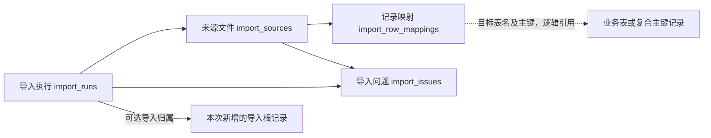

# 历史导入功能说明（0001至0004）

本页只解释0001～0004的旧结构。2026-10-24用户确认精简方案，0005_remove_history_import移除本页四张表、五个import_run_id字段及历史导入命令。这些定义不再属于当前数据库，也不能作为当前操作指令。

当前说明见[字段取值](../数据库字段取值说明.md)、[表关系](../数据库表关系说明.md)和[精简记录](../变更记录/历史导入能力精简记录.md)。旧结构仍保留在冻结版本模型schema_v1、schema、schema_v3、schema_v4及0001～0004迁移中。

旧命令database import-task-history和database import-collection-history曾提供旧文件固定快照、预览、导入和复核；0005已移除这些入口。本地实时事件流水补写及已采集数据的历史查询继续保留。

## import_runs

历史导入执行表：记录预览或导入的状态、范围、核对统计与解析版本。

第05项保存阶段快照中无此表真实业务记录，格式说明按当时代码/结构；后续真实例子见对应补充，不代表未测试分支已执行。

| 字段 | 中文用途 | 取值或填写规则 | 空值及默认值 | 例子 |
|---|---|---|---|---|
| `id` | 内部编号：数据库自增主键，不代替平台业务编号 | MySQL自增内部编号，可有间隔，不代表平台编号或业务先后 | 不允许NULL；数据库自增 | 格式：数据库生成 |
| `started_at` | 导入开始时间：北京时间（UTC+08:00），微秒精度 | DATETIME(6)直接存北京时间UTC+08:00，微秒精度；按字段发生时点填，序列化带+08:00 | 不允许NULL；无数据库默认值 | 格式：YYYY-MM-DD HH:MM:SS.ffffff |
| `finished_at` | 导入结束时间：北京时间（UTC+08:00），微秒精度；空值表示未发生或无法可靠确定 | DATETIME(6)直接存北京时间UTC+08:00，微秒精度；按字段发生时点填，序列化带+08:00 | 允许NULL：按本列用途解释未给/未知/不适用；无数据库默认值 | 格式：YYYY-MM-DD HH:MM:SS.ffffff |
| `status` | 导入状态：preview、running、committed、failed、partial | preview预览约定；running导入中；committed整批提交；failed失败；partial部分状态约定。当前预览只写报告，入库主流程使用running/committed/failed | 不允许NULL；无数据库默认值 | 格式：按本列及下文规则 |
| `scope` | 导入范围和源目录：JSON 对象或数组；SQL NULL 表示源未提供，原始文件另行保留 | kind=tasks_and_logs_only或collection_history；manifest固定来源清单；不同于采集scope | 允许SQL NULL；Python None当前写JSON null，读取同为None，需SQL区分；无数据库默认值 | 格式：按本列JSON规则 |
| `counts` | 各目标表新增、跳过、冲突与失败计数：JSON 对象或数组；SQL NULL 表示源未提供，原始文件另行保留 | 任务tasks_inserted/tasks_matched/events_inserted/events_matched/issues/conflicts；采集inserted对象（表名→新增数量）及issues/conflicts/quarantined_batches；失败rolled_back=true | 允许SQL NULL；Python None当前写JSON null，读取同为None，需SQL区分；无数据库默认值 | 格式：按本列JSON规则 |
| `manifest_sha256` | 来源清单哈希：SHA-256 十六进制，用于核对输入版本 | 程序固定规范生成的SHA-256十六进制；各用途不同，不互换或手工猜测 | 不允许NULL；无数据库默认值 | 格式：按本列及下文规则 |
| `parser_version` | 解析器版本：解释来源格式与规则的程序版本 | task_history_v1任务日志解析器；collection_history_v1采集解析器；不同于来源版本及结构版本 | 不允许NULL；无数据库默认值 | 格式：按本列及下文规则 |

### 导入状态、范围和计数

preview为预览约定（当前只写报告不插入根记录），running导入中，committed整批核对提交，failed失败回滚，partial部分状态约定（当前不作部分提交成功）。正常查询要求所属导入根committed才可见。

scope.kind=tasks_and_logs_only任务日志导入或collection_history采集历史；manifest指固定清单；parser_version分别task_history_v1/collection_history_v1。manifest_sha256核对来源版本。

counts任务导入使用tasks_inserted/tasks_matched/events_inserted/events_matched/issues/conflicts；采集导入使用inserted对象（表名→新增数量）、issues/conflicts/quarantined_batches；失败rolled_back=true。明确0与缺少统计键分开。此前旧业务数据已按用户要求清空，本文记录格式不构成重导旧数据的指令。

### 旧版查询示例（0005不可执行）

```sql
SELECT * FROM taobao_automation.import_runs LIMIT 5;
```

取值依据：旧版字段与写入流程的历史说明；现有冻结模型见[第四版结构](../../src/ecommerce/infrastructure/storage/mysql_migrations/schema_v4.py)。

## import_sources

导入来源文件表：登记一次导入使用的文件版本、格式和解析状态。

第05项保存阶段快照中无此表真实业务记录，格式说明按当时代码/结构；后续真实例子见对应补充，不代表未测试分支已执行。

| 字段 | 中文用途 | 取值或填写规则 | 空值及默认值 | 例子 |
|---|---|---|---|---|
| `id` | 内部编号：数据库自增主键，不代替平台业务编号 | MySQL自增内部编号，可有间隔，不代表平台编号或业务先后 | 不允许NULL；数据库自增 | 格式：数据库生成 |
| `import_run_id` | 所属导入执行编号：关联 import_runs.id | 外键关联import_runs.id；保存目标主键，复合归属也需一致，不能编造编号 | 不允许NULL；无数据库默认值 | 格式：填已存在目标主键 |
| `root_key` | 来源根目录配置键：与配置的数据目录对应 | 当前历史导入写workspace，配合relative_path定位，非固定盘符 | 不允许NULL；无数据库默认值 | 格式：按本列及下文规则 |
| `relative_path` | 来源文件相对路径：保留文件版本位置 | 按用途保留来源文本或业务键；不是固定枚举，不用随意默认值代替未知 | 不允许NULL；无数据库默认值 | 格式：按本列及下文规则 |
| `sha256` | 来源内容哈希：SHA-256；文件追加变化不能导致旧业务记录重复导入 | 程序固定规范生成的SHA-256十六进制；各用途不同，不互换或手工猜测 | 不允许NULL；无数据库默认值 | 格式：按本列及下文规则 |
| `size_bytes` | 来源文件大小：单位字节 | 整数，单位字节；实际空文件才为0，未知不能填0 | 不允许NULL；无数据库默认值 | 格式：符合用途的整数 |
| `source_kind` | 来源类型：任务库、模块元数据、明细、进度库、事件或文本日志等 | task_sqlite旧任务库；taobao_events淘宝事件；text_log文本日志；metadata_json模块元数据；module_working_sqlite模块工作库；file其他文件 | 不允许NULL；无数据库默认值 | 格式：按本列及下文规则 |
| `schema_version` | 来源声明的格式版本：未声明时为空 | 来源自己声明的整数格式版本；不从解析器版本猜测 | 允许NULL：按本列用途解释未给/未知/不适用；无数据库默认值 | 格式：符合用途的整数 |
| `parse_status` | 解析状态：pending、parsed、failed、skipped 等 | pending待解析；parsed已解析；failed失败；skipped跳过；当前成功来源写parsed，其他为备注约定，失败可整批回滚 | 不允许NULL；无数据库默认值 | 格式：按本列及下文规则 |

### source_kind与parse_status

| source_kind | 中文含义 |
|---|---|
| task_sqlite | 旧任务SQLite |
| taobao_events | 原淘宝事件JSONL |
| text_log | 文本日志 |
| metadata_json | 模块元数据JSON |
| module_working_sqlite | 模块执行期工作库 |
| file | 其他媒体/HTML/导出等源文件 |

parse_status=pending待解析、parsed已解析、failed失败、skipped跳过；当前成功插入写parsed，其他是备注约定，失败可能整批回滚。schema_version取来源声明或SQLite PRAGMA user_version，未声明NULL，不与解析器版本混用。文件哈希变更不意味着旧追加日志业务记录应重复导入。

### 旧版查询示例（0005不可执行）

```sql
SELECT * FROM taobao_automation.import_sources LIMIT 5;
```

取值依据：旧版字段与写入流程的历史说明；现有冻结模型见[第四版结构](../../src/ecommerce/infrastructure/storage/mysql_migrations/schema_v4.py)。

## import_row_mappings

导入记录映射表：保留每份源记录与目标记录的逻辑映射及内容指纹。

第05项保存阶段快照中无此表真实业务记录，格式说明按当时代码/结构；后续真实例子见对应补充，不代表未测试分支已执行。

| 字段 | 中文用途 | 取值或填写规则 | 空值及默认值 | 例子 |
|---|---|---|---|---|
| `id` | 内部编号：数据库自增主键，不代替平台业务编号 | MySQL自增内部编号，可有间隔，不代表平台编号或业务先后 | 不允许NULL；数据库自增 | 格式：数据库生成 |
| `source_id` | 来源文件编号：关联 import_sources.id | 外键关联import_sources.id；保存目标主键，复合归属也需一致，不能编造编号 | 不允许NULL；无数据库默认值 | 格式：填已存在目标主键 |
| `source_record_key` | 源记录位置或身份：行号、JSON 路径或旧主键 | 按用途保留来源文本或业务键；不是固定枚举，不用随意默认值代替未知 | 不允许NULL；无数据库默认值 | 格式：按本列及下文规则 |
| `source_record_hash` | 源记录键哈希：SHA-256，用于稳定的有界唯一索引 | 程序固定规范生成的SHA-256十六进制；各用途不同，不互换或手工猜测 | 不允许NULL；无数据库默认值 | 格式：按本列及下文规则 |
| `logical_key` | 业务逻辑身份哈希：不包含本次导入编号，支持跨次核对 | 程序固定规范生成的SHA-256十六进制；各用途不同，不互换或手工猜测 | 不允许NULL；无数据库默认值 | 格式：按本列及下文规则 |
| `target_table` | 目标表名：受控名单中的业务表，属于逻辑关联而非物理外键 | 受控逻辑目标表名：任务导入2表，采集导入16表，清单见本表；不是动态外键 | 不允许NULL；无数据库默认值 | 格式：按本列及下文规则 |
| `target_key` | 目标主键：规范化文本，复合主键使用明确字段的 JSON 对象 | 目标实际主键规范文本；数值id为字符串，任务保留原id，复合主键用带字段名的JSON文本 | 不允许NULL；无数据库默认值 | 格式：按本列及下文规则 |
| `target_key_hash` | 目标主键哈希：SHA-256，碰撞或内容不符须隔离核对 | 程序固定规范生成的SHA-256十六进制；各用途不同，不互换或手工猜测 | 不允许NULL；无数据库默认值 | 格式：按本列及下文规则 |
| `payload_fingerprint` | 源业务内容指纹：规范化内容 SHA-256，变更不能静默覆盖 | 程序固定规范生成的SHA-256十六进制；各用途不同，不互换或手工猜测 | 不允许NULL；无数据库默认值 | 格式：按本列及下文规则 |
| `result` | 映射结果：inserted、matched、skipped、conflict 等 | inserted新增；matched匹配；skipped跳过/conflict冲突为备注约定；当前成功映射生成前两种，内容冲突拒绝并回滚 | 不允许NULL；无数据库默认值 | 格式：按本列及下文规则 |

### 受控目标及映射结果

任务目标tasks/task_events；采集16表为products、collection_runs、collection_steps、collection_batches、product_current_sections、search_records、list_observations、sku_observations、parameter_observations、review_summaries、review_observations、question_observations、answer_observations、file_assets、media_references、collection_checkpoints。

target_key保存实际主键规范文本，复合主键JSON带字段名；target_key_hash核对目标键，source_record_hash核对来源键，payload_fingerprint核对业务原文，logical_key为跨次稳定身份。

result=inserted新增、matched匹配；skipped跳过/conflict冲突为备注约定，当前成功映射生成前两种，内容冲突拒绝回滚。目标表/主键是程序逻辑关联，没有动态外键。

### 旧版查询示例（0005不可执行）

```sql
SELECT * FROM taobao_automation.import_row_mappings LIMIT 5;
```

取值依据：旧版字段与写入流程的历史说明；现有冻结模型见[第四版结构](../../src/ecommerce/infrastructure/storage/mysql_migrations/schema_v4.py)。

## import_issues

导入问题记录表：保存输入缺失、内容冲突、格式异常和处理结果。

第05项保存阶段快照中无此表真实业务记录，格式说明按当时代码/结构；后续真实例子见对应补充，不代表未测试分支已执行。

| 字段 | 中文用途 | 取值或填写规则 | 空值及默认值 | 例子 |
|---|---|---|---|---|
| `id` | 内部编号：数据库自增主键，不代替平台业务编号 | MySQL自增内部编号，可有间隔，不代表平台编号或业务先后 | 不允许NULL；数据库自增 | 格式：数据库生成 |
| `import_run_id` | 所属导入执行编号：关联 import_runs.id | 外键关联import_runs.id、import_sources.import_run_id；保存目标主键，复合归属也需一致，不能编造编号 | 不允许NULL；无数据库默认值 | 格式：填已存在目标主键 |
| `source_id` | 相关来源文件编号：关联 import_sources.id；全局问题可空 | 外键关联import_sources.id；保存目标主键，复合归属也需一致，不能编造编号 | 允许NULL：按本列用途解释未给/未知/不适用；无数据库默认值 | 格式：填已存在目标主键 |
| `source_record_key` | 相关源记录位置或身份：无法定位时为空 | 按用途保留来源文本或业务键；不是固定枚举，不用随意默认值代替未知 | 允许NULL：按本列用途解释未给/未知/不适用；无数据库默认值 | 格式：按本列及下文规则 |
| `severity` | 问题级别：info、warning、error | info信息；warning警告；error错误；不是日志的大写level | 不允许NULL；无数据库默认值 | 格式：按本列及下文规则 |
| `code` | 稳定问题代码：供分类查询与人工处理 | missing_file缺文件；unknown_task任务缺失；missing_upstream_batch父批缺失；unlinked_page_media缺归属；newer_current_preserved保留较新结果；entry_without_detail_data仅入口；batch_rolled_back回滚 | 不允许NULL；无数据库默认值 | 格式：按本列及下文规则 |
| `message` | 问题说明：不包含密码、Cookie 或令牌 | 按用途保留来源文本或业务键；不是固定枚举，不用随意默认值代替未知 | 不允许NULL；无数据库默认值 | 格式：按本列及下文规则 |
| `resolution` | 处理结论：未处理时为空 | 处理结论原文，NULL未登记；不是枚举，非NULL不自动表示所有问题已修复 | 允许NULL：按本列用途解释未给/未知/不适用；无数据库默认值 | 格式：按本列及下文规则 |

### 问题级别、代码及处理结论

| code | 中文含义 | 处理口径 |
|---|---|---|
| missing_file | 缺文件 | 保留预期路径/校验并隔离相关批次 |
| unknown_task | 原任务不存在 | 关联置空并保留源编号 |
| missing_upstream_batch | 父批缺失 | 保留外部来源键 |
| unlinked_page_media | 页面媒体无可靠归属 | 不制造错误任务关联 |
| newer_current_preserved | 保留较新有效分区 | 历史不回退现有结果 |
| entry_without_detail_data | 仅有详情入口 | 不制造详情明细 |
| batch_rolled_back | 整批回滚 | 保留固定来源及失败结论 |

severity为info信息、warning警告、error错误，区别于日志大写level。message/resolution为原文；resolution非NULL不自动表示业务问题完全修复；source_id可NULL表示全局/无法定位到单一来源。

### 旧版查询示例（0005不可执行）

```sql
SELECT * FROM taobao_automation.import_issues LIMIT 5;
```

取值依据：旧版字段与写入流程的历史说明；现有冻结模型见[第四版结构](../../src/ecommerce/infrastructure/storage/mysql_migrations/schema_v4.py)。


## 5. 导入来源与所有目标表的追溯



| 引用字段（子表） | 目标字段（父表） | 关系与可空性 | 计划约束及业务核对 |
|---|---|---|---|
| `import_sources.import_run_id` | `import_runs.id` | 一次导入多个来源文件；非空 | 外键；同路径内容变更登记新源版本 |
| `import_row_mappings.source_id` | `import_sources.id` | 一源文件多源记录映射；非空 | 外键；一条源记录允许对应多个目标对象 |
| `import_issues.import_run_id` | `import_runs.id` | 一次导入多个问题；非空 | 外键；全局导入问题也须可追溯到一次导入 |
| `import_issues.source_id` | `import_sources.id` | 一源文件多个问题；可空 | 外键；填写时必须属于同一次导入 |
| 导入根记录的 `import_run_id` | `import_runs.id` | 一次导入可新增多个根记录；可空 | 外键；根记录包括 `tasks`、`task_events`、`collection_runs`、`collection_batches`、`search_records`；实时产生的记录不伪造历史导入归属 |
| `import_row_mappings.target_table` 与 `target_key` | 指定目标表的实际主键 | 多个源表现可指向同一目标 | 程序维护的逻辑关联，不是数据库外键；采用受控目标表名单，支持复合主键，按实际目标类型核对存在性 |

子明细通过所属运行/批次继承导入可见性；共享商品身份、文件索引的来源通过映射追溯，不因一次重复导入而覆盖其原有效来源。只有导入验收提交且批次已发布，正式查询才将相关数据当作有效结果。

