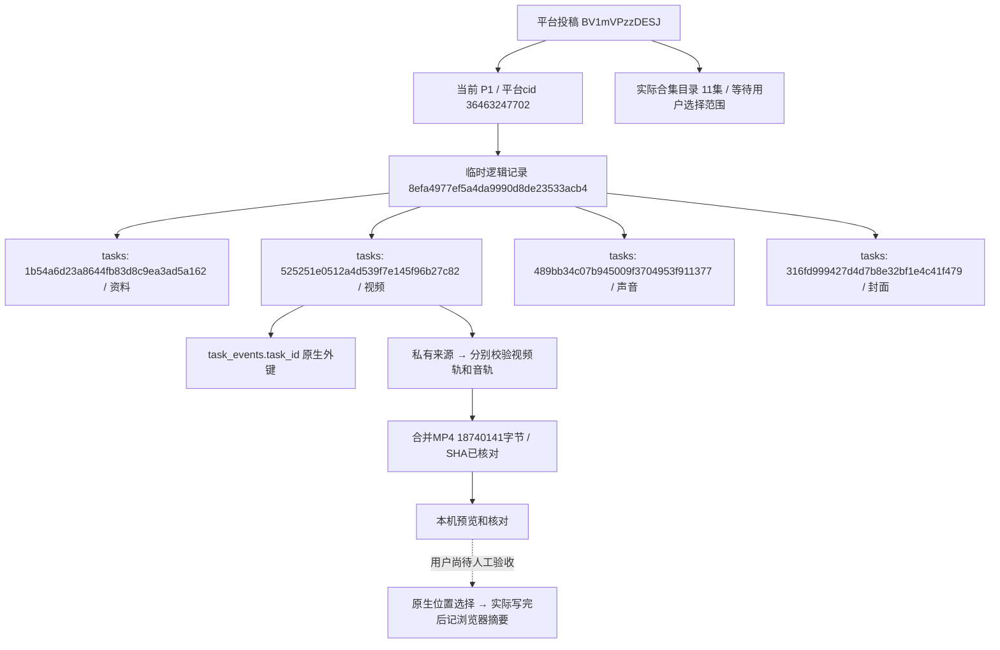

# B站视频下载（2026-11-02）

## 已批准范围与实际行为

工具箱新增独立入口 `/tools/bilibili`，保持全站公共控件和卡片风格。普通投稿、分P和合集均先解析，不自动下载全部。用户选择当前集、当前投稿全部P或合集全部集数，页面显示列表、数量、总时长与按当前码率估算的体积，点击“确认范围并准备视频”后才执行。

分P是同一BV下不同页号/内容编号；合集通常包含不同BV。用户提供的课程 `BV1mVPzzDESJ` 实际是11集合集，当前投稿只有P1；普通样例 `BV1jBHA68ERy` 也属于6集合集。两者默认均只下载当前一集。每集独立统一任务，顺序执行；重试只处理未完成项。合集顺序使用文件名 `E01`，投稿内页号保留 `P01`，并保留标题、BV、清晰度和编码，避免将合集序号误当分P号。

视频与音频列出当前会话实际取得的轨道，默认优先H.264与AAC；更多选项包含实际编码、宽高、帧率和码率。未返回的规格不伪装可用。不静默降清晰度：某集没有用户所选质量/编码时明确失败，用户可单独选择该集。登录使用独立B站资料与统一资源锁，扫码/验证码由用户完成；180秒未完成则需要重新登录，不绕过权限。普通MP4单段提供兼容路径，FLV/多段旧来源不冒充完整单文件。

DASH视频轨与音轨分别下载、按内容身份和摘要核验，再由现有随包FFmpeg复制编码合并MP4，不为合并而重编码。校验实际音画轨道与时长、解码开头；拒绝平台明确的试看和时长明显不一致文件。完整声音可直接使用独立音轨，输出M4A；封面可保留原格式、PNG或JPG，同一投稿的不同P共用投稿封面。没有增加背景音乐独立资源，B站返回的音轨代表视频完整声音。

准备成功后才显示预览与保存。选择其他规格清除确认；未准备的版本隐藏旧视频预览，已准备版本可重新打开。视频需在浏览器可预览并勾选核对后保存，不能预览的编码提示改选H.264。音频和封面可独立保存。单文件使用原生另存为，全部视频选择文件夹后逐个写入，同名文件增加编号；文件实际关闭且接收字节数相符后才记本浏览器保存摘要。原生窗口取消、中途停止、写入失败均不记成功，已完成文件保留。缓存清理后历史仍显示素材名称、大小、历次任务与本浏览器曾保存的名称/时间。

## 大视频、暂停与磁盘

没有单视频5GiB或其他固定大小上限。20GiB是缓存提醒值，不拒绝下载。临时目录可在高级设置切换磁盘；缓存下载前估算视频+音频+合并输出的空间，扣除可复用输入，流式下载持续核对空间，合并前再按实际输入大小检查，并保留256MiB余量。原生浏览器选择的最终目录不能从网页读取磁盘剩余空间，最终保存依赖系统实际写入结果，空间不足明确失败，项目缓存可复用。

暂停中止当前执行，保留完整轨道与可核验分段；数据库该次任务为 `needs_attention`，不是成功。继续是同一逻辑记录中的新执行任务，复用匹配且摘要正确的完整输入；未完成分段只有身份相同、来源未改变或实体校验值一致且Range响应准确时才追加。服务器忽略Range则从头获取；刷新地址且不能证明实体相同也从头获取，页面说明原因。来源过期允许一次刷新，刷新仍限定原BV/P/cid和规格。合并暂停丢弃未完成输出，恢复时复用完整输入重新合并。

取消删除未完成 `.part` 和续传旁文件，保留完整轨道/输出；删除缓存才删除完整临时文件，摘要/任务不删。自动清理只在解析新记录或用户点击清理时执行，默认清理闲置24小时的已完成、已取消记录；活动、暂停、失败及部分失败记录不自动清理。用户最终文件始终不在清理范围。

`config/settings.toml`与模板新增 `[bilibili]`：`temp_dir`（默认项目output/temp）、`cache_warn_gib=20`（0关闭提醒）、`idle_hours=24`（1～8760小时）。文件设置重启生效；页面应用设置立即覆盖本库后续新记录，保存于 `workspace/storage/video_tools/bilibili/<数据库命名空间>/options.json`。已有记录保持原缓存位置，不自动搬文件。调整期限/提醒对后续清理/显示生效。

## 实现与存储

平台识别/API和来源白名单在 `platforms/bilibili`，业务在 `modules/video_tools/bilibili.py`，通用Range传输、空间/摘要核验和本地媒体合并在 `infrastructure/media`，Web只负责接口与展示。封面仍调用现有公共图片转换。抖音原有下载和人工无水印确认合同保持不变。

记录摘要在 `workspace/storage/video_tools/bilibili/<scope>/<cache_id>/manifest.json`，带签名来源只存同目录私有 `sources_<episode_id>.json`；实际大文件在选定临时目录的 `bilibili/<scope>/<cache_id>`。命名空间按数据库目标隔离，路径校验拒绝越界编号/符号链接，清理逐个删除本记录文件，不对用户输入根目录递归删除。URL仅接受官方入口与官方CDN，逐跳校验，不向任意来源发送Cookie。Cookie仅用于官方API，来源签名、Cookie、凭据和最终保存路径不入事件。

沿用0019，仍32业务表、386列、67外键，无DDL/原生COMMENT变更。只使用 `tasks`、`task_events`，不在淘宝商品、采集批次或 `file_assets` 中创建B站记录。字段取值和逻辑关系见对应数据库文档。

## 真实样例与数据增量

第一轮两个样例各准备当前集的视频、声音、PNG封面，8个正式任务、30事件。补充逐操作审计、封面独立发布、最终命名后又按同一范围复核：8任务、36事件。合计正式 `tasks` 99→115（新增16）、`task_events` 12651→12717（新增66）；其余30业务表数量一致，没有将数量一致宣称为全部数据内容未变。未修改旧任务/事件，未删除正式记录，没有淘宝采集或付费AI调用。

最终一轮的实际任务如下，均 `succeeded`；解析成功只代表取得资料，准备成功只代表缓存就绪，均不代表用户已经另存为。

|样例 / 临时记录|资料任务|视频任务|完整声音任务|PNG封面任务|
|---|---|---|---|---|
|普通 `BV1jBHA68ERy` / `8aafab8902c0454c9d3887f681ac2682`|`dc58ae8532df4df3b6799a36f0832045`|`f22b4a8354da46d2aa9083aafb16833b`|`4190b357bdf84226adfe1939c91d653b`|`3d9359752449422c9e42eed1379aef66`|
|课程 `BV1mVPzzDESJ` / `8efa4977ef5a4da9990d8de23533acb4`|`1b54a6d23a8644fb83d8c9ea3ad5a162`|`525251e0512a4d539f7e145f96b27c82`|`489bb34c07b945009f3704953f911377`|`316fd999427d4d7b8e32bf1e4c41f479`|

|最终文件|普通样例字节数|课程样例字节数|
|---|---:|---:|
|480P H.264 MP4（含音频）|12,267,382|18,740,141|
|完整声音M4A|2,357,710|12,358,724|
|PNG封面|1,446,020|1,003,884|

普通视频SHA256：`ec0c780ac6efd0ccd2ad7e737693b1cd897a86b18e39875a50f69a44d9ed966d`。课程视频SHA256：`e49514ef48d506f86013f20665a5c304cd7b26aa72883b7f9fbb8ea950a9a0fc`。完整的本机快照、轨道规格、任务行和两轮表数量在忽略目录 `workspace/development/runs/undated-bilibili/results/bilibili_integration_first.json`、`workspace/development/runs/undated-bilibili/results/bilibili_integration.json`，不提交业务/签名数据。

独立SQLite任务额外验证真实课程CDN续传：`72b0c936449a49279450e5bada938af3`主动暂停为needs_attention，保留524,288字节；`d6e88a9594f0420c8304253205964fe6`恢复成功，服务器206返回 `bytes 524288-5890993/5890994`。完成轨道5,890,994字节，SHA256 `55f8bf29880e4b4cfb929a958d8cdd1e10a7d5f286521d1e6ba5ca903a3aae08`，与原完整视频轨一致。两编号只属于独立验证目录，不是正式MySQL任务，不与前述16任务混算。



BV/cid是平台内容身份，cache_id是临时逻辑记录，task_id是一次真实执行的数据库主键；资源指纹绑定集、视频轨和音频轨。上图没有淘宝商品ID、采集批次或文件表外键，不能将这些概念混用。cache_id/episode_id是事件JSON中的逻辑引用，唯一原生外键沿用task_events.task_id→tasks.id。

只读核对示例（北京时间）：

```sql
SELECT id,name,status,message,started_at,finished_at FROM tasks
WHERE id IN ('1b54a6d23a8644fb83d8c9ea3ad5a162','525251e0512a4d539f7e145f96b27c82',
             '489bb34c07b945009f3704953f911377','316fd999427d4d7b8e32bf1e4c41f479');
SELECT task_id,event_type,details FROM task_events
WHERE task_id='525251e0512a4d539f7e145f96b27c82' ORDER BY task_sequence;
```

## 验证与人工边界

全套回归 `python -m unittest discover -s tests`：1466项完成，OK，571项因显式启用条件跳过；耗时213.881秒。数据库只读check确认0019、32业务表/386列/67外键、全部备注齐全，无结构错误。没有安装新的依赖或修改冻结迁移。

22项B站相关隔离测试覆盖：输入/域名/编号冲突，分P和合集区分，拒绝试看和cid变化，不预下载，默认单集与显式全部，多集独立任务，不降规格、只重试失败项，暂停/继续新任务、取消只删分段，完整轨道复用，Range/实体不符拒绝、服务器忽略Range重下，6GiB响应无硬上限与磁盘不足，摘要篡改/Range预览/确认守卫，换临时目录、保护暂停，真实本地FFmpeg合并/声音与时长不符拒绝。

浏览器检查使用实际两样例缓存，1440/1024/390/320页面无横向溢出；工具箱三张卡在1440/1024/768/390/320检查通过，图片和抖音入口正常。核对当前集默认、课程11集选项、版本切换清确认、原生选择器模拟取消、中途停止不关闭/不记成功，以及MP4/M4A/PNG实际导出字节与SHA。批量保存用两个真实文件组成明确标记的隔离两集范围，核对顺序、同名改名和两个文件摘要；另有隔离下载50%/暂停/部分失败状态检查。没有通过这项测试声称已真实下载整个11集合集。截图和结果在 `workspace/output/reports/bilibili`。

原生系统选择窗口、人工登录/验证码、更高账号权限画质、整段观看与听音、真实多分P页面、整套11集下载、数GiB实际文件和空间耗尽后的人工体验仍待用户验收；自动检查与真实Range证明不替代这些体验。网页已保留真实样例供人工查看，不将人工验收勾为通过。
