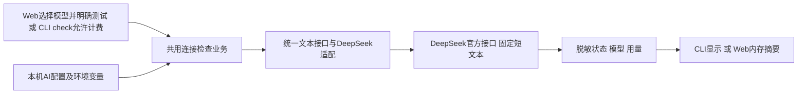

# DeepSeek配置与连接检查

2026-10-29，用户授权“开始接入”，本轮范围为统一文本客户端、DeepSeek适配、独立本机配置、Web和CLI选择及固定短文本连接检查。没有接入商品分析、图片输入、结果持久化或其他服务商，没有新增或修改数据库结构及业务记录。

配置为`config/ai.toml`，未创建时使用默认值，模板为`config/ai.example.toml`。默认deepseek-flash，可选deepseek-v4-pro；密钥仅通过DEEPSEEK_API_KEY环境变量读取，不写入配置、页面、日志或任务。读取与已有Settings和采集任务快照解耦，不改变已有后台任务配置。

统一契约为`TextClient.complete`，适配和工厂在`infrastructure/ai/client.py`，Web和CLI共用`modules/ai_service.py`。固定官方HTTPS地址，拒绝重定向、禁用思考、无自动重试；401、402、403、404、422、429、服务端故障、网络失败及响应不完整均返回明确安全错误，不回显上游原始响应。测试固定32个输出token上限，不发送商品资料，不展示模型回复原文；只展示完成状态、所选模型和有效非负整数用量，不估算金额。

Web入口`/settings/ai`复用公共表单及搜索选择控件。GET不访问AI服务；POST要求本机同源、页面令牌和明确计费勾选。每应用最多一个后台检查，不排队；GET轮询内存摘要，刷新不重复发送，重启清空。配置文件动态读取，环境变量由启动进程继承，修改密钥后需要从新环境重启服务。

CLI使用`ai status`只看配置；`ai check --provider deepseek --model deepseek-flash --allow-paid`执行真实检查。完整步骤见[使用指南](../使用指南.md#deepseek接入与连接检查)。

验证：新增5项AI单元测试通过，覆盖配置、密钥缺失、不泄密、请求参数、失败不重试、不完整响应、Web来源与计费校验、后台状态与重复检查、CLI计费保护。本轮全量unit共558项通过；Flask页面渲染200。原8000端口Web服务重启，实际本机页面1440桌面与390手机宽度检查通过，模型选择值同步、未配置密钥时测试禁用、无脚本错误；截图为workspace/logs/screenshots/ai-settings-desktop.png和ai-settings-mobile.png。真实DeepSeek调用未执行，密钥尚待用户本机配置，实际账号、额度、模型调用及计费效果待真实验证；不代表人工验收通过。

本轮测试使用隔离临时资料和模拟响应，上图E为真实调用设计路径，本轮未请求。该检查没有任务编号、采集批次、商品身份、商品观察及采集文件关联，不生成虚构业务编号。

官方依据：[首次调用](https://api-docs.deepseek.com/quick_start)、[Chat Completions](https://api-docs.deepseek.com/api/create-chat-completion/)。

## 本机密钥配置调整

2026-10-29用户要求密钥直接保存在本机配置文件，禁止提交Git。新增[ai].api_key，优先本机文件，空白兼容原环境变量；config/ai.toml已有精确忽略规则，示例仅保留空值。本机文件按需创建，不覆盖已有配置。每次查看状态或启动检查重新加载文件，修改后刷新即可；密钥不参与配置对象repr或公共状态，错误不回显配置内容。没有将AI配置加入采集任务快照。新增本机密钥优先、动态读取、环境回退和脱敏验证，实际密钥仍由用户本机填写，不执行真实AI调用。
