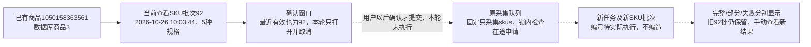

# SKU信息更新按钮

2026-11-01，用户确认执行，人工真实采集验收待用户操作。

## 行为

SKU页标题右侧增加绿色“更新SKU信息”，位于原采集任务/日志前。确认弹窗显示商品编号、当前查看批次/时间、本商品最近有效SKU批次/时间/数量，说明只更新本商品全部SKU、价格及可选状态，不受筛选/分页或历史批次影响；打开/取消不创建申请。按现有公共弹窗样式，手机换行，中间可滚动。

确认后复用原短请求、统一执行器和采集队列；只选择skus，其他模块开关关闭，无AI。新的更新入口不传旧cleanup_tasks或恢复来源，新建采集计划另存批次，旧完整或部分尝试保留。只有用户点击确认才可能启动真实淘宝采集；测试没有在正式入口提交。

同资源商品已有SKU或包含SKU的单商品详情/补采申请时，资源行锁内复用在途申请，不重复插入。按钮改为“查看更新进度”，刷新恢复；排队无实际task_id时不制造任务链接，实际任务创建后提供入口。暂停沿原队列规则，需要手动启动，不暗中恢复整个队列。

复用collection.js原轮询，不另开定时器；仅SKU页请求sku_update=1，其他页面原响应保持。读取失败禁用更新，不自动重试。当前SKU列表、筛选、图片、已加载批次及原任务/日志不被进度覆盖；新结果只显示在进度区域，手动点击查看才切换。部分完成、失败、停止和待核对分别显示，保留旧有效资料。任务成功标记不等于SKU完整：仅非空complete、已发布且在当前有效指针中的批次才报更新完成；孤立旧running不当成当前执行。

## 代码

- modules/collection/sku_update.py：商品全局有效资料、最近尝试、已核对在途申请及模块结果概况。
- web/sku_update.py：北京时间与仅真实task_id的站内链接。
- web_collection.start_sku_update：固定范围、无清理来源，调用原_start；CollectionJobStore.submit可选锁内SKU在途复用，不改变默认提交行为。
- collection_jobs蓝图：严格确认POST及可选只读进度模型；沿原本机/同源/令牌规则。
- sku_update.js：确认/进度窗口及新结果条；collection.js复用现有API/提交键和轮询，通过仅SKU事件协作。原任务栏、暂停/开始/停止仍由原逻辑处理。

没有新表/字段、持久状态或JSON键，数据库仍0019，具体临时字段及原申请参数见数据库字段取值说明。

## 本轮验证

- 741项全量单元通过；6项新增更新检查覆盖确认拒绝、固定SKU范围、无清理旧任务、跨提交键复用、复用含SKU的多模块任务、其他商品/模块隔离、原提交键重放、GET只读、部分结果及无有效旧资料的说明。最后6项复测通过。
- 隔离浏览器1440/390/320全部通过：看旧批60时显示全局有效70、取消零提交、双击只一次POST、排队刷新恢复、排队不造任务链接、采集中真实任务入口、部分80不替换有效70、断读禁提交、无结果失败、完整90手动切换。采集接口以模拟返回替代，不启动浏览器采集。
- 实际商品1050158363561/内部商品3/SKU92批在1440/390/320只读检查通过：按钮、当前批次/最近有效时间、确认弹窗及取消；全部POST被拦截，实际采集0、AI0。截图已查看。
- 4项与当前结构匹配的公共浏览器回归通过：关键词配置/详情配置、状态读取失败保护、暂停任务栏单项启动。另一次尝试的3项旧模块卡片用例在动作前因沿用已退役的基本信息页模块卡定位而失败，本次没有改回产品结构或将其计为通过；它们不能作为现行界面验收，状态流转由新增SKU流程及现行公共入口验证。
- 正式库和验证库各32业务表，前后行数及全行SHA256一致；结构0019_question_analysis不变，业务新增/修改/删除均0。没有实际创建正式采集申请、任务、批次、SKU观察或恢复旧记录。

产物位于本机Git忽略的workspace/output/reports/sku_update：before/after、unit.log、common_browser.log、确认/部分/实际三视口截图和Web重启记录。复现tests/browser_sku_update.py，--real只打开并取消弹窗，禁止POST。用户可刷新后自己确认一次真实更新。

## 实际数据与后续操作流

92来自原任务c6e778875d3e4c2e9000d21d9d661644，对应SKU观察189～193及图片索引556～560。本轮只是读取这些既有记录作为确认参考，没有产生新的正式编号。隔离60/70/80/90仅为测试样例，不能当作真实采集批次。
