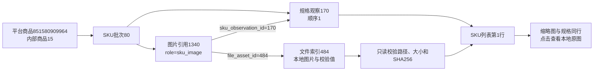

# SKU 图片融入规格列表

2026-10-25，用户确认方案并明确执行：SKU图片融入规格行，取消独立图片区及其分页，每页仍20条。

## 行为

- 商品SKU页和SKU批次明细页统一显示“顺序、图片、采集内容、价格/来源信息、采集时间”。
- 缩略图96×96像素，保持完整比例，点击在新标签打开已保存的本地原图。
- 图片随规格行排序和翻页，不再提供SKU图片的独立排序或分页。旧链接的media_page/media_sort/media_order不控制SKU图片，新排序/分页链接去掉这些旧参数。
- 按同批次、具体sku_observations.id以及role=sku_image关联；不用顺序、名称、其他批次或商品主图猜图。一次批量查询本页规格关联的文件，不改变规格总数或顺序。
- 页面无规格图、下载失败、尚未下载、本地文件缺失和校验变化分别提示。文件仍经过既有路径、大小和SHA256校验；失败不会修改数据库或自动下载。
- 视频、主图、详情图继续使用既有素材展示。SKU价格、库存、采集流程和数据库结构不变。

## 本轮验证

29项查询/页面单元检查通过，覆盖同批规格外键关联、反向图片顺序、其他批次和未关联图片不借用、价格排序、45条记录的20/20/5分页、缺失/校验变化/下载失败/确认无图，以及其他资料页回归。

隔离浏览器中7项既有网页采集流程检查通过；新增SKU行图片检查最终单项复测通过，覆盖真实加载、96像素布局、不裁剪、排序后对应关系、新标签查看原图及第二页显示。所有浏览器请求转入临时服务，未访问真实平台。

本机正式资料只读核对：商品851580909964（products.id=15）、SKU批次80，19个规格、19张本地图片全部对应；商品SKU页及批次明细页均只有一套分页，没有独立figure图片区。原图入口返回200；所有数据库表前后计数一致，没有DDL或业务数据写入。

报告：`workspace/output/reports/sku_list_images_20261025.json`；布局预览：`workspace/output/reports/sku_images_inline_preview.png`。浏览器最终新增检查日志为`workspace/output/reports/sku_list_image_browser_recheck.log`，单元日志为`workspace/output/reports/sku_list_image_unit_checks.log`。

## 真实数据关联示例

原采集任务为35b8f4272287412f93de9e8f83269563，批次80实际观察时间2026-10-25 19:24:25（北京时间）。第一条规格是sku_observations.id=170、position=1；图片由media_references.id=1340关联file_assets.id=484。此次只读取这些已有关系并改变页面展示，不创建新的任务、批次、SKU观察或文件索引。

平台商品编号代表淘宝商品；products.id是本库商品主键；批次代表一次采集结果；SKU观察代表该批具体规格；媒体引用连接观察与本地文件索引。关联依据是主外键，不是图片顺序。

当前代码已完成本地核对，未重启用户原Web服务；重启原服务并刷新页面后使用新布局，待用户查看确认。
