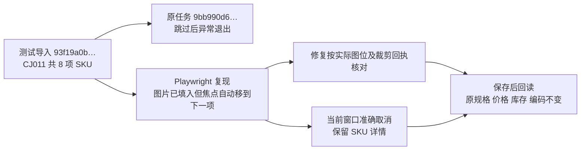

# SKU 多规格选图与跳过继续修复

2026-11-19，延续已批准的 SKU 智能裁剪及可选图片跳过方案，排查用户在测试页发现的误报和浏览器关闭。

## 原因与证据

用户失败任务为测试导入 `93f19a0b777941c889a6463dd406c928` 下的 `9bb990d678d04b95af0492ecd5af5a85`，商品 CJ011，首项 SKU 编码 CJ011-01。任务没有尝试提交商品。

- 日志 15:44:30 报「选择搜索主图并核对裁剪结果未完成」，15:45:23 收到跳过反馈，15:45:25 结束为「SKU 素材窗口未能安全退出」。这条异常退出浏览器会话，造成用户看到浏览器关闭。
- 现场版本 `e460d1f361504566872295cc32cef3d3` 显示第一项已填图，第二项空图位被选中。真实 Playwright 复现进一步捕获原始断言：第一项没有 `selected` 类。千牛填好图片后会自动移动选中项，旧代码将其当成失败。前一轮首项单 SKU 实测未覆盖此情况。
- 同一真实批量选图窗口中，「取消或关闭」的合并定位实际命中 2 个按钮；准确的「取消」命中 1 个。旧代码只接受唯一控件，因而没有点击取消，最终抛出结束任务的异常。

## 修改

- 上传前仍要求唯一目标规格、唯一选中图位。选图后按目标实际图片、原素材关联的裁剪回执核验，允许平台将焦点移动到下一条；不再次点击素材，不将下一 SKU 误填同一张图。
- 保存其他 SKU 的图片快照，确认批量选图前要求其他规格及图片未变化。发现其他行意外改图则不确认，交给原人工流程。
- 精确区分当前素材窗口的「取消」与「关闭」，逐个尝试唯一可见控件；兼容按钮位于窗口外层的布局。保留 SKU 详情，不使用全局 Escape。窗口消失时用即时读取避免等待已移除的节点。
- 用户跳过或原有 180 秒期限结束后，先记录当前图位的跳过，再退出素材窗口并继续后续图位、标题及 SKU。
- 关闭失败时保留浏览器和当前填写内容，网页显示「图片已跳过，请关闭素材窗口」，只提供「完成」。用户关闭素材窗口后复查再继续，不重置选图期限、不因图片跳过而结束任务。确实关闭商品页时仍说明无法继续。
- 日志增加失败阶段、原始异常及原因，避免只有笼统的网络或平台提示。网页任务状态文件新增提示类型 `sku_image_cleanup`，不写 `expires_at`，动作仅 `continue`；未改数据库表或字段。

## 验证范围

本地 Playwright 覆盖自动切换 SKU、上传后立即裁剪、错改其他 SKU 不确认、取消和关闭并存、取消无效时使用当前窗口关闭、关闭仍失败时保留详情并人工关闭后继续、超时只跳过单图，以及网页清理提示不显示倒计时或再次跳过。

本轮通过 25 项 SKU 图片浏览器用例（24 项组合回归及随后新增的外层按钮用例）、34 项网页上架与裁剪单元检查、1 项完整网页人工交互用例。首次组合测试命令将裁剪模块名写错，产生 1 项加载错误，其余 50 项通过；随后使用正确的 `tests.unit.test_sku_crop` 与网页上架模块执行上述 34 项检查，全部通过。没有把加载错误算成通过项。编译检查及 Git 空白检查通过。

真实测试使用项目 Playwright、测试配置和千牛守卫，在同一浏览器内复现并继续排查，没有桌面接管。测试证据保存在 `workspace_test/logs/sku-multi-playwright/`；真实文件、账号会话及诊断脚本不进入 Git。

真实页面先在复现的同一选图窗口执行跳过处理，准确点击「取消」后，选图窗口消失，SKU 详情及浏览器保持打开（`skip-real.json`）。随后取消本项未保存详情，从现有 8 项规格继续运行修复后的图片填写：16 张图片和 8 条搜索标题均自动保存并回读，跳过及差异均为空（`multi-repair.json`）。8 项原规格、价格、库存 10、CJ011-01～CJ011-08 编码及状态的前后快照一致。覆盖新资源裁剪及原地址带 `~crop` 标记的裁剪；这一轮未提交商品，也未执行主图、视频、商品属性等完整上架验收。真实跳过与正常填图是连续的两段检查；跳过后下一图位、标题及下一 SKU 的完整分支另由本地用例覆盖，不混称一次真实跳过后全流程验收。

导入编号是本地预检资料身份，任务编号是用户该次执行身份，CJ011 是商品级商家编码，CJ011-01 是首项 SKU 编码；诊断没有新建网页上架任务，不把这些编号当成平台商品 ID 或采集批次。

## 使用与环境

命令和参数不变，见 [使用指南](../使用指南.md#网页商品填写与入仓)。旧任务的浏览器已经关闭，不能凭网页「完成」恢复原页面，需要重新发起填写。

完成测试后已重启测试服务 8001，原进程 21028 替换为 25936；上架页、修复后的 JS、采集活动及账号状态接口均返回 200，采集活动为空、账号状态为空。正式 8000 保持原进程 21424。本轮不提交商品，不调用项目 AI 模型；未修改数据库结构，也未做逐表内容指纹核对。真实验证浏览器保留供查看，重新发起该账号任务前须关闭验证窗口释放会话。
