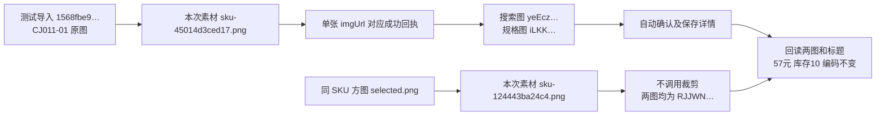

# SKU 智能裁剪校验修复

2026-11-19；用户确认后执行。修复前证据见 [Playwright 诊断](../测试记录/SKU智能裁剪Playwright诊断.md)。

## 修改

- 粘毛器、背包的 SKU 搜索主图共用本次修复；存在商品规格图片入口时，同样使用该校验流程。组合规格原有图片入口数量不变。
- 本次唯一素材名、素材卡片原图、唯一选中卡片，以及唯一目标 SKU 均须核对。
- 普通原图沿用原地址，兼容已有缩略后缀和已知裁剪标记；方图无需因开关开启而强制等待一次裁剪请求。
- 对生成新资源编号的智能裁剪，只读监听当前选图范围内千牛已发起的处理请求和成功响应，关联单张输入原图与唯一结果。不主动调用该接口、不重放上传或裁剪。
- 监听从打开素材窗口前开始，支持上传完成时自动开始裁剪。原图地址取得后再绑定此前回执；无对应原图、失败、多个输入或输出、非已观察接口的回执都不能放行新地址。
- 搜索主图先核实本次裁剪结果，再确认窗口；规格图先核实唯一素材，确认后等待实际结果。两者都回读详情，保存 SKU 详情后再核对表格。原上传缓存和已核实派生地址分别保存，支持同一图片用于不同 SKU。
- 失败提示区分素材上传、选择与裁剪、确认窗口和详情回读阶段。保留网页人工处理、明确完成、跳过以及原有 180 秒期限，未确认的已存图片继续进入入仓差异提醒。
- 原图、结果和保存地址分行记录，避免 URL 查询参数脱敏吞掉后续说明。未改变标题、价格、库存或商家编码规则。
- 只将有明确依据的派生图记入裁剪缓存，不把原图直传误标为智能裁剪。正常页面检查计入等待上限，仅真正人工处理的时间从选择等待中扣除。

## 平台关联口径

实际观察的接口路径为 `/h5/mtop.taobao.qn.copilot.node.aigc.img.web.batch.sync.change.size/1.0/`，主机 `h5api.m.taobao.com`。

请求表单或查询中的 `data` 是 JSON；`paramStrList` 可能再次编码成 JSON 文本，其单个成员也可能是 JSON 文本。只有一项 `imgUrl` 与本次原素材对应时，才关联响应。响应须为成功、单项 `data.result.taskResults`、单项 `jsPictureDOS`，并给出受支持图片 CDN 的 HTTPS `fullUrl`。JSONP 仅解析数据，不执行回调。

无法识别的平台变化交给现有人工流程，不以“开关开启”或“出现任意图片”为成功依据。

## 验证

本地完整执行 20 项 SKU 图片 Playwright 回归与 6 项裁剪单元检查通过；新增等待期限检查后，最终 8 项单元检查通过。随后对保存后换图提示、未裁剪日志分类各做一次针对性浏览器复测，均通过。覆盖原图、旧式裁剪标记、新资源编号、上传完成即裁剪、共用素材、其他原图的回执、错图、确认失败不重放、超时跳过后继续、保存后图片被换，以及已有组合规格场景。

真实页面使用 `config/settings.test.toml` 与测试账号专属会话，直接运行项目 Playwright 和千牛守卫，没有桌面接管：

| 场景 | 样本与实际结果 |
| --- | --- |
| 智能裁剪 | 测试导入单 `1568fbe937654659880abfa358ca4b29` 的 CJ011-01 首项，原图 1086×1448；本次素材 `sku-45014d3ced17.png`；两个图位和搜索标题自动确认、保存并回读，跳过和差异均为空 |
| 不裁剪 | 使用该 SKU 先前由平台生成并保留的 1448×1448 方图 `selected.png`，不修改资料原件；本次素材 `sku-124443ba24c4.png`；裁剪接口请求数为 0，两个图位保存相同原资源，标题回读通过 |
| 不应改动的字段 | 两次场景都比较保存前后快照：原规格、57.00 元、库存 10、CJ011-01、启用状态一致 |

裁剪场景的原图资源编号为 `O1CN01plylxfN4LoE2CiCk`；搜索主图结果为 `O1CN01yeEczbojKQK2wHTs`，商品规格图结果为 `O1CN01iLKKGre0O7K2wHTs`。方图直传的两个图位均为 `O1CN01RJJWN1bwFnL2wHTs`。结果对应两组独立本地截图及 JSON，不将不同尝试混成一次上架成功。

导入编号代表本地预检资料，CJ011-01 是 SKU 商家编码，CDN 编号代表图片资源，均不表示已创建商品。本轮诊断脚本未分配网页上架任务号，不伪造任务或采集批次关联。本轮没有提交商品，也不把首项 SKU 的局部验证当作全部 8 项商品上架验收；背包类目本轮未做新的完整真实上架测试，共用代码和组合规格由本地用例覆盖。

本地证据位于 `workspace_test/logs/sku-crop-playwright/`：`repair-crop.json`、`repair-crop-api.json`、`repair-crop.png`、`repair-square.json`、`repair-square.png`。真实图片、账号会话和调试脚本不进入 Git。没有修改数据库结构，未调用项目的 AI 标题生成或其他模型服务，也未主动发起平台裁剪请求；未做数据库逐表内容指纹核对。

## 使用

现有网页和 CMD 命令不变，见 [使用指南](../使用指南.md#网页商品填写与入仓)。本轮仅更新测试服务；8000 正式服务须在测试确认后另行同步。
