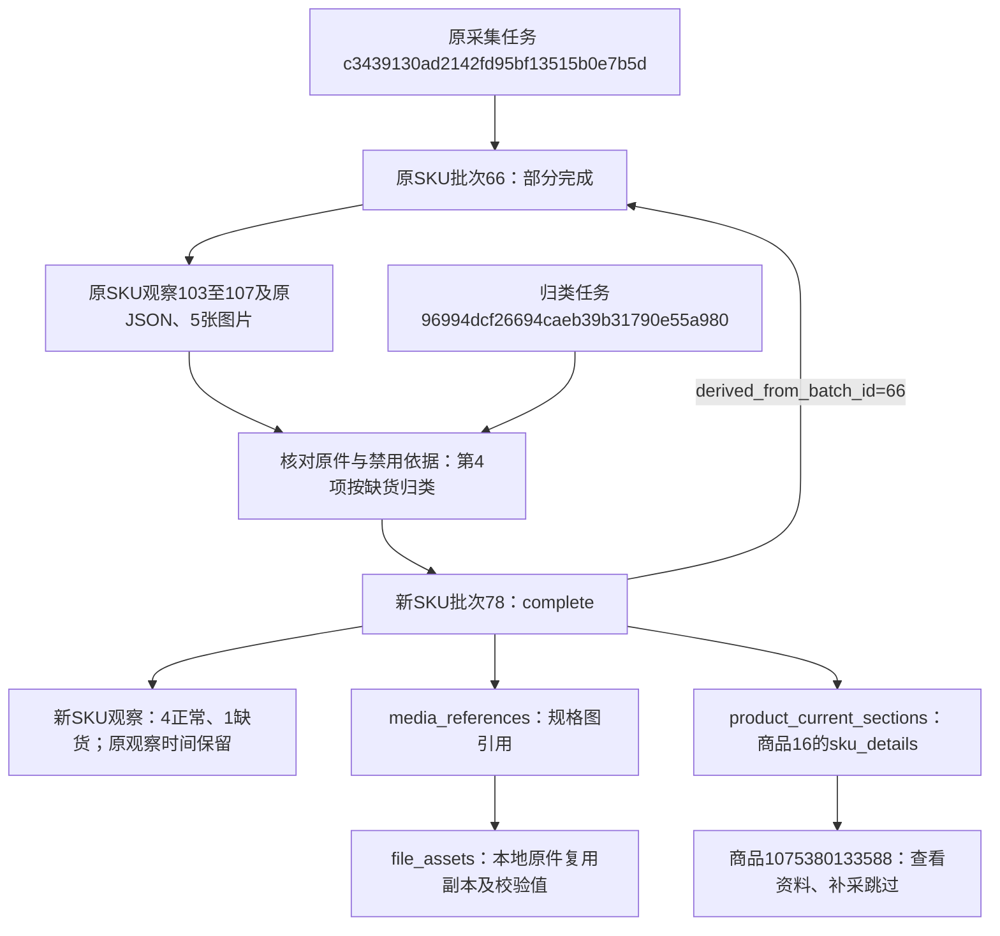

# SKU 禁用即缺货调整记录

2026-10-25，用户确认：有明确禁用依据的不可选规格即缺货，缺货不属于采集操作失败，应算已完成并被“采集所有”跳过。用户随后明确下达执行命令。本轮不访问真实商品，不新增字段或迁移；数据库仍为 `0007_basic_info`。

## 判断与页面

- 支持的依据：disabled属性、aria-disabled=true、data-disabled=true，以及既有识别器支持的isDisabled/disabled/soldOut/outOfStock样式标记。
- 明确禁用的规格保存 `stock_status=out_of_stock`、`price_status=out_of_stock`，数值价格为空；原先无价格文本的记录继续为空。保留原禁用数组，并在stock_evidence/price_reason明确记录按业务规则归为缺货，不假称页面出现缺货文案。
- 组合已确认、所有候选已处理、价格或缺货依据通过、图片已保存或确认无图且发布入库确认后，模块为complete。缺货本身不产生不可选原因未确认警告；平台SKU编号未提供不单独阻断。
- 可选规格价格读取失败、缺货依据不足、未确认组合、漏规格、下载失败等继续阻断；不把点击超时、未加载或验证遮挡当成缺货。
- 缺货且价格文本为空时，明细显示“缺货，未取得价格”。有效资料按钮和补采跳过均使用已有有效分区机制。旧网页任务不覆盖页面已经展示的较新批次。

## 历史结果

只处理各商品最近一份已发布的partial SKU结果，核对原JSON与数据库登记哈希、规格数和全部原图片。符合新规则才生成同商品同模块的派生批次；不修改原批次业务字段、原SKU观察、采集日志或源文件。新任务只表示规则归类，原观察时间不变。

| 商品平台编号 | 内部商品编号 | 原批次 | 新完成批次 | 规格数 | 正常/缺货 | 原观察时间（北京时间） |
|---|---:|---:|---:|---:|---|---|
| 996877163053 | 1 | 9 | 77 | 35 | 33 / 2 | 2026-10-24 12:25:05 |
| 1075380133588 | 16 | 66 | 78 | 5 | 4 / 1 | 2026-10-25 15:44:47 |
| 759806771408 | 20 | 33 | 79 | 22 | 21 / 1 | 2026-10-24 19:04:44 |

前后变化举例：原批次66的第4项“16CM替换装1卷胶带100撕..”在原记录中仍为unavailable_unconfirmed；新批次78对应项为out_of_stock，price_text/price_value均为空，保留data-disabled=true和禁用样式依据。其他4项价格仍是17.02、24.30、29.99、16.80；5张原图片校验通过后复用。新批次78进入product_current_sections.sku_details，因此网页展示完成并跳过补采。

两次审计任务：`056b5578a16f4ecf843a7dcb481a8709`先保存批次77，随后附加事件的时间对象序列化失败，真实状态保留needs_attention；修正临时代码后，`96994dcf26694caeb39b31790e55a980`完成批次78和79，状态succeeded。没有重放第一个结果，也没有把已停止的第一任务改成成功。两个任务均未打开平台浏览器。

## 数据数量与留存

以下为本轮新增量，全表累计前后数量见工作区报告：tasks +2、task_events +9、collection_batches +3、sku_observations +62、product_current_sections +3、collection_checkpoints +62、file_assets +65、media_references +65。65份文件是62张已校验图片的本地复用副本和3份新归类JSON。

products、collection_runs、collection_steps、search_records、list_observations、product_info_observations、参数、评价与问答观察数量不变；无业务记录删除，无DDL。3个原批次及62条原SKU业务快照和3份原JSON哈希均复核不变。发布流程只按既有约定调整旧批次result_payload的最后尝试/导出选择控制键。

完整证据：`workspace/output/reports/sku_stock_reclassification_20261025_final.json`，含各表累计数量、增量、来源哈希、原始报告链接、实际任务/批次和页面核对结果。两个分轮报告继续保留。一次性执行代码完成后删除，业务代码中不新增历史补采命令。



其中，平台商品编号是淘宝商品身份；products.id=16是本库内部身份；任务记录本次处理过程；批次记录一次有来源和时间的SKU结果；sku_observations记录批次内具体规格；media_references连接具体规格与file_assets登记的本地文件。禁用规则归类不等于重新采集商品。

只读核对示例：

```sql
SELECT id, product_id, status, derived_from_batch_id, derivation_kind, captured_at
FROM collection_batches WHERE id IN (9,33,66,77,78,79);

SELECT position, sku_name, stock_status, price_status, price_text, price_value
FROM sku_observations WHERE batch_id=78 ORDER BY position;

SELECT product_id, section, module, batch_id
FROM product_current_sections WHERE section='sku_details' AND batch_id IN (77,78,79);
```

## 验证

- 单元检查339项通过，后续相关模块32项复核通过。
- SKU隔离浏览器27项通过：明确禁用归缺货且不点击；多组组合未确认、下载失败继续阻断；已有有效结果保留等。
- Web隔离浏览器7项通过：查看缺货资料、跳过补采、旧任务不覆盖新批次及原有人工反馈流程。
- 验证库1项事务回滚检查通过：原观察/原文件不变、派生外键、数值价格为空、有效分区发布、摘要和补采计划一致。
- 正式库3个商品的资料概况及新批次详情GET查询通过，3个补采计划均跳过skus。

没有重启用户原Web进程。重启原服务并刷新页面后使用新代码；本轮结果待用户查看确认，不替代人工验收。
