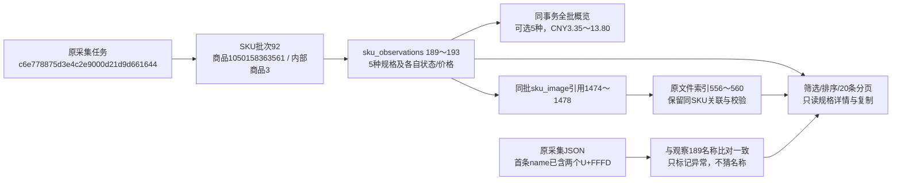

# SKU页面排版与状态筛选

2026-11-01，用户确认执行方案及stock_status来源，人工体验待用户确认。

## 结果与范围

SKU商品页采用专用模板，合并原有两块大区域，集中标题/批次/时间/状态和对应任务/日志。统一搜索批次控件，明确点击查看才应用，待选不改变正文/价格/图片或来源。切批次重置状态、排序和页码；沿原observation运行范围选择，历史批次不借当前有效资料。

增加整批概览、5个状态筛选及原始顺序/价格正倒序。整批计数/分币种价格区间不受分页或筛选影响；筛选结果与整批数量分别显示。未确认、币种缺失及非collected金额不纳入，真零价格可纳入；跨币种分组，不能混为一个区间。20条分页及原稳定编号保持，筛选/排序回第一页；已确认价格按数值排序，未确认排最后。

规格图保留同批SKU身份关联和校验，统一缩略图完整显示，沿全站预览。名称、价格、可选状态分层；多属性显示已有group/name，简单属性不重复。规格详情默认折叠，显示原名称/属性和标识、可靠平台编号、组合确认、逐条时间、原价格、状态及依据，支持复制名称；浏览器拒绝复制时明确提示，不假报成功。手机使用卡片。批次来源单独默认折叠，异常批次保留简述及完整来源说明。

没有修改淘宝采集流程、库存判断、历史数据、数据库结构或AI；普通批次页继续使用通用表格。只有商品SKU页开启新查询选项。公共控件外观在form_controls，sku_page.css仅负责布局。

## 状态与价格数据口径

筛选直接读取sku_observations.stock_status：selectable可选；out_of_stock缺货／已禁用（沿原规则包含明确禁用）；unavailable_unconfirmed不可选原因未确认；unknown/NULL/无法识别的值归状态未确认。MySQL筛选采用二进制精确比较，避免大写异常状态被误当可选，不把其他未知状态改写为unknown。

同一读事务返回临时sku_overview，仅投影统计所需4列，既不读所有SKU的payload作概览，也不按当前页估算。price_status与stock_status分别保留；collected且金额/币种可靠才统计或排序，独立币种按币种名分组后数值排序。商品页原kind等筛选不能将SKU结果替换成媒体，其他模块原行为不变。

新代码：infrastructure/storage/sku_page.py负责轻量统计/筛选/价格表达式，modules/collection/sku_view.py负责原属性/价格/状态的可读解释，web/sku_presentation.py负责批次界面上下文，product_skus.html及sku_page.js/css负责展示/复制。新增选项与临时字段见数据库字段取值说明；没有新增存储字段或持久状态。

## 乱码核对

实际商品1050158363561、内部商品3、批次92的sku_observations.id=189，名称含两个U+FFFD替换字符。其sku_name、properties.name、payload.name与同任务保存的sku_details.json第一条name相同，原groups第一项name也一致。因此异常在当前页面读取前已存在，不能从这些证据进一步断定是当时网页源文字还是当时采集环节造成。未发现可可靠替换的原名称，不改写文件名、采集JSON、数据库或图片关联；仅在页面标记异常。检测不猜其他文字或自动修复编码。

原件位于本机Git忽略的workspace/output/raw/taobao_details/1050158363561/history/c6e778875d3e4c2e9000d21d9d661644-b6b9c652/sku_details.json。核对摘要保存在本轮text_audit.json，未将原业务JSON提交Git。

## 本轮验证

- 735项全量单元通过，包含本轮6项新增行为检查；40项相关检查覆盖全批/筛选/跨页统计、原文字段不变、未知状态精确筛选、零价及未知价、币种独立排序、历史来源、空结果、参数拒绝及原SKU图片关联。
- 隔离浏览器1440/390/320通过：多状态28条样例，20条分页、筛选回首屏、排序、复制、详情默认折叠、规格图预览、批次待应用与显式切换；真实本机Web同三视口通过，只读既有92批，全部5条可选，CNY采集价3.35～13.80。
- 全站图片预览6项隔离浏览器回归通过，原商品/列表/批次/SKU入口、关闭/焦点/滚动和人工弹窗优先保持。浏览器测试仅允许本机GET/HEAD，禁止采集和AI写请求。
- 两库各32业务表前后行数及全行SHA256一致，结构0019_question_analysis不变；业务新增/修改/删除均0。没有真实采集、AI调用或旧数据恢复。

产物在本机workspace/output/reports/sku_page：before/after、source/text_audit/image_links、单元日志和三视口截图；均被Git忽略。复现脚本tests/browser_sku_page.py，--real仅读取本机已存在商品，测试自己的临时上下文剪贴板不读取用户剪贴板。Web已更新并保留，Ctrl+F5查看。

## 本轮真实数据流

批次92表示那一次SKU采集，189～193是本批规格观察而非平台SKU编号；媒体引用把每条规格与556～560原件索引连接。整批概览和分页均来自该批观察，不从其他批次补价或补图。以上全部是本轮读取的真实已有编号，不是新采集记录。
