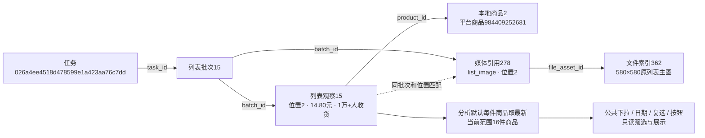

# Web筛选控件统一规范

2026-10-28，用户确认本次全站一次统一改造，覆盖搜索词分析、搜索列表、商品库、任务与日志、采集配置、商品资料/评价及各页分页。仅调整控件外观、公共模板和可访问名称；字段、默认值、范围解释、提交/自动更新方式及采集流程保持原行为。

## 单一维护入口

| 文件 | 职责 | 后续修改方式 |
|---|---|---|
| `src/ecommerce/web/static/form_controls.css` | 公共设计变量、输入/日期/数值、普通下拉、复选/单选、范围、按钮、状态和分页外观 | 调整颜色、高度、圆角、字号等变量；调整某类控件的规则 |
| `src/ecommerce/web/templates/form_controls.html` | `input_control`、`select_control`、`field`、`range_field`、`control_button` | 调整控件结构或增加公共类型，所有引用页面同步生效 |
| `src/ecommerce/web/static/searchable_select.js` | 搜索型下拉的检索、选中、键盘及浮层行为 | 通过data属性配置字段名、提示和计数单位，复用行为 |
| `src/ecommerce/web/static/searchable_select.css` | 搜索型浮层专有结构、图标、候选排布 | 引用公共设计变量，维护浮层排布，不另定义一套主题 |
| 各页面模板与页面CSS | 字段、值、选项、布局、宽度、排列和换行 | 引用控件，不复制外观定义 |

公共样式与搜索组件从 `base.html` 各加载一次。原 `app.css`、分析页、日志页、采集历史状态下拉等重复的边框、背景、字体、圆角和聚焦定义已迁移或删除。操作按钮的来源、历史、外部链接等用途色继续保留，由公共文件统一管理。

常用变量：`--control-height:40px`、`--control-radius:8px`、`--control-font-size:13px`、`--control-label-size:12px`、`--control-accent`、`--control-border`、`--control-ring`。表格/分页紧凑按钮使用 `--control-height-compact`，手机输入字号使用 `--control-mobile-font-size`。

普通下拉继续是原生select，在支持 `appearance:base-select` 的浏览器中使用统一的白色浮层、圆角阴影、限高滚动和浅绿色勾选选中态；其他浏览器保留原生展开方式。搜索型下拉继续使用已确认的可检索控件。所有字段保留原来的name、ID、约束、已选值和事件钩子。

## 新页面写法

```jinja



  {{ input_control({'name':'shop','value':request.args.get('shop',''),'placeholder':'输入店铺名称'}) }}



  
    <option value="">全部</option>
    <option value="list">仅搜索列表</option>
  


{{ control_button('查询',{'type':'submit'}) }}
```

可见input和select统一使用公共宏；隐藏输入仍可保持原生标签。属性通过xmlattr转义，False属性不输出，零值保留。`field`会向嵌套select传递明确的可访问名称；使用外部label或原有复合结构时，传 `aria-label` / `aria-labelledby` 或 `select_control(...,label='名称')`，避免普通下拉的选项文本污染控件名称。

按钮可通过 `variant='secondary'` 使用次要样式；旧action用途类兼容公共外观。控件禁用、只读、错误和聚焦状态统一维护。销量区间使用 `range_field`，保留最小/最大值的独立名称、包含边界及留空/零值口径。页面样式只负责布局；增加新控件时先补充公共组件，再由页面引用。

2026-10-28新增`data_chip(label,count,href,attrs)`数据档位链接：统一在公共模板/样式维护，`data-tone=0～4`引用公共五档色标变量，`aria-current=true`表示当前筛选；表格页面仅负责排列及间距，不重复实现可点击色块的边框、字体与状态。

## 覆盖和验证

已迁移全部页面的可见输入、下拉、复选和公共操作按钮，包含动态任务按钮的公共外观；商品库与搜索词商品页的销量区间共用同一范围模板。分页跳转、商品资料批次选择、评价资料选择也接入公共控件。

自动验证涵盖属性安全转义、False/零值、原生标签与范围语义、全站可见输入/下拉必须使用公共模板、公共资源仅加载一次，以及多页的统一尺寸。浏览器中将公共高度改为48px、圆角改为14px，日志、采集配置和分析页全部可见控件同步变化；普通下拉选项可直接点击，任务状态过滤、禁用联动和手机布局按现有行为验证。

所有浏览器测试使用临时数据和独立浏览器；正式页面检查限定本机GET请求，不启动真实采集。最终结果：485项完整单元测试通过，64项隔离浏览器测试通过（公共控件4、分析10、任务/商品库42、评价/问答8）。最后的评价模板调整后，8项评价/问答浏览器及3项公共模板单元复核通过。正式9类页面HTTP均为200，390/768/1480px三种尺寸通过，浏览器脚本错误0；已查看桌面普通下拉、商品库、采集配置及手机分析/商品库截图。

回归发现并修复了两处表现问题：手机分析页的长范围名称与日期挤在同一行，改为搜索词/范围各占一行、日期并排，并增加实际字段重叠检查；上方队列新增行时，浏览器滚动取整叠加到历史列表更新，造成1.02px偏差，现在在队列更新时同步保持当前阅读卡片，原1px断言通过。商品库继续/停止旧测试原读取退役JSON，已改用现行数据库控制指令的测试入口，生产任务协议未修改。

原8000端口Web服务仅在核对父子Python启动路径后重启，独立采集进程未操作。正式库全部业务表行数和商品、批次、列表观察、文件索引、媒体引用五类源记录的完整内容SHA256前后一致；新增/修改/删除均为0，表结构变更0。证据保存在不入Git的 `workspace/output/reports/form_controls/20261028/`：`before.json`、`after.json`、`result.json`、`actual.json`、`browser-real.json`及各页桌面/手机PNG。自动验证不代替人工验收，人工状态只在[功能逐项验收清单](../功能逐项验收清单.md)维护。

## 本轮只读核对的真实数据流

正式关键词“粘毛器”仍为22条观察、16件商品；下图是本轮重新查询得到的既有记录，本次没有创建采集任务或新批次。



任务表示一次采集执行，批次表示其中一页保存结果，观察表示商品在该页某位置的展示；本地商品主键与平台商品号分别标识数据库身份和淘宝身份。媒体引用的批次/位置与观察由程序匹配，并非观察到媒体的数据库外键；文件索引关联保留原件。此次仅替换展示控件，仍从原批次和原文件追溯，不生成另一份业务数据。

2026-10-28：新增公共`distribution_bar(value,label)`宏与`.ui-distribution-bar`比例条，使用原生meter表达0～100的百分比，色彩复用公共数据色阶，辅助名称由调用方提供；页面另显示商品数和百分比文字。发货地区折叠模块复用现有`.sa-composition`的标题、箭头、边框及合计标签；省份/城市只在页面CSS中增加布局，不另复制一套折叠标题样式。

2026-10-28：新增公共`help_label(label,description,attrs={})`，输出type=button的可聚焦说明名称和ⓘ图标；通过data-ui-help-text传递已转义说明。全站base仅加载一次help_tooltip.js；初始页面有说明按钮才启用，浮层挂到body，使用textContent展示、role=tooltip与动态aria-describedby关联。支持悬停名称/图标、浮层内阅读、键盘聚焦/Esc、触屏点击切换及外部关闭，滚动/窗口变化时重新定位或隐藏，边缘自动避让；显式关闭后抑制布局变化触发的意外重开，直到真实鼠标移动。外观由公共.ui-help-label/.ui-help-popup和现有设计变量统一维护。

首批仅腰部卡片和对照表使用：metric_help_definitions.html集中保存middle_metrics的名称和解释，search_middle.html通过同一宏复用。新增指标说明应先维护统一定义，禁止各展示位置复制不同文案；其他页面可复用help_label，无需再实现浮层脚本。定义文件只含展示文字，不承担业务统计规则。
