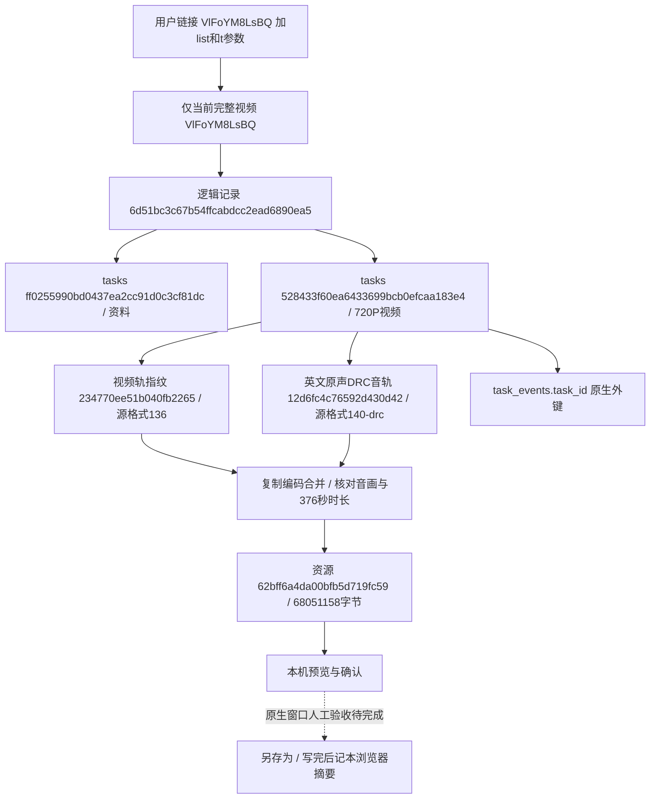

# YouTube单视频下载（2026-11-02）

## 范围与使用

用户明确：只下载当前链接的视频，画质由用户选择，不下载列表。新增工具箱 `/tools/youtube`，支持官方watch、youtu.be、Shorts及存在完整播放文件的直播回放入口。输入先规范为 `https://www.youtube.com/watch?v=<视频编号>`，丢弃list、index、t和跟踪参数；频道、纯列表、重复/冲突视频编号和多个链接明确拒绝。后台同样强制noplaylist，若解析器返回列表或其他视频身份则拒绝，不依靠前端隐藏按钮保证范围。

先解析标题、频道、封面、时长、发布时间和实际规格，不预下载视频。画质选择常驻展示分辨率、帧率与编码，更多选项按实际语言组织音轨/音质，默认优先原声、H.264和AAC；返回缺失数据不编造，真实0保留。独立视频轨和含音频的版本明确区分，含音频版本标注自带语言且禁用独立音轨，避免选了英文却保存内置其他语言。所选画质或语言失效时需重新选择，不静默降画质或切换语言。

准备后显示播放器，视频必须能预览并由用户勾选核对再选择保存位置。切换画质/音轨清除确认，不匹配的旧视频预览隐藏；已准备资源可明确选择重新查看。视频合并保持原编码：通常MP4，VP9/AV1与Opus等适用组合使用WebM，不将改后缀当格式转换。完整声音输出M4A：AAC复制封装，其他编码明确转成兼容AAC；封面复用公共图片能力，支持原格式/PNG/JPG。未提供字幕、裁剪或列表功能。

保存使用桌面Chrome/Edge原生另存为，用户可改名和选择位置。实际接收字节数匹配且写入关闭成功后才记本浏览器保存摘要；选择器取消、中途停止或磁盘写入失败均不记成功。缓存清理保留历史名称、资源大小、真实任务与本浏览器曾保存的名称/时间；不将浏览器保存伪装成数据库任务成功。

## 下载、恢复与磁盘

单个视频没有固定大小上限，默认20GiB缓存仅提醒。下载/合并前检查临时峰值空间并扣除已有输入，流式写入持续检查，保留256MiB余量；用户最终保存磁盘的剩余空间不能由原生网页选择器读取，依赖系统实际写入结果，失败可复用缓存重新保存。

显示当前视频轨/音频轨的实际字节、速度和剩余时间；未知总量不造百分比，合并阶段单列。暂停保留完整输入和未完成分段，该次任务needs_attention；继续创建新执行，复用身份/大小/SHA一致的完整轨道。续传必须有可用HTTP实体校验、If-Range和严格一致的206范围，来源无法证明一致或服务器忽略Range则明确从头下载。来源失败可刷新同一视频一次，仍要求原规格/语言存在。YouTube媒体连接等待上限60秒，停止在下一个检查点生效；不是承诺点击后立即中断底层阻塞读取。

取消删除本记录未完成分段，保留完整轨道与成功输出；删除缓存才移除完整临时资源。闲置24小时终态记录在下次解析或手动清理时清理，暂停、失败待恢复及进行中记录不自动清理。跨进程活动任务核对PID和启动身份，存活或未知时不另开冲突执行，明确死亡后才显示中断待恢复。

## 配置、依赖与分层

使用官方 `yt-dlp[default]`，当前验证版本2026.10.26、配套yt-dlp-ejs 0.8.0；声明范围 `>=2026.10.26,<2027`。本机Node v24.22.1可用，支持自动检测Deno或Node，页面可指定运行程序路径；Node须22以上。不在每次任务里自动更新引擎或从远程加载额外脚本。需更新时按项目依赖安装流程处理并验证。[官方脚本运行环境说明](https://github.com/yt-dlp/yt-dlp/wiki/EJS)。

新增 `[youtube]` 设置，与本机/模板同步：temp_dir默认workspace/output/temp，cache_warn_gib=20（0关闭提醒）、idle_hours=24（1～8760小时）、proxy=""（默认沿用本机网络，可指定不含账号密码的HTTP/HTTPS地址及端口）、js_runtime=""（自动检测）。文件修改重启生效；页面设置立即保存本库覆盖项，缓存目录变更只影响新记录，不搬旧文件。解析、封面、媒体和登录窗口沿用同一平台网络配置，其他平台不被该独立代理修改。登录使用独立profile/session和统一任务锁，人工完成登录/验证码，无权限不绕过；本轮未实际登录账号。

`platforms/youtube`负责入口、实际格式与独立会话；`modules/video_tools/youtube.py`负责明确选择和任务流；公共MediaCache从B站抽出目录/缓存校验、任务核对、磁盘设置、历史与清理生命周期，B站事件名、资源键和旧缓存格式不变。通用传输/FFmpeg/图片组件继续复用，浏览器会话只增加可选proxy参数，省略时旧行为保持。

缓存按数据库目标和平台分区，元数据/私有签名目录在 `workspace/storage/video_tools/youtube/<scope>/<cache_id>`，大文件位于选定临时目录下youtube命名空间。API不返回播放源签名/Cookie；下载逐跳校验HTTPS Google视频/图片CDN，不向任意地址发送登录Cookie。只有本工具独立保存的YouTube会话可用于解析；原始引擎日志不直接进入任务，避免泄露签名信息。

## 真实样例及数据库变化

视频 `VlFoYM8LsBQ`：全英｜长大以后，朋友越来越少，正常吗？Why is it so hard to make friends as an adult?，频道Leah's Diary 莉雅老师，时长376秒。实际解析到21个可校验直接视频格式、109个音轨格式，最高1080P/60帧；其中有不同语言与动态范围版本，音轨数量不是语言数量。HLS/故事板/受保护内容不混入可直接核验的完整文件选项。

本轮逻辑缓存 `6d51bc3c67b54ffcabdcc2ead6890ea5`。正式数据库tasks 124→129（新增5），task_events 12759→12780（新增21），其余30业务表行数相同；这是本轮快照，不据此声称其他表全部内容未变。无本轮DDL/备注修改，当前保持0020_composite_analysis、32业务表/386列/67外键。未修改/删除旧任务，也无淘宝采集或付费AI。完整本机证据在忽略目录workspace/youtube-integration.json，未提交签名来源和业务缓存。

|动作|真实任务编号|结果|
|---|---|---|
|资料与规格、原封面|ff0255990bd0437ea2cc91d0c3cf81dc|succeeded|
|360P/30帧/H.264/英文原声DRC版|4ee26ccef0e544adb40831a1892fb7b0|succeeded|
|720P/30帧/H.264/英文原声DRC版|528433f60ea6433699bcb0efcaa183e4|succeeded|
|完整声音M4A|3c7babf64bda4792965e7d5187c5005f|succeeded|
|PNG封面|ede8f11545b44ddfa378314a6a5dfe5e|succeeded|

|产物|字节数|SHA256|
|---|---:|---|
|360P MP4|14,904,594|b47c6e92cebd7972e0b11415bdd654ae42b3d6fef79c7c20d018d7fcc11296e8|
|720P MP4|68,051,158|edde0ee6c643b7d3d81c2a45f048f027f0fae24f6912d018a70769209fcf4c85|
|完整声音M4A|6,081,674|99ad046c33f0fc8c04fe57478ba626a334b24ce1f5b031a1815870648a9753c3|
|PNG封面|894,530|4ec6f388124ec3eb5d4c76695444cdee257d79fbd54f5e88c23f53e01c6a3ba6|

真实下载曾遇媒体网络慢/来源失败，程序刷新同视频同规格后取得完整文件；完整轨道HTTP长度、已知格式大小、媒体时长、音画轨道和开头解码校验通过。该结果不冒充整段人工观看或独立的真实YouTube暂停续传实验。



视频编号是平台内容身份；cache_id是一条逻辑记录；task_id是一次真实数据库执行；20位轨道键绑定源格式/编码/宽高/帧率/语言；24位资源键绑定视频和明确的音画组合。这些都不是淘宝商品或采集批次。metadata.video_id和事件video_id是11位YouTube编号；准备接口/资源中的video_id、audio_id是轨道键，不能误当平台编号。唯一数据库外键继续是task_events.task_id→tasks.id，文件不写淘宝file_assets。

只读核对：

```sql
SELECT id,name,status,message,started_at,finished_at FROM tasks
WHERE id IN ('ff0255990bd0437ea2cc91d0c3cf81dc','4ee26ccef0e544adb40831a1892fb7b0',
 '528433f60ea6433699bcb0efcaa183e4','3c7babf64bda4792965e7d5187c5005f','ede8f11545b44ddfa378314a6a5dfe5e');
SELECT task_id,event_type,details FROM task_events
WHERE task_id='528433f60ea6433699bcb0efcaa183e4' ORDER BY task_sequence;
```

## 验证与人工边界

最终全套回归1496项完成，OK，571项按显式启用条件跳过，耗时451.212秒；包含当前工作区其他已存在测试。最终YouTube相关15项和B站22项均通过。只读database check确认0020_composite_analysis、32业务表/386列/67外键及原生备注完整，无结构错误；pip check通过。服务已按原地址8000重启，未停止采集或分析进程。

最终重启后再次通过浏览器验收；另一次真实缓存复用POST核对attempts数量不变（新增任务0），刷新后保留360P所选轨道与英文音轨，确认框仍清空。该动作只更新临时选择摘要，不另下载、不增加正式数据库记录。

15项最终相关测试覆盖：入口及列表/时间剥离、冲突/外站拒绝、真实0/缺失统计、帧率/语言/原声区分、受保护/直播/错误身份过滤、单视频接口拒绝scope/list/分集参数、不预下载、不同画质/语言独立资源、旧规格消失不降级、暂停新任务恢复、取消只删分段、摘要篡改/确认/Range预览守卫、完整轨道复用、完整声音不预下载视频、设置与清理、跨进程存活核验；包含真实本地FFmpeg的VP9+Opus复制封装WebM及转M4A测试。B站22项回归通过。初轮全套1488项OK（571显式条件跳过）；最终补充用例及代理接入后再跑全套，结果另在验收清单记录。

浏览器使用真实缓存检查1440/1024/390/320、工具箱四卡1440/1024/768/390/320：无横向溢出、页面错误；画质常驻可选、1080P60可见，360P/720P实际预览，换未准备画质/日语隐藏旧视频并清确认，切回英文原声恢复可查看；MP4/M4A/PNG经模拟原生句柄写入核对完整字节和SHA；选择器取消及中途停止不记成功。准备请求被隔离拦截并核对无列表/范围参数，另有模拟50%进度、暂停、失败和其他进程运行中状态。浏览器验收没有新增真实下载任务，图与结果在workspace/output/reports/youtube。

原生系统位置窗口、人工登录/验证码、独立代理实网、整段听看、实际Shorts/直播回放、更高画质完整下载与数GiB文件仍待人工体验；没有宣称已人工通过。当前样例最高1080P可选，但本轮实际准备的完整视频是360P和720P。首次浏览器连接技能缺运行文件，改用项目已有独立浏览器验证；额度导致的一次自动审批检查未执行，用户继续后已完成相关检查，不算代码失败或安全拒绝。
