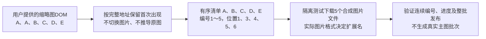

# 主图 DOM 去重采集说明

2026-10-26，按用户明确指令“直接采集提供DOM里面的图片，排除重复，按顺序标记”实施。此方案替代此前两套页面数据都须与缩略图对应的规则；此前裁切地址修复记录保留为历史依据。

## 本次规则

1. 核对当前详情页URL属于目标商品，读取`#picGalleryEle`中唯一缩略图列表的所有`img.src`。
2. 按DOM顺序规范化完整URL，保留地址首次出现的位置。保留压缩后缀和查询参数，不推导原图、不按文件名或像素内容去重。
3. 图片依次编号1、2、3……，文件扩展名按实际下载格式确定。参数没有图片，不参与清单；首项不再按视频入口猜测排除。
4. 不读取item.images/headImageVO.images，所以这些来源缺失或内容不同不再影响主图采集。下载的是DOM中实际链接对应的图片，包括其缩略图版本。
5. DOM缺失、区域不唯一、图片地址无效、商品页变化或下载中去重后的有序清单变化仍暂停。仅重复节点位置或数量改变时，只要有序唯一地址相同，就不阻断当前下载。

逐张下载、文件完整性和解码检查、失败进度保留、相同来源补采及整批发布沿用原流程。新方法与旧方法的来源指纹不同，不混用旧原图结果；旧历史和文件不回写。新生主图记录schema_version=3、collection_method=dom_thumbnails，增加原始节点数、去除数量及去重规则，取值见[字段说明](../数据库字段取值说明.md#2026-10-26-主图改为-dom-地址去重)。无数据库DDL。

## 输入和验证

用户提供DOM包含6个img：A、A、B、C、D、E，最后是无img的参数入口。使用其实际图片地址和节点结构做隔离验证，得到5个有序下载地址，index=1～5，首次位置slot_index=1、3、4、5、6；raw_image_count=6、duplicate_count=1。测试拦截所有页面请求，并以合成图片替代网络下载，不能当作真实商品图片已采集成功。

399项单元回归、28项主图浏览器测试通过；补充的用户DOM原样输入、无效地址及下载中来源变化3项关键场景再次通过。测试覆盖完整URL去重、不同目录/查询/压缩版本保留、重复节点变化、缺失页面数据、视频入口无依赖、不误删首项、无图片DOM暂停、下载损坏、中断恢复和发布回滚。

本轮没有替用户停止、继续或重启真实采集任务，没有下载真实商品图片。此前任务`8bc7f34f90bb40d3a8608f5b012c1b03`中已保存基本信息批次100不受此代码修改影响。旧采集进程仍加载旧代码；需要在网页停止旧任务后，新建“仅主图”任务使用新规则。Web服务按既定授权更新，访问地址保持原8000端口。

本机验证日志：`workspace/dom-main-images-regression.log`、`workspace/dom-main-images-browser.log`、`workspace/dom-main-images-browser-final.log`。操作见[使用指南](../使用指南.md)。真实平台验收另按[功能逐项验收清单](../功能逐项验收清单.md)记录。
