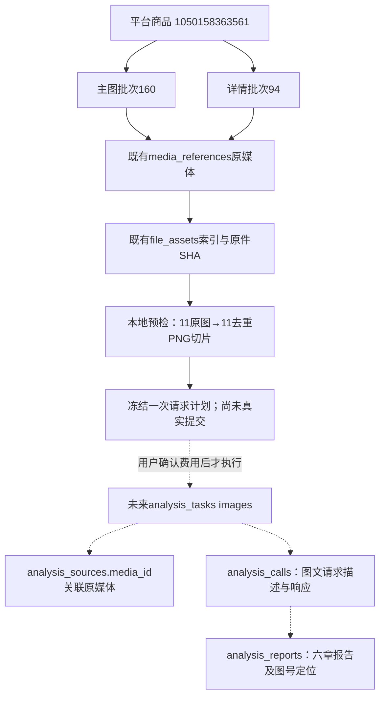

# 主图与详情图片分析

2026-11-02，用户确认在“综合分析”内增加“主图与详情”，本轮完成实现和离线/模拟验证。真实付费看图及报告语义仍待单独确认，没有自动调用真实API。

## 使用与报告

- 综合分析保留原“评价与问大家”为默认页签，增加“主图与详情”，两种历史独立。图片分析不以评价、问答已分析为前提，也不发送它们的报告。
- “分析主图与详情”打开公共样式弹窗，选择同商品的主图与详情已发布批次。可展开每张图的实际PNG切片、尺寸、坐标及编号，查看完整提示、发送清单、请求数及保护额度。
- 默认优先完整一次；只有模型上下文、图片数量或48MiB请求体不容纳才分组N＋1。每次最多600张处理图、单图32MiB；1280×1600切片同时满足官方4096/8192像素边长要求。48MiB内联请求也小于官方64MiB原图片总量限制。单任务200次/500万Token为本机保护，不是模型上限，不静默截断。
- 图片每片按1024Token上界预留，文字用本地分词估计或UTF8保守估计，另扣输出和余量；base64只影响网络字节，不当成文字Token。分组后也提前预留汇总输入、输出与网络空间；汇总只发组稿与范围，不重发原图或自动加层级。
- 主图/详情缺失、不完整或文件校验失败均列原因，只有用户明确允许部分范围才继续；全部不可用始终拒绝。不自动改选其他批次。更换设置重新预检并清除费用确认；未勾费用许可不能创建任务。
- 六章：总体判断、主图分析、详情分析、联合检查、选品线索、展示与改进建议。提示要求区分可见事实、商家宣称、分析推测，保留单位/限定条件，道具不当作SKU包含物，跨款式不强判矛盾。场景、卖点、展示不足和选品线索给具体图号与验证动作；先现成款、再包装/组合，定制附前提。
- 支持Markdown、HTML、JSON导出及显式免费图号重查；HTML导出正文及固定图片索引，不内嵌图片字节。实际切片在本机任务报告中按图号查看，默认折叠。图号定位不等于OCR、宣称真实性、结论语义或实物性能已验证。
- 相同在途任务复用；已成功明确给出查看已有/再次计费生成选择；失败或中断默认另建，不重复进入失败任务。无自动重试、扩额、补写或修改旧报告。

## 图片处理与发送

公共处理位于`src/ecommerce/infrastructure/images/vision.py`；业务入口、规划、报告在`src/ecommerce/modules/image_analysis/`，提示词为该目录的`prompts/report.txt`及`prompts/group.txt`。文本综合的执行/预算/收据和目录阅读布局通过显式适配复用，原文本客户端继续拒绝图片消息。

1. 从数据库查同商品/同模块/已发布批次及main_image、detail_image角色，不使用页面当前分页或下载功能的201项截取。
2. 校验文件根目录、存在性、大小、采集登记SHA256和实际解码格式。32MiB/8000万像素是解码保护；动态图片不悄悄只取首帧，需先明确转静态。处理静态JPEG/PNG/WebP/GIF，不靠扩展名判断。
3. EXIF转正，保留原像素，长宽图按顺序完整切片，重叠128像素；保留转正后原图尺寸、每片box与piece。不覆盖采集原件。相同切片字节去重后保留全部角色/原图/片段别名，重复区域不是新样本。
4. PNG内容寻址保存于Git忽略的`workspace/output/analysis_image_inputs/<SHA256>.png`。这是固定分析依据副本，与临时下载不同，不按下载过期策略自动清理。用户打开预览会生成这些本地派生文件，但不创建业务数据行或AI任务。
5. 冻结文字和image_ref描述（摘要、大小、别名、原图坐标）及处理/提示版本。联网前再次核对数据库归属/发布/原文件索引、原件和切片字节，再在内存构造`image_url`的PNG data URL、detail=original，发送固定官方chat/completions地址。描述和摘要入库，base64不入库，不上传到其他图床或远程图片地址。
6. 调用前持久预算预留及请求描述，响应先落本地收据再入库；未知用量继续占预留。图号检查基于实际有返回的调用范围，不仅看计划中是否有该图。

官方能力依据核对于2026-11-02：[Vision](https://api-docs.deepseek.com/guides/vision/)、[Models & Pricing](https://api-docs.deepseek.com/quick_start/pricing/)。仅deepseek-flash已核实支持视觉，deepseek-v4-pro不支持视觉，不能仅凭文字1M容量认定可看图。后续服务商/模型需单独验证后加适配。

## MySQL与兼容

新增0021_image_analysis/schema_v21，不修改0020或任何早期迁移/模型。32业务表＋1技术表，387字段（含技术版本列），68外键。

- analysis_sources新增可空media_id→media_references.id外键及任务内唯一；review_id/question_id/media_id恰选一个。媒体归属商品和批次另由程序检查，不把单字段外键描述成复合归属约束。
- 复用analysis_tasks/sources/calls/reports，analysis_type=images、rule_version=images-v1、content.schema_version=images-report-v1；source_count是原媒体数量，processed_count=0，不写旧逐条分类或人工修订表。
- 参数冻结完整输入、范围排除原因、切片、文字/图片描述和容量；source.snapshot冻结原媒体，content_hash绑定其内容。切片不是新file_assets记录，不是原图/评价样本数。
- 报告生成与图号检查分开；可读总稿/组稿保留。免费重查以报告身份和来源/调用快照防过期追加版本，旧版/旧返回不覆盖。
- 图片历史及重复任务查询只排序轻量列，不让整份大JSON参与排序。原评价、问答、文字综合入口与已有任务规则保持。
- 新列及所有中文原生COMMENT已在正式库、验证库升级核对，schema_errors均为空。逐字段、取值、表关系三份文档同步维护。

## 本轮验证及数据影响

全套自动测试1513项通过（571项按原规则跳过），最终46项图片/文字综合/问答/来源导航回归通过。覆盖：来源归属与发布、费用与部分范围许可、陈旧计划、长宽图覆盖/重叠/原件不变、去重别名、模型视觉能力、改文件或归属后零调用、一次与N＋1模拟、缺章/未知用量零重试、JSON不存base64、三格式导出、版本与免费检查、路径/哈希/动态图片、视觉HTTP契约。

隔离及实际页面1440/390/320三视口通过：双页签、弹窗边界、模型下拉反复展开、设置变化后重规划/费用清除、报告图号展开定位、无横向溢出。所有实际网页仅GET/HEAD，阻断POST及外站。已查看隔离桌面页与320弹窗截图。浏览器插件缺内部启动文件，读排障说明后改用项目独立Playwright测试环境，未修改插件或用户浏览器资料。

正式MySQL使用外层事务验证11个图片来源、一次模拟响应、两版报告及免费重查后**全部回滚**，从未调用真实API。两库迁移前后32业务表的既有列全行SHA256和数量一致；新media_id均NULL，技术版本从0020到0021；未新增/修改/删除持久业务行，未恢复旧数据。派生PNG副本新增于忽略目录，采集原件不变。仅重启本项目8000端口Web，其他执行进程未停止。

真实只读预检快照（2026-11-02）：平台商品`1050158363561`，主图批次`160`（2026-11-01 18:51:09）、详情批次`94`（2026-10-26 10:05:28），11张可用原图、11张去重切片、一次请求计划，当前默认输出下保护额度24091Token。预检不会计费；无正式图片分析任务/调用/报告编号。后续采集、设置或模型变化会使上述快照变化，应以新弹窗为准。

平台商品编号是淘宝商品身份；批次是不同模块某次采集范围，不是一次AI请求；原媒体/文件是已保存图片；PNG切片是程序逻辑处理依据。图中未来分析节点没有真实编号，不能将模拟测试编号当作正式报告。

自动验证证据保存在本机忽略目录`workspace/output/reports/image_analysis/`，含迁移前后指纹、只读浏览器截图和Web重启记录。真实付费看图、接口实际延迟/账单/图片识别质量、长图小字可辨认程度、报告内容是否达到用户研究要求，以及人工视觉验收均未完成，需要用户确认后另行测试。
