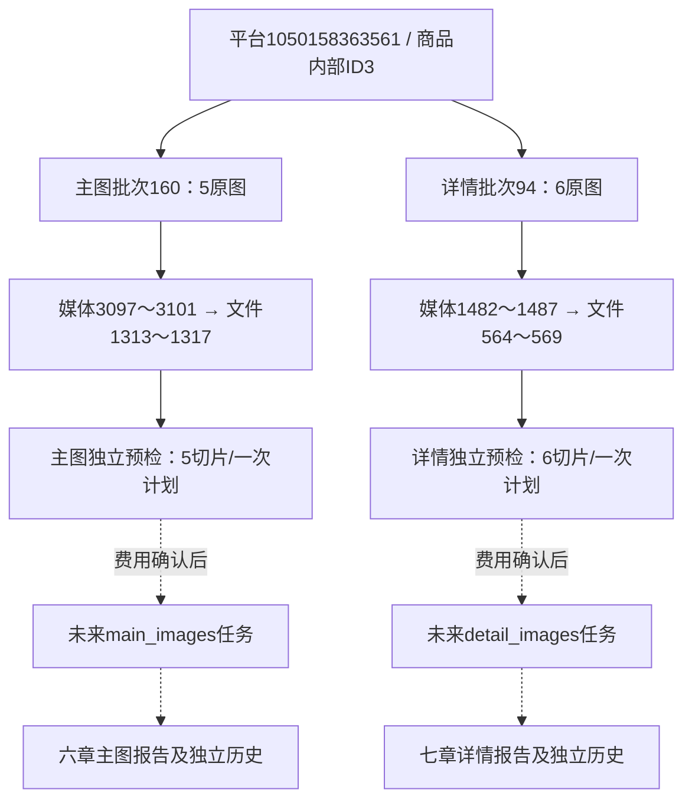

# 主图与详情独立分析

2026-11-03，用户确认本轮先拆分图片基础分析，入口移回主图/详情图片模块；四类报告自由组合留下一阶段。旧联合报告不迁移、不拆分、不删除，不混入新历史。

## 页面与操作

两模块统一在当前批次说明下、图片浏览区域上方显示分析栏。主图提供“分析主图”“查看分析记录”，详情提供“分析详情图”“查看分析记录”。同模块同批次存在成功报告时，突出“查看本批报告”，重新分析仍要求确认费用。当前批次无成功稿时不会借用其他批次结果；已有部分内容或在途任务可进入内容/进度页。

点击分析打开同一公共样式弹窗：仅一个采集批次选择，实际原图/切片可展开，显示完整发送提示、模型、输出上限和调用计划。范围是本批全部原图，包括所有分页，而非页面当前20张。更换批次/设置重新预检并清除费用确认。原图缺失、校验失败或采集未确认完整时列原因，明确允许部分范围才继续；全部不可用始终拒绝。

独立历史采用统一的页头、批次筛选、最近成功报告卡、轻量历史表。桌面并排，手机换行；表格在自身容器横向滚动，页面及筛选不外溢。主图与详情记录分开，返回模块保持该报告原批次。报告阅读、默认折叠图片依据、目录、固定版本、免费图号检查与三格式导出继续复用。HTML导出正文与来源索引，不嵌入原图字节；实际固定切片在本机报告查看。

原综合分析的“主图与详情”生成页签撤下；旧`analysis=images`及旧联合new入口跳到主图模块，旧联合start拒绝。评价与问大家综合功能保留。旧联合数据及原有读取路径原样保留，不新增迁移转换或自由组合兼容功能。

## 报告与提示词

主图六章：总体判断、逐图分析、卖点与使用场景、整组图片的分工与信息完整性、选品线索与待验证事项、展示改进建议。

详情七章：总体判断、阅读结构与介绍逻辑、使用场景与需求表达、规格、包含物与使用说明、卖点宣称与图片依据、选品线索与改进方向、拿样与供应商确认清单。

提示词分别为`src/ecommerce/modules/image_analysis/prompts/main_report.txt`、`detail_report.txt`，共用组稿`independent_group.txt`。关键要求：可见事实/宣称/推测分开，商品特点与表达效果分开，包含物/规格/适配及效果边界优先于装饰，选品线索转成筛选条件与验证动作，减少重复。关键可辨认文字、数字、单位和条件尽量简短保留供人工对图；不全文OCR，不宣称识别正确。主图首张只代表本次采集顺序；详情切片按原图/坐标理解，重叠不增证据数。仅使用所选模块和必要标题背景，不自动加入另一类图片、评价、问答、SKU或参数。

六章/七章完整性及stop结束状态与图号定位分开。图号属于实际已返回请求的范围才可定位，不意味着OCR、宣称真实性、语义或产品性能通过。不可读部分说明限制，不为填满章节编造；没有完整总稿也保存可读内容和组稿，无自动补写。

## 共用核心与费用

`kinds.py`维护两种白名单/章节/规则版本；`independent.py`统一两类预览、创建、读取及历史，`image_modules.py`只处理Web参数和页面。底层`store.inputs/create`仅增显式单模块模式，旧联合输入契约保留。图片校验/EXIF转正/完整重叠切片/内容寻址/容量与字节规划/DeepSeek视觉发送/预算收据/后台任务/安全阅读继续共用，没有复制两套网络或切片代码。

当前规则沿已核实视觉能力，主图和详情各自优先一次；超容量N组＋1次汇总，先预留汇总空间，不增加隐式层级。原图只读，派生PNG固定SHA，描述及位置入库，base64仅内存发送。预览会生成或复用本地切片缓存，但不创建分析任务或调用AI。

创建时商品行锁内重核单一模块、同商品已发布批次、角色、文件大小/哈希和固定计划；开始时必须明确正数batch_id，URL模块不能被请求正文改写。执行前再次核对来源和原件。在途相同任务复用，成功明确给出查看/重新生成选择；失败新建，不自动重试、扩额或重复POST。重新生成分别计费，旧报告不覆盖。查看、下载、本地图号检查无AI调用；真实付费验收不在本轮授权范围。

## 数据库及持久契约

0022_separate_image_analysis/schema_v22更新6条独立契约备注；发现数量、规则版本及media_id的原说明仍只列旧类型后，新增0023_image_kind_comments/schema_v23补齐3条，不改写已执行0022。最终32业务表＋1技术表、387列（含技术版本列）、68外键不变；两库备注/约束核对schema_errors为空。

新任务analysis_type=main_images或detail_images，rule_version=main-images-v1/detail-images-v1，规则带module/sections/report_version。输入为images-input-v2，只包含一个同模块批次；商品背景仅编号、标题及标题来源。来源表仍用media_id外键及原batch_id，scope与任务类型一致由程序检查，不新增复合外键。

报告schema_version=main-images-report-v1/detail-images-report-v1并带module；其余报告、调用、预算和本地检查结构沿用。source_count是纳入原媒体数，processed_count=0；相同字节去重不改变原图数。独立历史只按商品/类型/来源批次筛选轻量列排序，不让大JSON进入MySQL排序。模型未配置为MySQL分析后端时，图片浏览与下载仍按原方式工作，不强制读取分析存储。

取值、完整字典及关系文档同步更新。旧联合images/images-v1及既有业务值不转换。

## 本轮验证

全量1528项通过（571项按原规则跳过），最终75项相关回归通过。初轮全量发现未开启MySQL任务后端的浏览下载页误读取分析存储，增加后端/已发布批次守卫后复测通过；此前结果不能替代本轮最终结果。

- 相关回归75项：单模块范围、提示与章节、缺失另一模块不阻止、费用/陈旧计划/跨类型守卫、在途/成功/失败行为、整批24图及角色过滤、一次及N＋1、创建后文件变化零调用、免费重查/版本/导出、旧联合入口撤下，及原主图/详情浏览下载、评价/问答/综合/来源返回。
- 页面：隔离与实际1440/390/320，两个模块各自的入口、弹窗、批次、模型下拉重复展开、设置变化清费用、实际切片预览、历史、模拟报告定位及返回。实际页面阻断所有POST和外站，未调用真实AI。修复320历史筛选外溢及页头误继承全局header样式，加入历史页宽度断言。
- MySQL：正式连接外层事务中，分别主图5来源/一次模拟调用、详情6来源/一次模拟调用，各验证两版报告及零调用重查，全部回滚。模拟记录编号不冒充正式任务；未产生正式独立分析记录或真实模型响应。
- 数据：正式/验证两库升级前后32业务表数量及全行SHA256一致，仅技术版本0021→0023和9条备注变化；原件未改写，本地派生缓存/测试证据在Git忽略目录。没有采集、没有恢复或删除旧报告。只重启本项目8000端口Web，其他任务未停止。

真实只读预检：平台商品1050158363561，主图批次160共5原图/5去重切片/1次计划；详情批次94共6原图/6去重切片/1次计划。这是采集范围与未付费发送计划，不是模型已完成实际识图。

商品平台编号标识淘宝商品；批次是某模块某次采集范围；media_id关联原媒体而非切片；file_asset_id关联原文件索引。图中的正式新分析任务/报告尚未创建，无可提供的正式分析编号。本轮真实主图media_id为3097～3101、file_asset_id为1313～1317；详情media_id为1482～1487、file_asset_id为564～569。两种id是不同表的身份，不能互换。回滚结果和指纹记录保存在忽略目录`workspace/output/reports/separate_image_analysis/`。

待确认：真实付费接口、模型实际识图和报告质量、真实延迟/账单、长图小字可辨认程度，以及用户人工视觉与选品实用性验收。四类自由组合未实施。
