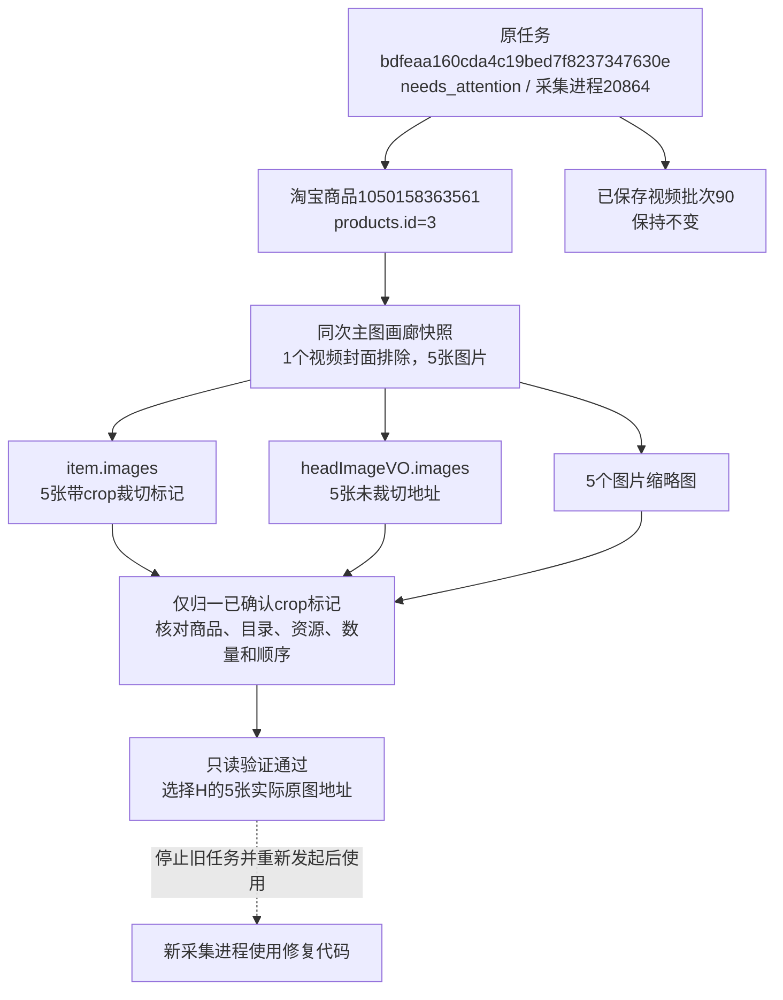

# 主图裁切地址与复核提示修复

2026-10-26，用户反馈商品页面正常但提示登录／业务复核失败，随后授权修复。本轮包含定位、规则修复、差异记录、本地验证及Web自动重启；没有自动继续、停止或重启真实采集任务。

## 实际原因

任务bdfeaa160cda4c19bed7f8237347630e，商品1050158363561（products.id=3）。原日志09:43:13记录“页面商品主图来源或顺序与缩略图不一致”；人工继续后09:43:44被通用resume_check文案替换成“登录状态或当前业务页面未通过复核”。

只读连接本项目已运行的Chrome（PID17432，本机CDP端口14112），核对进程归属后读取原画廊快照，未点击、刷新或触发采集。item.images和headImageVO.images各5张，排除1个视频封面后缩略图也为5张。

商品数据中的5张图片全部带有淘宝裁切标记，例如首图资源为`O1CN01FZs8ql1YIzzaSzPLv~crop,48,0,600,800~_!!3245473037.jpg`；图集与缩略图的对应资源为`O1CN01FZs8ql1YIzzaSzPLv_!!3245473037.jpg`。域名、目录、基础资源及排列顺序均一致，原规则保留裁切标记比较，因而误判。

## 修复边界

- 仅识别已确认的`~crop,非负x,非负y,正width,正height~`，且必须紧接`_!!数字卖家编号.图片扩展名`。其他未知变换不剥离。
- 域名、目录、原资源身份、商品编号、图片数量和顺序继续严格核对；不同图片、目录、域名、错序等仍暂停，不以同文件名跨目录或跨域名放行。
- 各个已有页面数据来源仍须全部通过核对。优先选择页面提供的未裁切原图地址，随后才考虑精确匹配或现有地址；不拼接、反推或额外请求原图。本例选中headImageVO.images的5张未裁切图。
- 主图恢复检查可返回含具体原因和差异的business阻断；点击继续后仍失败时显示“检查尚未通过”，保留具体图片顺序／缩略图位置，不误报登录。
- 旧布尔恢复检查继续支持；原业务阻断返回False时保留业务原因，真实验证阻断保持原验证规则。恢复检查失败不会重放操作。
- blocked事件及守卫JSONL的check_details记录两组去查询参数地址和逐项匹配结果；下载前后清单变化保留期望／当前资源身份，取值已登记数据库字段取值说明。没有改写旧任务提示或历史事件。

## 验证

28项相关单元检查、40项浏览器检查通过。最后收尾对裁切原图完整下载、错误顺序持续提示、下载中来源变化不重放这3项关键场景再次通过。浏览器测试只使用隔离页面和合成图片，没有下载真实商品主图。

验证覆盖裁切与原图映射、选择实际原图地址、仅有裁切来源时不虚构原图、未知变换拒绝、错域名／目录／资源／数量／顺序／商品拒绝、重复图片保留位置、提示原因与诊断持久化，以及既有守卫、主图逐张进度、恢复和发布回滚。

原现场快照复核：5张商品裁切图与缩略图均为同一原资源；修复后的清单选中页面明确提供的5张未裁切原图。没有实际发起新采集。原任务仍为needs_attention，所属采集进程PID20864保持不变；已保存视频批次90（downloaded）保持不变。

任务代表原采集执行，平台商品号识别淘宝商品，内部商品号用于本库关联；视频批次90是已保存模块结果。主图清单只是本轮对现场快照的只读验证产物，没有建立主图批次或文件资产。

无数据库结构变化，本轮业务数据新增0、修改0、删除0；19张业务表数量以及原任务状态、消息和归属前后一致。原历史数据保留。诊断报告：workspace/output/reports/main_images_fix_validation_20261026.json；原画廊快照：main_images_paused_snapshot_20261026.json；单元最终日志：main_images_fix_unit_final_20261026.log；浏览器日志：main_images_fix_browser_20261026.log和main_images_fix_browser_final_20261026.log。

已按调试约定，仅重启核对过归属及创建时间的Web进程，8000端口现由PID3476提供服务；首页及原任务页面HTTP200。采集进程不随Web更新代码，用户需停止旧任务，再重新发起“采集所有”；新计划会跳过已确认完成模块。未替用户停止或继续当前任务。
