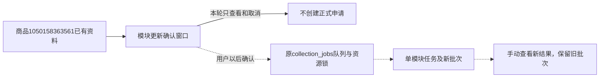

# 九模块统一确认更新

2026-11-01，用户确认按SKU方式统一九模块。基本信息（摘要和历史批次页）、视频、主图、SKU、参数、详情图片、评价概览、评价明细、问大家及采集概况均调用公共确认窗口。全局范围配置入口继续保留。更新资料与AI分析分开。

## 行为

- 窗口分别显示当前查看与商品全局最近有效批次、时间；没有资料时明确显示为空。历史资料标识提供有效批次链接。
- 更新范围固定唯一模块，评价明细默认100条有效评价、问大家默认50题，可选不限数量；实际受平台可见范围限制。每次打开恢复默认，不默默延续不限量。
- 确认才提交，取消不创建申请；复用原执行队列和资源锁。无task_id仅提供队列入口，任务/日志链接只使用实际编号。
- 同商品包含本模块的未结束申请优先复用，返回原options并展示实际范围；不同范围不会覆盖原申请。只有在途申请复用，结束后新一次确认可另开。
- 所有更新不传cleanup_tasks/resume，不清理完整或部分历史；没有自动采集、重试或AI分析。当前表格及其日志不随轮询改变，新资料手动打开。
- 原提交助手保留X-Submission-Id；更新请求15秒超时后GET核查原编号，查询失败继续只读核对，禁止新提交，未查到时允许用户使用原编号再次确认。不自动POST。
- 公共模型按各模块完整/已发布当前分区判断；SKU零条complete不计成功，基本信息/概览无需SKU非空规则。no_video/no_images/no_parameters/no_reviews/no_questions分别按对应模块确认无内容，跳过入口独立提示。关联任务其他模块失败不掩盖本模块已保存有效结果。
- 平时不重复显示同批成功；在途、异常和未查看的新批次单列提示。原卡片渲染不再覆盖统一模块已加载的来源或状态。

## 实现边界

公共业务：`modules/collection/module_update.py`、`web_collection.start_module_update`；Web展示：`web/module_update.py`；界面：`module_update_controls.html`、`module_update_modal.html`、`module_update.js/css`。复用`collection.js`原轮询，不另建定时器。控件外观沿公共form_controls，页面CSS仅布局。

旧SKU业务/展示/API入口作为兼容委托保留；九模块新入口使用POST `/api/collections/products/<product_id>/module-update/<module>`，严格confirm=true和可选unlimited布尔值，其他字段拒绝。沿原Host/Origin/令牌保护。GET同路径加submission_id只读核查原申请，绑定商品、模块和执行配置；不存在返回job=null。

GET `/api/collections/products/<product_id>/jobs?module_updates=1`可选返回九模块只读概况，普通GET不增加键。现有overview=1可同时使用。

## 存储与兼容

无DDL、字段、COMMENT或迁移，仍0019_question_analysis/schema_v19。申请options仍用既有详情结构，未新增持久update标记。CollectionJobStore.submit的可选reuse_pending_module从仅skus扩为九模块白名单且必须唯一模块；更新request_key包含本次申请id，避免终态申请被旧内容指纹再次命中。已有submission_key/request_spec校验保留，其余入口默认不变。复用在途申请不改原参数或添加别名。readonly module_updates为临时派生JSON，不写业务表。

## 验证与边界

746项全量单元检查、最终47项相关检查通过。隔离浏览器1440/390/320检查九模块确认、取消0提交、连点1提交、数量实际范围、原响应丢失后只读找到申请、历史60/有效70分离及读错禁提交通过。模拟每视口9次POST，仅测试替身；不访问淘宝、不调用AI。旧按钮文案断言按已批准的新名称更新，原SKU浏览器入口委托公共验证。

实际商品1050158363561九模块及采集概况在1440/390/320均通过打开/取消检查，拦截全部POST及外站图片请求，正式POST 0。界面截图已目视核对基本信息桌面和评价明细手机窗口。Web已确认专用启动器与子进程后重启至http://127.0.0.1:8000，启动器35672、服务12020，通过只读查询。

两库前后32表指纹核对：验证库全部相同；正式库31表相同，仅task_events新增1条id=11553、task_id=null、event_type=log、level=ERROR的Web错误事件。该事件来自代码编辑期间旧服务访问采集概况，缓存的父模板尚未导入update_button，子模板已更新，触发UndefinedError；重启清理旧模板缓存后，最终所有实际页面通过。日志保留不删除，不恢复旧任务，不谎称正式库完全无写入。新采集批次、商品观察、collection_jobs、任务执行和文件索引均无新增/修改/删除，结构仍0019。原采集资料未改动。证据位于workspace/output/reports/module_update的before.json、after.json、web_restart.json及页面截图。正式采集和人工体验待用户操作，程序检查不能替代实际采集验收。

商品编号为平台身份，数据库product_id为本地商品主键；批次表示某次模块采集的快照，task_id表示实际执行。此次不产生新的正式任务、观察或文件身份，不编造真实编号。
