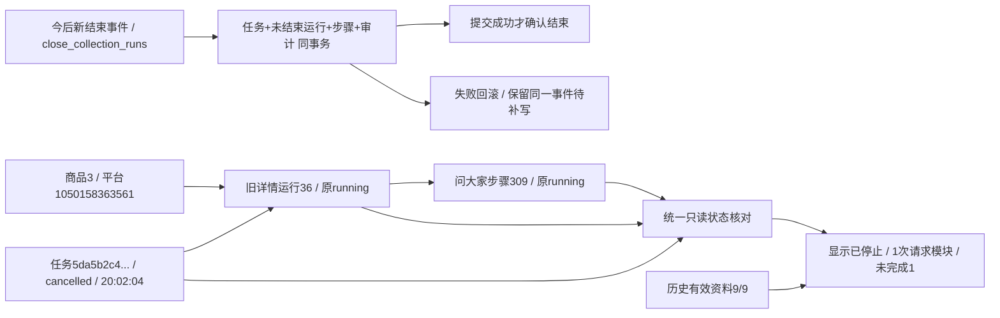

# 任务与详情状态同步

2026-11-01完成用户批准的统一收尾、显示校正、停止中/停止区分、防迟到进度、跨页面一致状态和本次模块数量方案。

## 复现与边界

实际商品1050158363561（内部商品3），最近运行36于2026-10-31 20:01:47开始，仅请求问大家，步骤309仍为running且无结束时间。其任务5da5b2c4b55249078af3c464574e88c2已于20:02:04.537877记录cancelled，说明为用户停止；原PID24104身份核对为已退出。此前页面直接展示collection_runs.status，因此残留执行中。

代码确认中断汇总保存需要读取已确认资料，该读取又经过停止检查，可能在汇总快照排入流水前再次抛出停止；总任务的结束事务此前也没有兜底收尾未结束详情。本轮保留停止与存储检查，不绕过页面安全边界，而在总任务结束的同一事务补齐收尾。

## 写入流程

新TaskEvents.finish生成稳定结束事件，collection.taobao.*且采集库为MySQL时带close_collection_runs=true。任务、未结束详情运行、对应请求步骤、结束审计和原采集申请释放同事务提交。只按同task_id、运行status=running且finished_at=NULL处理：已完成运行、已结束模块、未启用模块、其他任务/商品资料不改。

用户取消的未结束运行/正在执行模块记interrupted；失败记failed，需人工记needs_attention；原安全失效恢复生成的task_recovered记详情interrupted。待执行请求步骤记not_run。没有依据的详情不能因为总任务succeeded变成complete；页面会单独提示执行结束但详情需核对。结束时间为结束事件确认时间，保留原开始时间和原始快照。

运行error仅SQL NULL时补TaskFinalized类型和安全说明，已有对象（包括空对象）保留。task_events.details.collection_finalization记录version=1及实际收尾run_ids，原事件指纹保持。任何写入失败连同总任务/运行/步骤/事件回滚，结束事件仍由本地可靠流水补写；不自动重放浏览器动作。重复同事件只确认，不重复修改。重复finish沿用第一次身份，冲突结论拒绝；首次落盘失败重试也沿用同一事件，不误报完成。

进入收尾后不再排入进度或新采集快照；已结束任务拒绝新进度，晚到job_runtime/job_prompt不能改执行结论或申请提示。已结束运行的迟到running汇总被记录为忽略，运行中已结束的模块也不能被pending/running回退。模块最后完成与取消交错时，已完成模块始终保留。

只有新生成的结束事件带标记；旧流水缺失标记沿旧行为，已结束历史不自动回填。原进程失效恢复仍在原资源锁和进程身份核对后执行，GET不推进恢复。

## 显示流程

collection_lifecycle提供统一只读核对：关联任务有结束结论时，旧running记录按任务终态显示并提示未同步；原进程确认退出但未结束显示中断待核对；无法核实显示状态待核实，停止申请不能掩盖此情况；进程存活且收到停止申请才显示正在停止。已经结束的商品详情不因总任务之后取消而降级。

商品页、商品库、搜索来源上下文、任务记录/详情和采集进度复用这一口径。商品页开始/停止时间分开，本次请求、完成和未完成步骤数与历史商品9/9分别显示；多商品任务按每商品的请求步骤计数，不冒充独立模块类型数。任务详情仍保留本地结果待入库提示。

商品jobs只读接口复用原补采查询返回run_status，查询结果已序列化的ISO时间保持不变，避免再次当datetime转换；直接接口核对为200且保留+08:00。原2秒轮询刷新页头状态、时间、数量和最近任务链接，不新增轮询或自动任务。本批资料/来源日志保持原批次；普通来源链接、按钮、分析/费用确认规则不变。手机时间整段换行，任务名称/编号可换行。

collection_steps.payload.record/run_metadata、原件和源快照继续保留当时原文；detail_document派生当前步骤时以原生状态/时间/放行列覆盖原快照中的旧值，显示核对另放display，不回写JSON。数据库结构和原生字段含义保持0019_question_analysis/schema_v19，没有新增表、列、约束或DDL；详细扩展键见字段取值说明。

## 验证与现有数据

- 706项全量单元通过；100项相关回归通过。新增8项收尾边界覆盖同事务失败回滚/补写、幂等、已完成及其他任务保留、原快照/空对象保留、旧事件不补历史、存活/未知/失效/停止中、总任务成功不推详情成功、首次落盘失败、迟到汇总/步骤及终态后进度。
- 独立MySQL验证库真实事务测试通过：模拟结束事件插入失败后状态整体回滚，随后同事件补写正确结束，重复补写仅一个事件，迟到进度拒绝。合成记录外层事务全部回滚，无持久业务行；MySQL自增序列可能因回滚测试前进，不代表新增保存记录。
- 隔离商品页1440/390/320通过，页头在不重载时依次执行中→正在停止→已停止；原批次资料/日志保持固定，最近任务链接独立更新；复制、展开按钮颜色、配置范围、来源守卫回归保持。问大家原隔离三视口也通过，未发起真实AI或采集。
- 正式旧任务/运行36在三视口商品页、商品库和任务详情均显示已停止，开始20:01:47、停止20:02:04，本次请求1/完成0/未完成1；商品已有资料仍9/9。只允许本地GET/HEAD，截图与证据位于workspace/output/reports/collection_lifecycle及workspace/lifecycle-*.log。
- 最终核对：正式库31张其他表及验证库32表行数/全行SHA256相同；正式task_events原11421条完整内容指纹相同，另新增9条调试刷新接口时间转换错误日志（ID11422～11430，task_id=NULL、event_type=log、logger=ecommerce.web.app），已保留，未删除或伪称零审计写入。0019保持；旧run36/step309原数据库running不变，仅显示校正。没有重新采集、恢复旧分析、调用AI或改写正式任务/详情/资料。仅隐藏重启本项目8000 Web，采集进程不停止。人工体验待用户Ctrl+F5确认。

左侧是本轮实际旧记录的读取关联，未修改旧运行；右侧是已实现并通过隔离事务验证的新任务收尾流程。
