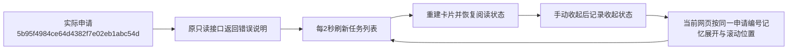

# 任务说明自动刷新保持展开

2026-10-27，用户反馈点击任务卡“查看任务说明”后，几秒内自动收起。原因是采集页面每两秒查询任务并重建历史卡片，原details节点被移除，新节点默认关闭；不是用户点击或任务停止引起。

刷新重建前按采集申请编号记忆说明的展开状态和内部滚动位置，再将其恢复到同一任务的新节点；原焦点位于说明摘要时恢复键盘焦点且不额外滚动页面。手动收起后继续保持收起，不同任务不会串用状态。翻页、切换状态再返回仍保留当前网页内的阅读状态；整页重新打开回到默认收起，不增加数据库、接口、文件或浏览器持久状态。

原错误文本、自动刷新、分页、状态筛选、启动/停止/恢复等操作继续使用既有规则。原说明文本长短判断保持不变，不把错误说明改成成功，也不因阅读动作启动真实采集。

新增隔离浏览器回归覆盖：连续两次更新说明仍展开并保持内部阅读位置和焦点；手动收起后更新仍收起；不同任务默认独立、翻页返回及切换筛选后分别保留状态。修复前已用同一行为用例复现自动收起。验证日志位于workspace/output/reports/task_description_refresh_20261027/。

完整31项隔离网页用例通过。一次测试清理时出现Playwright异步路由取消提示，不影响用例结论；正式只读核对没有页面错误。Web已在原8000端口重启，并以截图对应实际申请`5b95f4984ce64d4382f7e02eb1abc54d`核对：展开后连续两次自动刷新仍展开，手动收起后连续两次刷新仍收起，原199字符错误说明未改变。正式核对脚本阻止所有POST及外部请求，不关闭或启动采集浏览器，不触发数据库结构或采集数据修改。

该流程仅在当前网页保存展示状态，数据库仍维护原申请与执行结论；读取任务说明不建立新任务、批次或文件关联。不改变原39项真实平台人工验收结论。
