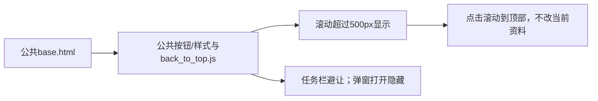

# 全站回顶部

2026-11-01，用户批准统一公共模板添加回顶部。

## 行为与实现

base.html只放置一次公共back_to_top宏和back_to_top.js，公共外观在form_controls.css维护。业务页面沿公共模板自动获得按钮，无逐页代码或后端接口。

- 页面滚动超过500px后在右下角显示“↑ 回顶部”，顶部和短页默认隐藏。手机保留44px触控面积，仅显示箭头，aria-label/title仍为回到顶部。
- 原生button支持键盘Enter/空格；点击平滑滚动至window顶部，保留水平位置、URL、页码、批次及筛选，不刷新或提交表单。焦点转至main且preventScroll，避免按钮隐藏后焦点丢失；减少动画偏好即时返回。
- 底部collection-task-bar显示或高度变化时按其实际顶边自动上移12px，空间不足暂隐藏；不改变任务栏。safe-area-inset-bottom保留安全间距。
- 原生dialog或popover打开时隐藏，关闭后按原滚动位置恢复。动态新增dialog、页面返回、窗口大小和任务栏变化均触发核对。
- passive滚动事件用requestAnimationFrame合并，不设定时器，不发网络请求，不改业务状态。公共按钮层级低于任务栏及弹窗。

## 验证

10项公共控件和相关页面单元检查通过。隔离浏览器1440/390/320覆盖七类页面唯一按钮与脚本、顶部/450px隐藏、900px显示、44px触控、移动文字隐藏、点击平滑到顶部/URL不变、动态dialog与原生popover隐藏恢复、任务栏120/200px高度避让、键盘操作/焦点及减少动画偏好。

实际本机工具箱、转换页、任务、日志、商品采集、AI设置、商品参数和详情长图页面三视口只读检查通过；长图等待本地图片加载后滚动，按钮显示且点击回顶部。正式POST 0，外站请求拦截。证据在workspace/output/reports/back_to_top。

Web已按项目专用启动器与子进程归属核实后重启原8000端口（启动器28436、监听29572），没有停止采集进程。本轮无DDL、表/字段/COMMENT/JSON变化，仍0019；按钮无网络操作，未触发采集或AI。

## 并行采集与数据核对

两库前后32表已记录。验证库完全一致。正式库在本轮存在运行中的Web采集申请/任务5f7279838dd24743ac1e536561982c5b（created_at=2026-11-01 19:52:49，name=collection.taobao.detail.open），采集过程持续追加评价、媒体和检查点及任务事件，不能宣称正式库全行指纹一致。

观测快照的正式库变化包括tasks 79→80、review_observations 904→954、media_references 3186→3261、collection_checkpoints 1564→1614、task_events 11996→12168、collection_plan_executions 28→29、collection_jobs 50→51，以及运行/步骤/批次/计划/队列状态的同数量更新；这些为当时观测值，运行中可能继续变化。没有恢复、删除或改写该任务数据；新按钮及浏览器检查不发送采集POST，不将采集结果计作按钮功能产物。

这里只改变浏览器界面。运行中的任务编号表示独立采集执行，非回顶部功能生成；回顶部不产生商品、批次、观察或文件身份。人工界面体验待用户确认。
