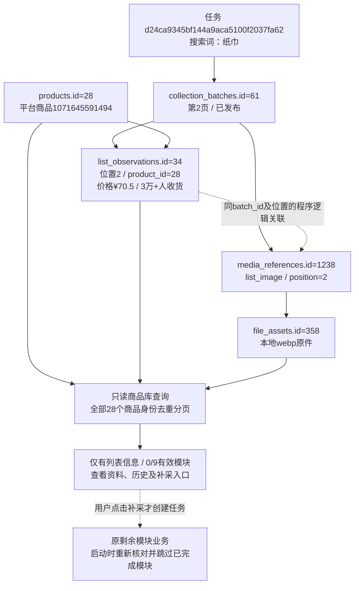

# 全部商品库与来源展示

2026-10-26，用户确认完整方案后执行。商品详情列表入口改为商品库，展示全部已登记淘宝商品；不自动启动真实采集。实现与本轮本地核对完成，等待用户查看。

## 范围与展示

沿用products中平台与平台商品编号的唯一身份，每个商品一行。仅有列表、仅有详情访问／运行、失败尝试或只有身份的商品均可显示并打开详情；无身份列表观察仍在搜索列表中独立保留，不按标题猜测归属。只扩大商品身份入口，未发布或隔离批次的内容仍不展示。原列表／批次API及旧browse_details查询含义保留，网页新入口使用独立browse_catalog查询，原网页地址可继续访问。

八列为商品、价格、销量、店铺／发货地、来源、详情资料、最近记录、操作。标题为商品身份显示缓存；价格、销量、店铺优先取同一条最近已发布列表观察，排序依据时间、批次ID和观察ID，不跨行补齐空值。没有列表观察时使用最近已完成基本信息批次的原文。每条价格及销量明确标注列表页／详情页与来源时间，详情区间或起价保留原文，不作为实际SKU价格。

商品来源分为仅搜索列表、仅详情采集或访问、两者都有、仅登记。关联搜索词来自全部已发布列表观察，归并空搜索词但不从标题推测；点击后限定搜索词及该商品查看原列表记录。筛选历史搜索词只筛商品，不改变最近列表快照。

资料分为仅登记、仅列表、详情已尝试但无有效资料、部分模块有效、九模块均有效；按当前有效分区及原完成状态计数，已确认无内容也算完成。最近详情运行及其原状态单独展示，即使最近失败，已有有效分区继续保留。查询派生分类不是新数据库状态。

最近记录从已发布列表、详情模块保存、详情入口、详情运行的事件时间中取最新值，不以某个来源存在就覆盖更新的来源。日期筛选按此列，开始日期包含、结束日期包含整天；仅登记且没有时间的商品置后，指定日期范围时不匹配。默认按时间倒序，支持标题、列表数值价格、已解析列表展示数量、当前显示店铺、有效模块数排序，未知值两个方向均置后，稳定ID作同值排序。20条分页在数据库执行；未将全部观察加载到内存排序。

销量区间包含上下限，留空不限，0不代替未知；详情基本信息尚无结构化销量字段，保留原文但不参与数值排序和区间筛选。复用现有列表五字段，不在查询中推断真实成交量或回填详情数量。

缩略图先取本商品已发布主图批次的本地原件，文件缺失或校验失败则尝试最近列表的同批次、同位置图片；没有可用图片明确提示。沿用站内文件校验和全站放大，不访问淘宝补图。

每行可查看资料、查看采集历史或直接补采未完成模块。补采绑定所点行商品，复用原剩余模块业务，在派发时重新校验完成分区与互斥；全站进度及人工弹窗沿用。结束后重新查询该商品计划更新按钮，整行资料刷新后读取最新结果。本轮浏览器测试模拟派发，不实际启动淘宝采集。

## 验证与真实数据

72项相关单元检查通过，覆盖全部身份、跨平台排除、暂存隔离、仅登记入口、同名不同商品、同条快照、历史搜索词、详情原文、日期比较、失败与有效资料分离、缺图回退、0与未知、区间边界、稳定分页及错误参数。17项既有浏览器回归通过，新增4项商品库浏览器交互通过：搜索追溯与返回、销量筛选排序及窄屏、多商品补采绑定及人工继续停止、来源和资料筛选重置。日志保留于workspace/output/reports/catalog_unit.log、catalog_browser.log及catalog_browser_final.log；最后一份为商品库四项最终复测，修复后的筛选控件具备明确可访问名称。

正式库快照中products累计28行，原详情活动列表查询11个商品；商品库查询28个商品，无重复，分页20＋8。其中17个仅有列表信息、4个部分模块有效、7个九模块均有效；本次正式数据没有仅登记或仅入口样本，这两类用隔离样例验证，不伪造正式记录。

Web自动重启后，以仅允许本机GET的独立浏览器核对28个商品及上述分类数量，页面均HTTP 200；零条分类显示真实空结果。实际商品1071645591494可从仅列表筛选进入详情，补采按钮显示剩余9项，未点击启动；来源链接显示该商品的1条原观察，返回保留来源筛选。图片本页放大及再次点击关闭通过。销量30000～30000实际匹配1件商品。截图catalog_all.png、catalog_list_only.png及逐项核对catalog_live.json保留在同目录。

前后19张业务表累计数量相同；15张商品、来源、运行、批次、有效指针、观察、媒体及文件表的全记录哈希一致。数据新增、修改、删除均为0，未修改字段值、数据库表结构、JSON存储结构或原状态；无需迁移。完整快照为catalog_before.json、catalog_after.json。验证期间写入的是本机报告、独立测试目录及Web服务管理记录，不写正式采集资料。

## 本轮真实关联

商品1071645591494对应products.id=28，只存在列表资料。任务d24ca9345bf144a9aca5100f2037fa62搜索“纸巾”，第2页批次61，商品位置2对应list_observations.id=34。其原文价格¥70.5、销量3万+人收货、结构化展示数量30000；列表图片引用media_references.id=1238，关联file_assets.id=358。该原件为output/raw/taobao_products/images/d24ca9345bf144a9aca5100f2037fa62-711dd44b/c38c1b5c918abd7ee55074c526b38564e4cc31c045cb4398ad031d40a547e354.webp。完整只读字段快照见catalog_source_example.json。

任务是一轮执行，批次是一页或一模块的结果；商品身份用平台编号和内部主键关联，不靠标题。观察保存某次出现的原文，媒体引用保存用途、来源及文件关联，文件表维护原件索引与校验。图中观察到列表图片为程序逻辑关联，并非新增外键。本轮仅读取该链，未新建图中任务或采集运行。
