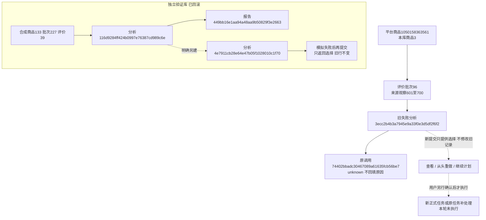

# 分析启动与错误反馈修复记录

2026-10-30。用户确认四部分方案后实施：任务选择、安全错误说明、提交反馈、离线验证与交付。已有数据不恢复、不修改；不运行真实AI复测。

## 已查明的行为

商品1050158363561、批次96的新V5任务3ecc2b4b3a7945e9a33f0e3d5df2f6f2于17:17创建，首次调用74402bbadc30467089a61635fcb56be7没有取得可确认结果，任务failed、提取0/100、未知调用1。17:21两次POST均返回202及同任务地址。原因是已有同指纹终态也默认复用，前端又无条件跳转；同时V5执行将安全的具体AIError覆盖成泛化未知提示，无法从现有记录还原首次故障原因。这不是按钮没有提交，也不能据此判断密钥、网络或余额的具体故障。

## 当前行为

| 同资料、规则及模型的任务状态 | 点击“开始分析”后 |
|---|---|
| 无已有任务 | 费用确认后新建并进入进度 |
| 活动任务 | 返回当前进度，不另发请求；即使强制另建也优先防重 |
| 成功 | 弹窗显示已有记录，可查看报告或明确全批重做 |
| 失败、部分完成、中断 | 弹窗显示状态，可查看、明确全批重做，或进入原任务剩余计划 |

终态选择响应HTTP200，包含choice_required/status/message/can_continue；新建和活动任务仍202。选择提示本身不派发进程、不请求AI。原repository产品行锁、指纹及活动任务唯一约束保留。费用与发送计划验证仍由统一service处理。

从头重新分析需要明确勾选再次计费，另建记录、重发当前批次全部评价；原记录保留。高级设置中的显式force选项也写明全量重发和计费。继续入口只跳转原任务#analysis-resume、展开剩余计划；原任务自己的费用、额度及未知请求风险确认仍须完成，链接不触发恢复或付费。

客户端只保留允许展示的固定错误说明及HTTP状态：参数、密钥、余额、权限、模型、频率和服务异常；连接失败与超时分开说明，不保存HTTP原正文、授权头、密钥或底层异常字符串。V5新调用的error和任务message/报告既有diagnostics保留该安全说明。原调用与旧错误不补写；调用用量仍未知时保守占用预留，不能从HTTP拒绝推断零费用。旧规则快照及执行分支不升级。

提交反馈放在按钮旁，与高级设置预算反馈分开。未勾费用时明确提示；请求期间按钮禁用，双击只派发一次。JSON异常/网络失败显示中文说明，不自动重试；提交结束后清除上一次force意图，结果丢失后再次点击先核对已有任务。

## 验证及数据保护

- 630项全量单元测试通过，含成功/失败/部分/中断选择、运行中防重、旧行不变、安全HTTP及网络错误、费用确认等。
- 独立MySQL真实事务通过：合成商品133、批次227、评价39；分析116d9284ff424b0997e76387cd989c6e，另建4e7911cb28e64e47b05f1028010c1f70；两次模拟AI、复核/归属约束及成功/失败选择检查，全部回滚。
- 桌面1440/手机390真实动态弹窗和本地API通过：未确认费用阻止、失败选择、不确认重做不派发、确认重做新ID、双击一次派发、活动复用、成功提示、部分继续只预览、错误在折叠外可见、丢响应后清除force、无横向溢出/脚本错误。全部使用临时SQLite、模拟launch，禁止调用AI。
- 既有V5阶段报告、人工复核、采用条件及导出的桌面/手机交互回归通过。
- 仅重启核实属于本项目的127.0.0.1:8000 Web，新确认片段、新脚本及原失败结果页GET200；没有正式POST或真实AI调用。

没有数据库结构、JSON形状或状态枚举变更，版本仍0016_review_pipeline。两库全部32业务表按主键排序计算全行SHA256，前后数量和内容均相同；验证库回滚后0业务行。原失败任务及旧98条提取任务原样保留。

| 正式库分析表 | 修改前 | 修改后 | 本轮业务新增/修改/删除 |
|---|---:|---:|---|
| analysis_tasks | 4 | 4 | 0/0/0 |
| analysis_sources | 400 | 400 | 0/0/0 |
| analysis_calls | 25 | 25 | 0/0/0 |
| analysis_details | 288 | 288 | 0/0/0 |
| analysis_reports | 5 | 5 | 0/0/0 |
| analysis_review_decisions | 0 | 0 | 0/0/0 |

平台商品号用于淘宝商品定位；本库商品主键关联采集批次；批次代表一次评价采集，观察是其中逐条记录。分析来源冻结观察，调用归属分析，明细关联来源与调用，报告和人工决定仍走既有外键。图中验证编号为本轮真实合成事务编号，已回滚，不是正式商品数据。

证据位于Git忽略的workspace/output/reports/analysis_start_fix/20261030/173059/：database-before/after、unit.log、mysql.json、browser-final、report-browser、formal-get及Web日志。没有新的正式模型response_id；实际AI错误原因需用户手动复测后才能进一步判断，不把模拟通过当真实接口已恢复。

## 复测方法

先Ctrl+F5刷新商品评价页，再打开“分析评价”，核对费用后点击“开始分析”。出现已有失败任务时，在选择区确认重新计费并点击“从头重新分析（再次计费）”。不要仅反复点击主提交按钮。若接口再次失败，查看新任务顶部具体原因，再据实定位；旧任务仍显示原来的泛化说明。
