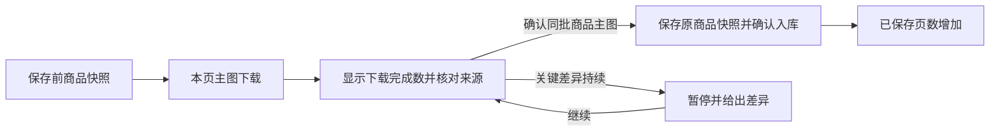

# 列表主图来源复核与保存进度

2026-11-16，用户确认调整淘宝列表下载后的核对和网页进度。真实任务 `ad1ae5866b4b4734958ecc51177f63b4` 搜索「猫包」时，第1页批次键为 `ad1ae5866b4b4734958ecc51177f63b4-af8deff0`，本地已下载46张主图，列表JSON和CSV尚未生成。08:48:16已收到继续，08:48:17仍因同一复核暂停。现场显示视频预览和榜单文字变化；旧日志不含具体字段差异，无法证明单个字段即为触发条件。

- 复核只比较原搜索条件和本次范围内商品编号、规格引用、商品顺序、静态主图地址。未知格子、商品身份不能核实或实际来源改变仍阻止保存；已知的调查、推荐词格子和上限外内容不作商品比较。发布内容始终取下载前的商品快照，不拼入后续展示字段。
- 首次出现暂时不一致时，间隔500毫秒只读复查，最多3次。不刷新、提交搜索或重下图片；已明确改词、换页或换排序时直接提示。人工继续按同一规则复核，提示及日志包含具体差异；无法恢复原列表时由用户停止并重新采集未保存页。
- 下载阶段记录本页成功、失败、无地址数量；列表阶段依次为待复核、等待保存确认、已保存。下载处理事件先于列表保存事件，已保存页数仍以批次入库为准。没有新增表、字段或迁移；现有余下页面、翻页和续采规则不变。[使用指南](../使用指南.md#列表主图下载)及[字段取值说明](../数据库字段取值说明.md#2026-11-16-下载后的列表来源复核)已同步。

图中显示修复后流程，不表示上述旧任务已恢复。本轮使用本地合成页面、下载替身和临时数据验证；不操作真实采集任务，不补写旧批次。

84项相关单元测试、33项淘宝列表／分页／网页进度的隔离浏览器回归通过。覆盖下载期间展示变化、短暂加载、真主图变化后的再次暂停和恢复、停止前不误算保存、网页弹窗刷新，以及多页保存边界。正式8000、测试8001的Web已重新启动，实际采集页均返回200，并核对已加载新版进度脚本。网页仅执行只读核对，未启动新采集，也未停止已有采集进程；已经运行的采集进程仍用其启动时加载的代码。
