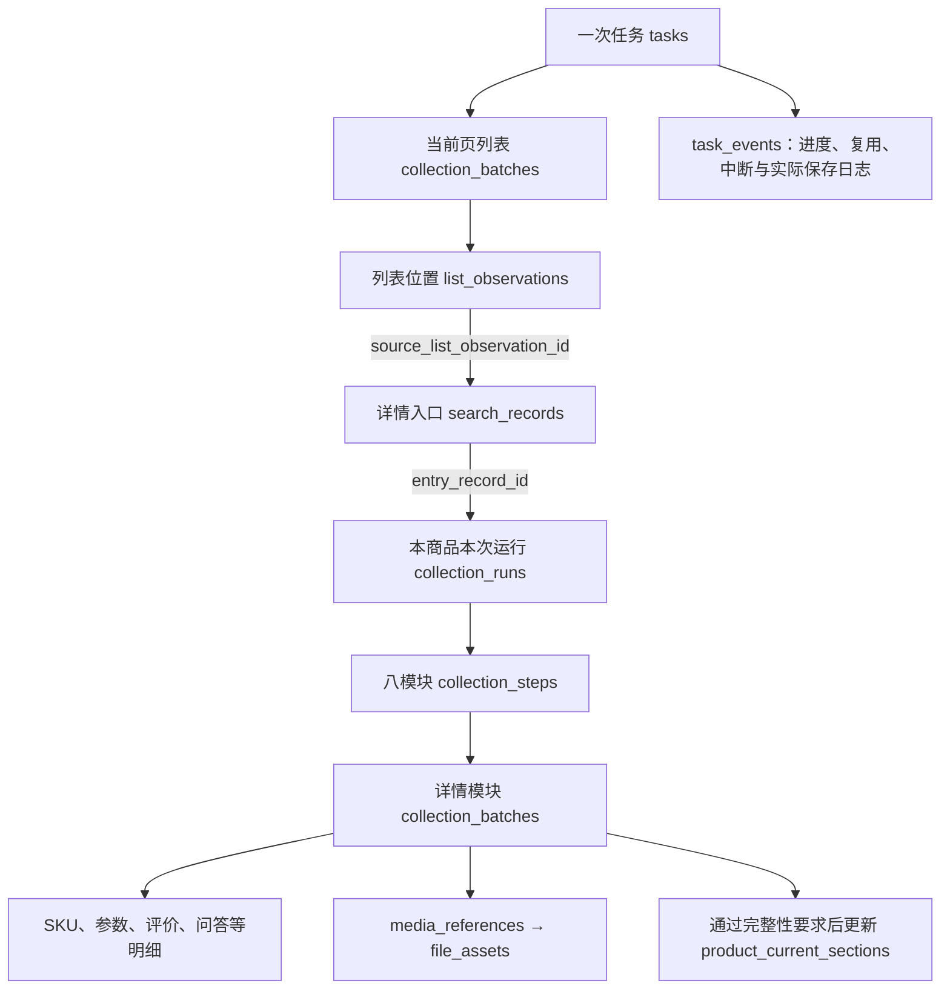

# 列表到详情采集接入记录

版本说明：本文保留当时的设计或验收快照；0005已移除历史导入表、字段和专用命令，旧数量及导入步骤不代表当前结构或可执行操作。当前规则见[字段取值说明](../数据库字段取值说明.md)及[精简记录](../变更记录/历史导入能力精简记录.md)。

日期：2026-10-24，北京时间。用户已确认接入方案并授权实施代码、数据库迁移、文档与本地验证；真实淘宝采集另行提交测试方案并等待确认。当前人工验收进度只在[功能逐项验收清单](../功能逐项验收清单.md)维护。

## 接入行为

```cmd
python main.py taobao collect --keyword "粘毛器" --page 3 --limit 3 --with-details
```

`--with-details`显式开启列表到详情流程。每页列表保存并确认入库后，按照保存位置串行打开商品标准详情链接，核对商品编号，复用现有默认八模块，保存完成后关闭本商品详情并返回搜索页，核对关键词、销量和页码，再处理下一个商品或翻页。未传该开关时保留现有列表采集行为。

评价默认最多100条、问题默认最多50个，每题页面可提供的回答不限。本轮不对列表命令开放`--all`或模块选择。广告入口使用已确认商品编号生成的标准地址，不跟随推广跳转。数据库已有商品在新任务中仍重新采集；同任务已成功或含允许继续警告的详情仅采一次，重复位置保留列表观察，并在统一事件与汇总中记录复用运行。

本次共用现有浏览器会话、锁和验证守卫；提取已打开详情页的公共采集流程，各商品的运行上下文、入口文件和截图分别保存。验证码、商品或来源不符、模块阻断时暂停，不自动跳过当前商品；已保存列表和模块保留。正常完成后保留搜索页供查看，`--no-wait`正常完成后关闭浏览器。

## 数据库结构与关联

新增迁移`0004_list_detail_entry`，冻结原0001至0003迁移和模型。两库均升级到23张表、285字段、51个外键；新增字段均有MySQL原生中文备注。

| 修改表 | 新字段 | 作用与规则 |
|---|---|---|
| search_records | source_list_observation_id | 可空BIGINT UNSIGNED，关联list_observations.id；只有详情入口可以有值，程序校验同任务、同商品及来源条件 |
| collection_runs | entry_record_id | 可空BIGINT UNSIGNED，关联search_records.id；程序要求detail_open入口且同任务同商品 |

新增两外键均更新/删除RESTRICT，分别有`ix_page_list_observation`、`ix_run_entry_record`索引；新增`ck_page_list_detail`检查约束。旧记录来源不明保持NULL，没有根据商品或时间相近推测回填。

下图表示新流程的关联结构，节点名称不是本次产生的真实采集编号：



持久原件使用`list_source`稳定批次键、商品顺序和平台商品号及`entry_key`解析当前库内部编号；历史导入按列表→入口→运行→模块批次排序。详情批次的现有搜索来源字段继承入口，覆盖范围及当前有效指针的规则保持原口径；不使用列表批次作为详情模块的派生父批次。新JSON与每个取值统一维护在[字段取值说明](../数据库字段取值说明.md#列表进入详情的来源与汇总口径2026-10-24)，物理外键和逻辑复用区别见[表关系说明](../数据库表关系说明.md#列表到详情的新增物理关联0004)。

## 本地验证与迁移证据

本地验证使用临时资料、全部请求被拦截的网页夹具和独立验证库。浏览器检查覆盖两页四处展示、三个独立商品、八模块调度、跨页重复复用、搜索现场保留、中途停止和返回搜索条件变化；模块内容由本地替身隔离，不能当真实八模块采集结果。另用现有参数模块本地用例验证独立入口，并补充正常关闭保留窗口后仍成功收尾的回归检查。验证库使用实际持久流水核对两商品入口、运行、参数及来源上下文隔离，并检查来源冲突拒绝、旧记录兼容、外键与CHECK限制。

迁移在空验证库模拟首列创建后中断，确认旧版本保留、已提交DDL可识别，重入补齐后原生结构一致；重复升级通过。随后在正式库持有两平台资源锁升级并重复执行，核对原业务记录、时间、原件及旧迁移校验值不变。

- [执行前两库完整快照](../../workspace/output/reports/search_details_20261024/before.json)
- [迁移后两库快照](../../workspace/output/reports/search_details_20261024/after.json)、[全部验证结束后的两库最终快照](../../workspace/output/reports/search_details_20261024/final.json)
- [原记录与结构独立核对](../../workspace/output/reports/search_details_20261024/final_audit.json)
- [246项离线检查日志](../../workspace/output/reports/search_details_20261024/unit_tests.log)
- [数据库集成检查日志](../../workspace/output/reports/search_details_20261024/mysql_tests.log)、[最终来源校验复核](../../workspace/output/reports/search_details_20261024/mysql_final.log)
- [本地浏览器检查日志](../../workspace/output/reports/search_details_20261024/browser_tests_retry.log)、[最终协作与原参数入口复核](../../workspace/output/reports/search_details_20261024/browser_close_final.log)
- [DDL中断与重复迁移检查](../../workspace/output/reports/search_details_20261024/migration_tests.log)、[0001至0004迁移链兼容复核](../../workspace/output/reports/search_details_20261024/migration_compatibility.log)
- [正式库升级结果](../../workspace/output/reports/search_details_20261024/formal_upgrade.log)、[正式库重复升级结果](../../workspace/output/reports/search_details_20261024/formal_upgrade_repeat.log)

正式库本轮没有新增、修改或删除采集业务内容：仍为15任务、1373事件、16商品、17批次、22列表观察、4详情运行、5页面入口、110文件索引、291媒体引用。原有5条页面记录的新来源字段、4条运行的新入口字段均为NULL；版本记录从0003推进至0004。验证库合成业务数据均回滚或按测试归属清理，最终22张业务表为0条。共246项离线检查、18项数据库集成检查（另1项需浏览器的用例在该组跳过）、18项不同的本地浏览器检查及3项迁移链兼容检查通过；重复复核不累加为新用例。

## 下一轮真实测试边界

接入完成不等于真实业务人工通过。下一轮建议先规划1页1商品、默认八模块，明确关键词、数据基线、浏览器查看方式及异常处理后由用户确认，再启动。届时提供实际任务/批次/商品/观察/入口/运行编号、逐表增量、字段前后值、只读SQL及真实流转图；本记录中的本地模拟不替代该轮验收。
