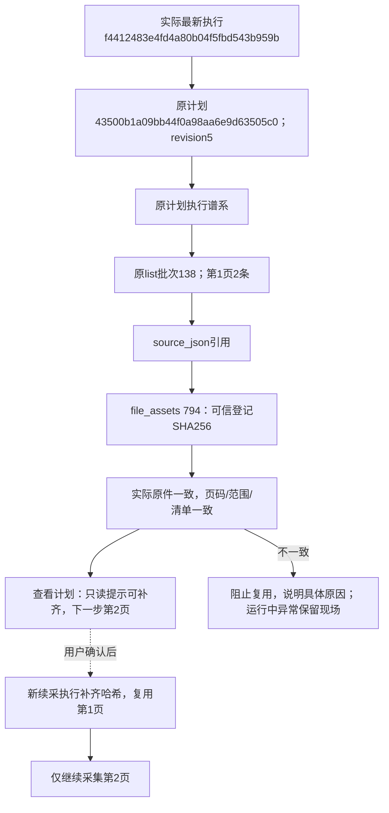

# 列表续采检查点与人工处理现场修复

2026-10-27，用户确认修复列表续采误报原件变化、需要人工处理却关闭窗口的问题。修改范围为检查点生成与复用核验、旧数据兼容、窗口生命周期、进度提示、文档和隔离验证；真实续采由用户手动触发。

## 真实故障

计划43500b1a09bb44f0a98aa6e9d63505c0要求“手机壳、2页、每页2条”。第1页批次138、source_json文件登记794及原件均在，原件SHA256与登记一致。原执行事件证明：15:22:02的collection快照revision=2含json_sha256；15:22:03的recovery更新revision=3被不完整页面返回值覆盖，丢失该字段。

随后22f444162f424ff4bcd9fc462415f44c和f4412483e4fd4a80b04f5fbd543b959b两次续采将实际文件哈希与NULL比较，误报“已保存列表原件缺失或变化”。该异常直接抛出NeedsAttention且guard.failure为空，原包装器未进入保留现场分支，原生Chrome的finally清理关闭窗口，最终任务done=true、needs_attention。

## 修复

- 页描述由list_checkpoint统一生成，capture_list与采集返回值都保留json_sha256；页读取和更新均核验批次、原件登记、文件及商品清单，不再盲目覆盖完整描述。
- 兼容旧缺失哈希时，必须以原计划执行谱系内的原批次及source_json登记为依据；原件字节一次读取，哈希与JSON解析使用同一份数据。核对范围、归属、路径、哈希、数量和商品清单后才补齐。已有错误哈希、真实缺文件/内容变化或登记不可信都拒绝。
- 恢复预览只读核验，提示缺少校验值但可在续采时补齐；补齐由新执行走原持久流水，记录WARNING事件。旧计划在本轮交付时不直接修改，旧失败结果和原件保留。
- 可见浏览器中的业务NeedsAttention即使未设置guard.failure，也进入现有hold_without_input保留现场流程。可现场继续的验证仍走原反馈；已中断的数据异常仅保留现场，停止/关窗后再续采，没有绕过核验的继续。
- 任务卡分开显示原计划累计保存页/记录和本次执行处理页数；预览展示下一页与待补齐说明。前置核验就失败时拒绝启动，不先开窗口再关闭。

不新增表、列、迁移或外键，0001～0009和冻结模型不变。新增计算字段plan_progress/page_checks和开放日志事件口径已同步字段取值说明。

图中任务/计划/批次/文件编号均来自真实故障记录；新续采分支由隔离样例验证，并不表示本轮实际操作了淘宝。预览、数据比较和正式页面核对均不启动真实采集。验证报告位于workspace/output/reports/list_resume_integrity_20261027/，不改变原39项真实平台人工验收结论。

## 验证与交付

- 468项完整单元、38项MySQL、60项隔离页面/列表提取、4项临时原生Chrome验证通过，共570项；最后调整为同一份原件字节完成哈希及解析后，12项恢复MySQL专项再次通过。
- 停止/续采完整链分别覆盖正常检查点和旧缺哈希检查点：只采剩余第2页，第1页沿用原批次，无重复入库；旧值在新执行补齐并记录WARNING，原停止任务不改写。缺原件、篡改内容、跨计划、范围/路径/清单不一致均拒绝。
- 临时Chrome验证业务NeedsAttention在guard.failure为空时保留窗口，收到合成明确停止才关闭；无真实登录、平台访问或淘宝采集。前期测试清理遇到标题来源外键，已修正用例清理顺序，验证库25张业务表最终均为空。
- 已核验本项目进程归属，仅重启原8000端口Web，未停止采集工作进程。浏览器技能缺少运行依赖，正式页面改用项目现有Playwright工具；仅允许本机GET，拒绝写请求及外网。桌面、手机页面和恢复弹窗均通过，无脚本错误、无写请求。
- 正式最新任务f4412483e4fd4a80b04f5fbd543b959b仍为已结束的needs_attention，显示原计划1/2页、累计2条、本轮0/2页。只读恢复预览revision=5、page_checks第1页needs_hash_repair=true、下一步第2页；仅打开预览，未点击“按此计划继续”。
- 正式库25张业务表数量、申请版本/状态、队列状态、任务结论及完成时间与基线一致；全部计划内容及原件哈希、登录文件大小/哈希/修改时间均一致。旧计划仍缺哈希，真正补齐留给用户手动续采时执行。

正式页面截图：workspace/output/reports/list_resume_integrity_20261027/production_desktop.png、production_mobile.png；接口结果production_ui.json；比对证据before.json/after.json、plan_before.json/plan_after.json。运行资料不提交Git；本地提交代码、测试与文档，不推送远程。
