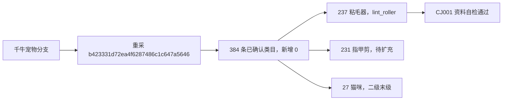

# 千牛发布类目管理

2026-11-06 在自动验证库验收宠物分支。Web 路径为「我的商品 → 发布类目管理」，上架入口仍为「我的商品 → 商品策划与上架」。迁移 0027 新增类目目录、采集批次和管理菜单。

发品页实测需要先进入「搜索发品」，再打开「选择类目」。页面有独立滚动列，右箭头表示还能下钻。宠物分支实际最深四级。首轮抽查及三次采集均未从类目行读到稳定平台 ID，当前宠物数据按完整路径识别。

| 验证批次 | 结果 |
|---|---|
| `6155ef81f3de4cf1b208a19d8ebd2786` | 初次读取 329 项，发现 6 个三级项还有下级，保留已确认分支 |
| `39e12b3b92f5461b8f0ff81917f4c770` | 完整读到 384 项和 38 个父级栏目。补采新增 55 项，失败、待核对、不可见均为 0 |
| `b423331d72ea4f6287486c1c647a5646` | 再次完整读到 384 项，新增、路径变化、不可见、失败均为 0 |

实测一级 1 项、二级 33 项、三级 301 项、四级 49 项。「猫咪」本地编号 27，为二级末级。「指甲剪」编号 231，为三级末级，待扩充。「粘毛器」编号 237，为三级末级，绑定 `lint_roller`。编号属于自动验证库。

验证库网页已核对目录、搜索、CSV 和上架选择器，桌面 1440 像素与手机 390 像素宽度通过。指甲剪请求及方案处于待复核时的已导入请求均被阻止。854 项全量单元测试及最终 4 项类目合并专项通过。

CJ001 的 36 个资料文件自检通过，导入编号 `e33cee720c3f4e8cabe30a28260fcf6c`。实际千牛任务 `e6609d37051f46e7aba7766aa122b70b` 已填完，浏览器停在人工核对状态。自检显示两张 SKU 图的文件名与规格名不匹配，填写回执显示店铺分类「测试无」没有同名选项。真实入仓须核对当次商品填写内容，自动验证环境禁止入仓。正式库升级和全量扫描留待验收后执行。
