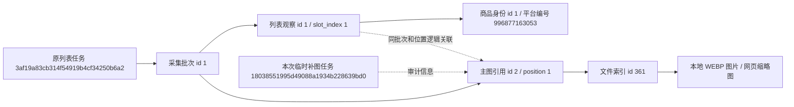

# 历史列表图片一次性补充记录

执行日期：2026-10-25。本轮按用户确认的方案补充所有已发布列表中缺失的主图，不重新搜索或采集商品；没有新增长期补下载入口。

## 本次结果

- 补充任务：`18038551995d49088a1934b228639bd0`，名称`maintenance.list_images.once`，结果`succeeded`。
- 补齐图片引用 30 条，失败 0 条，无地址 0 条；跳过原有有效图片 4 条。
- 新增本地文件及索引 24 个，相同内容共享文件，各批次和商品位置仍独立引用。
- 不修改数据库结构。原商品身份、列表观察、标题、价格、原采集时间、批次、原始JSON/CSV，以及原任务、原事件、原文件索引均通过前后快照核对保持不变。

| 表 | 执行前累计 | 执行后累计 | 本次新增 | 本次更新 | 本次删除 |
|---|---:|---:|---:|---:|---:|
| tasks | 18 | 19 | 1 | 0 | 0 |
| products | 28 | 28 | 0 | 0 | 0 |
| collection_runs | 10 | 10 | 0 | 0 | 0 |
| collection_steps | 80 | 80 | 0 | 0 | 0 |
| collection_batches | 61 | 61 | 0 | 0 | 0 |
| product_current_sections | 45 | 45 | 0 | 0 | 0 |
| search_records | 11 | 11 | 0 | 0 | 0 |
| list_observations | 34 | 34 | 0 | 0 | 0 |
| sku_observations | 92 | 92 | 0 | 0 | 0 |
| parameter_observations | 59 | 59 | 0 | 0 | 0 |
| review_summaries | 5 | 5 | 0 | 0 | 0 |
| review_observations | 500 | 500 | 0 | 0 | 0 |
| question_observations | 146 | 146 | 0 | 0 | 0 |
| answer_observations | 1002 | 1002 | 0 | 0 | 0 |
| file_assets | 360 | 384 | 24 | 0 | 0 |
| media_references | 1240 | 1240 | 0 | 30 | 0 |
| collection_checkpoints | 732 | 732 | 0 | 0 | 0 |
| task_events | 5000 | 5062 | 62 | 0 | 0 |

tasks新增1条为本次执行，task_events新增62条为开始、逐项图片关联确认、进度及结束记录，不代表重新采集了商品。media_references数量不变，30条原图片引用的file_asset_id由NULL补为对应文件编号，download_status从link_only变为downloaded，payload增加backfill（本次任务号、处理时间、文件元数据）；原payload键及原归属保持不变。

## 真实记录关联示例

以下编号均取自本次正式库核对结果：

- 原列表任务：`3af19a83cb314f54919b4cf34250b6a2`。
- 原列表采集批次：内部编号`1`，源批次键`3af19a83cb314f54919b4cf34250b6a2-694d54a9`。
- 商品平台编号`996877163053`，数据库商品身份`products.id=1`。
- 商品观察`list_observations.id=1`，属于批次1，原格子位置slot_index=1。
- 主图引用`media_references.id=2`，batch_id=1、position=1，与该观察按批次和位置逻辑匹配；原file_asset_id=NULL、download_status=link_only。
- 本次补充后file_asset_id=361、download_status=downloaded，指向file_assets.id=361。
- 正式文件：`output/raw/taobao_products/supplement/18038551995d49088a1934b228639bd0/43d1f51e88a2275828556fca46a5da90d244638fe8dd9d9dc22e344846857d7c.webp`。

任务代表一次执行；采集批次代表原列表页快照；平台商品编号代表淘宝商品，数据库商品身份是内部关联编号；列表观察代表商品某次出现在列表的位置和当时字段；文件索引登记实际下载图片的位置和校验值。图片与列表观察通过批次和位置关联，没有新增列表观察外键。本次补图任务不替代原采集任务。

## 网页与文件核对

- 四个搜索词范围（猫抓板、粘毛器、纸巾、羽毛球），商品汇总和全部采集记录及其分页/排序链接共检查 61 个页面，图片访问检查 450 次，均返回成功，未出现缺图占位提示。
- 使用Flask测试客户端核对页面结构、图片来源和受限文件响应，不将其表述为人工视觉验收。
- 本次事件流水全部确认入库；临时处理代码可安全删除，不留待补写操作。

## 结果留存

执行数据目录：`workspace/output/reports/list_image_supplement/once-06eed2df485b46ed9a232d7fe26514cf`。

before.json、after.json保存前后字段快照；verification.json包含结构、原记录和原文件核对、30条图片引用字段前后值及24个新增文件；web_verification.json保存网页检查数量及真实关联示例；summary.json和逐引用JSON保存成功/失败详情。正式图片及上述执行数据保留；临时脚本已删除，原历史补下载两个专用模块及其缓存已移除，正式图片目录无.part残留。

历史地址在本次执行时返回的内容已本地保存，处理时间单独登记，不宣称等同于原采集时已归档的图片。

本机预览已刷新，健康页、粘毛器商品页和本次文件361的实际HTTP访问均返回200；文件361返回image/webp，80,464字节。
