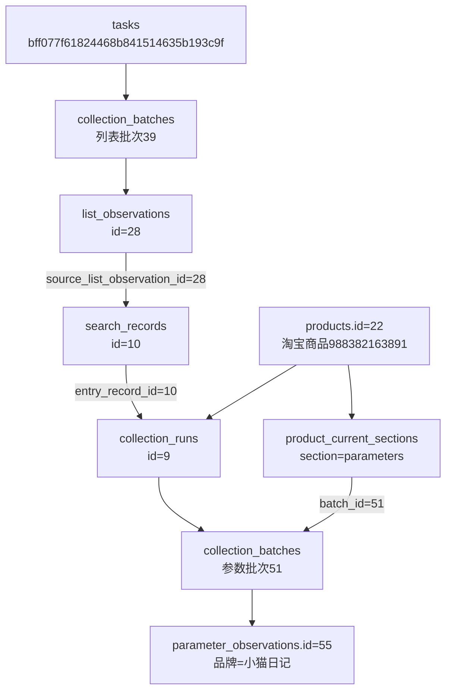
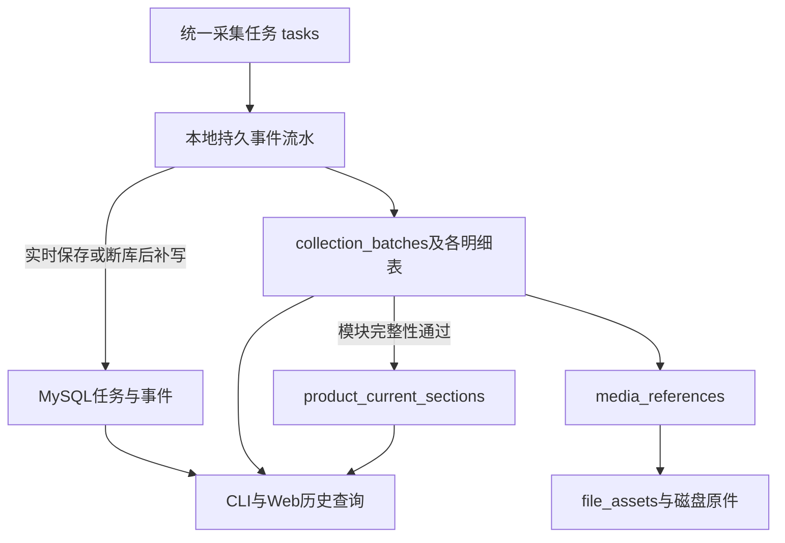

# 历史导入能力精简记录

日期：2026-10-24。用户已确认移除历史导入能力，保留实时采集、数据库历史查询、原始文件和持久流水补写。本轮不进行真实淘宝采集，不变更原39项人工验收结论。

已完成：正式库和验证库均为0005_remove_history_import；正式库于2026-10-24 21:05:37（北京时间）完成升级和重复升级核对。只读数据、原件、备注与查询核对通过，未启动真实淘宝采集。

## 范围

- 新版本0005_remove_history_import删除import_issues、import_row_mappings、import_sources、import_runs。
- tasks、task_events、search_records、collection_runs、collection_batches删除import_run_id及其外键。
- 移除database import-task-history、database import-collection-history及导入专用代码；双平台升级资源锁移至公共任务锁模块。
- 保留0001～0004迁移与模型，运行时使用schema_v5；正常查询不再依赖导入状态。
- 模块完整性、当前有效分区、标题来源、媒体引用、北京时间、实时快照与事件幂等补写沿用原规则。

## 数据基线

用户采集中曾暂停本轮，关闭浏览器后重新记录最新基线，采用resumed_before.json；更早的before.json仅记录暂停前状态，不用于迁移前后对比。

最新正式库基线：17任务、4938事件、24商品、59批次、10运行、80步骤、45当前有效分区、11页面记录、30列表观察、92SKU、59参数、5评价概览、500评价、146问题、1002回答、352文件索引、1232媒体引用、732检查点。四张导入表均0，五个导入归属字段均NULL；验证库业务表全空。活动任务0、待补写流水0；603份已有原件记录了SHA-256。

## 迁移与验证

迁移拒绝尚未结束的任务、非空导入表、非空导入归属和陌生外键依赖。所有安全检查先于首个DDL；仅删除空表和已确认无关联的字段。MySQL DDL分步提交，中断时保留旧版本号，允许核对现存对象后重试；不支持自动恢复退役功能的降级。

验证顺序：独立库的拦截、故障注入、重试和全链建库 → 实时入库/查询/补写回归 → 正式库迁移 → 数据、文件与结构只读核对。

两库结构均从23表/285字段/51外键变为19表/245字段/42外键；19表含18张业务表和alembic_version。原生中文备注全部保留，schema_errors=[]。正式库保留字段的物理顺序不变；验证库的旧版兼容演练重建过空表，collection_batches的列顺序与演练前不同，字段定义、约束和备注均与当前模型一致。

正式库18张业务表逐字段对比通过：只排除获批删除的五个NULL列，没有新增、修改或删除任何业务记录。仅alembic_version的单一版本值由0004推进到0005。603份原件SHA-256全部一致，9份冻结模型/迁移文件校验一致，验证库业务记录清理为0，活动任务与待补写流水均为0。详细证据见[逐表核对](../../workspace/output/reports/remove_history_import_20261024/audit.json)、[正式升级记录](../../workspace/output/reports/remove_history_import_20261024/formal_upgrade.json)和[前后快照](../../workspace/output/reports/remove_history_import_20261024/after.json)。

验证结果：

- 246项离线用例通过，含模型精简边界、命令退役和双平台锁。
- 4项精简迁移演练和3项旧版本迁移兼容演练通过，覆盖删列后/版本提交前故障、重试、重复升级、拒绝非空导入和活动任务，以及全链建库。
- 数据库回归26项全部覆盖：主套件25项通过、1项本地浏览器守卫另行启用后通过；包括真实持久流水入库、提交回执丢失后补写、并发事件、重采有效分区切换、部分结果保留、来源外键和问答归属。
- 本地模拟浏览器3项通过，仅拦截响应的测试页面；沙箱初次启动报EPERM后，在获准的沙箱外重跑通过。
- 独立基础验证16项检查全部通过，合成数据回滚。
- 正式库7个页面/接口返回200，4组CLI只读查询退出码0；真实来源链SQL核对通过，见[查询结果](../../workspace/output/reports/remove_history_import_20261024/smoke.json)。

## 一条保留的真实数据链

下面使用你本次已有数据，不是新采集或合成记录。任务为bff077f61824468b841514635b193c9f，商品内部编号22对应淘宝商品988382163891；参数批次51有11项，参数观察55为“品牌=小猫日记”。这些编号、值及关联在精简前后全部一致。

可直接核对[只读关联SQL](../../workspace/output/reports/remove_history_import_20261024/real_chain.sql)。来源不再经过导入表，仍通过列表观察、详情入口、运行、批次和明细的现有外键串联。

## 保留的数据流

“历史查询”表示查询已经采集入库的批次和明细，继续保留；“历史导入”表示扫描旧文件或SQLite再迁入数据库，已经退役。实时不可变快照供当前持久流水补写，不能因文件名含history就一并删除。

## 说明入口

[字段取值](../数据库字段取值说明.md)、[完整字典](../数据库字段字典.md)、[表关系](../数据库表关系说明.md)、[命令参考](../操作参考/命令参考.md)。旧表和字段仅作版本解释，见[退役功能说明](../历史记录/历史导入功能说明（0001至0004）.md)。本机证据目录为workspace/output/reports/remove_history_import_20261024，包含迁移前后快照与检查日志，不随代码分发。
