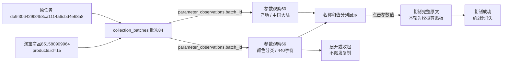

# 参数值点击复制

2026-10-25，用户明确执行：取消“复制参数值”按钮，改为点击参数值复制，并提示复制成功。

## 当前交互

商品参数页和参数批次明细共用此交互。非空参数值悬停显示“点击复制”，点击即可复制该行完整原文；键盘Tab定位后可按Enter或空格。页面底部显示“复制成功”，约2秒自动消失，短参数行不再保留按钮区的空白。

长参数继续默认3行，展开／收起按钮独立操作，不触发复制。复制包含折叠部分、换行和尾部空格，不包含参数名或反馈文字。手动拖选原文时不自动复制全文。NULL、空串和纯空白只显示“未采到参数值”，没有复制操作；“0”可正常复制。

优先使用浏览器剪贴板API，拒绝或不可用时尝试兼容复制，恢复原焦点、选区和滚动位置。两种方式均失败时显示“复制失败，请展开后手动选择复制”，约5秒消失。相邻行快速操作使用最新操作的反馈，避免较早完成的复制覆盖最新提示。没有新增业务请求。

## 验证

- 32项相关单元检查通过：名称和值分列、重复名称、空值与0、HTML转义、完整原文、排序、20条分页及其他资料展示。
- 5项参数隔离浏览器检查通过：点击原值、折叠时全文复制、换行和尾部空格、成功提示自动消失、展开独立、空值不可复制、0的键盘复制、兼容与失败提示、焦点恢复、跨页复制、手动选区不复制全文。
- 8项既有Web采集隔离浏览器检查通过，人工提示和相关资料展示交互正常。
- 所有复制验证使用模拟剪贴板，未覆盖用户系统剪贴板；隔离浏览器只访问本机服务，无淘宝操作。

单元日志：`workspace/output/reports/parameter_click_copy_unit_checks.log`。
浏览器日志：`workspace/output/reports/parameter_click_copy_browser_checks.log`（13项全部通过）。

## 真实资料只读核对

本轮核对时间2026-10-25 20:40:08（北京时间）。商品851580909964，内部商品products.id=15；原参数批次84，原任务db9f306429f8458ca1114a6cbd4e68a8，原采集时间2026-10-25 20:02:46。批次中的7条观察id=60～66均与页面全文一致。

参数观察60为“产地／中国大陆”，点击后模拟剪贴板取得“中国大陆”。观察66为“颜色分类”，完整值440字符：折叠高度约61.17像素，展开约122.34像素；折叠时复制仍与原值逐字符一致。提示自动消失，展开／收起未增加复制次数，页面无脚本错误。

平台商品编号用于识别淘宝商品，内部商品编号用于本库关联；任务是原采集执行，批次是该模块的一次采集结果，参数观察是批次中的具体记录。本轮仅沿既有关联读取，不创建任务、批次、观察或文件资产，不修改来源文件。

没有数据库结构或字段含义变更；业务数据新增0、修改0、删除0。核对前后19张业务表数量完全一致，7条原观察的完整快照SHA256均为`0132d3352edc12fbf08971f02f6a74ec08152acea4ff46a4ed96deba3f7a3178`。各表数量、编号、复制结果和页面检查详见`workspace/output/reports/parameter_click_copy_live_20261025.json`。

页面截图：`workspace/output/reports/parameter_click_copy_preview.png`。未重启用户原Web进程；重启原服务并刷新后可查看新交互，待用户人工确认。
