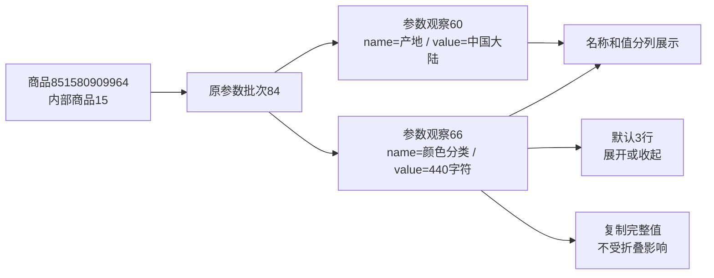

# 参数分列与完整值复制

2026-10-25，用户明确执行：参数名称与值分列，调整列宽，长内容展开/收起，复制参数值，明确空值并保留重复名称。

后续交互已调整为点击参数值本身复制，取消独立复制按钮，并短暂显示“复制成功”。当前方式和本轮证据见[参数值点击复制](参数值点击复制.md)；本文保留首次分列实现的验证记录。

## 展示与操作

商品参数页和参数批次页共用三列：顺序、参数名称、参数值。名称与值直接取已有parameter_observations.name/value，不拼接、不拆原文、不改采集逻辑。

名称列较窄，值列自动换行。页面按实际显示高度判断是否超过3行，仅长值显示“展开全部”；展开后按钮为“收起”。完整文字始终保留在页面中，脚本未运行时仍可阅读全值。窗口尺寸变化时重新判断未展开的值，已展开状态保留。

“复制参数值”只复制该行完整值，包括折叠部分、换行和尾部空格，不复制名称、按钮或反馈文字。优先使用浏览器剪贴板API；不可用或拒绝时尝试兼容复制，失败则显示手动复制提示。反馈只在真实成功时显示“已复制”，按钮操作完成后恢复可用及适当焦点。复制不新增页面弹窗或业务请求。

NULL、空字符串、纯空白显示“未采到参数值”，不提供复制；“0”保持原文并可复制。同名参数保留各行，不分组去重。顺序、名称、值排序及每页20条分页沿用原查询；整行悬停高亮保留。

## 本轮验证

- 32项相关单元检查通过，覆盖名称和值分离、重复名称、空值与0、HTML转义、长值原文、20条分页及其他资料页回归。
- 8项既有Web采集隔离浏览器检查通过。
- 4项参数浏览器检查最终全部通过：真实三行折叠与展开/收起、折叠时完整复制、换行及尾部空格、小值/空值/0、重复名称、HTML按文本展示、剪贴板拒绝后的兼容与失败提示、按钮焦点，以及排序翻页后复制。
- 首轮检查发现复制按钮暂时禁用会丢失焦点，已修复并复测；展开按钮的验证定位也调整为不随按钮文字改变。最终日志见parameter_display_browser_final.log。
- 剪贴板检查全部使用浏览器内替身，没有覆盖用户系统剪贴板；浏览器所有网络请求仅进入临时服务，不访问真实平台。

## 真实资料核对

商品851580909964（products.id=15），原参数批次84，原任务db9f306429f8458ca1114a6cbd4e68a8，实际观察时间2026-10-25 20:02:46（北京时间）。该批7条参数观察id=60至66。观察60的名称“产地”和值“中国大陆”分别显示；观察66的名称“颜色分类”，完整值440个字符。

在1600×1050隔离浏览器中，观察66折叠高度约61.17像素（3行），展开约122.34像素；收起恢复，模拟剪贴板取得的字符串与数据库原值逐字符一致。页面没有脚本异常。

平台商品号代表淘宝商品；内部商品号用于本库关联；批次代表原采集结果；参数观察代表该批具体参数。此次只读取既有name/value，不创建新任务或批次、不修改任何观察或原文件。

没有DDL，各表数量前后相同，原7条观察完整快照指纹前后相同。完整证据位于：

- `workspace/output/reports/parameter_display_live_20261025.json`：批次、参数编号、字符数、展开高度、模拟复制及各表数量。
- `workspace/output/reports/parameter_columns_preview.png`：真实7条参数的默认布局。
- `workspace/output/reports/parameter_display_unit_checks.log`：32项单元检查。
- `workspace/output/reports/parameter_display_browser_checks.log`：既有Web与首轮参数检查。
- `workspace/output/reports/parameter_display_browser_final.log`：4项参数最终通过记录。

未重启用户原Web进程。重启原服务并刷新后使用新页面，待用户查看确认；不替代人工验收。
