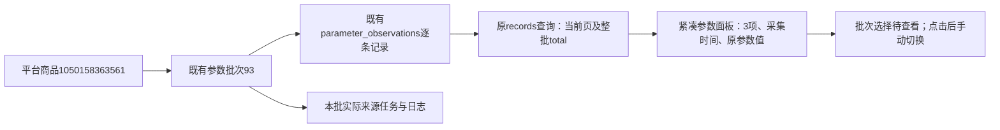

# 商品参数页整理

2026-11-01，用户确认整理商品参数页，不增加整批复制。

## 实现

专用product_parameters.html替代该模块通用标题/筛选/状态三块区域。单一紧凑面板顶部依次显示商品参数、整批项数、真实批次状态、更新/任务/日志、批次与时间和最近有效/历史/尝试标识。公共搜索批次框明确显示当前实际批次，选择后提示待查看，点击查看才切换；不继承页码或排序。更新继续复用公共确认窗口，不触发AI。

表格保留顺序、参数名称、参数值及原排序/20条分页，单页隐藏多余分页栏。标题项数使用当前批次detail.total，与当前页条数分开。桌面顺序列64px、名称适中、值占剩余；手机逐项排列名称和值，保留表头排序。默认按原始顺序，无去重、合并、推断或文本修正；无品牌、20撕等原文保留。空值沿原宏显示“未采到参数值”，零字符串不当空；长值继续原展开/收起和单项点击复制，未增加整批复制。

本批来源与采集说明默认折叠，包含状态/时间、实际来源task_id和范围说明；异常仍直接显示。no_parameters明确提示“本次未发现商品参数”，部分/失败空明细显示“本批没有已保存的参数明细”，明细查询MySQL读错独立显示“参数资料读取失败”及只读重读入口，不伪装为0项或无参数。商品主查询读错继续原公共错误处理。

页面路由只读parameter_view派生标签/数量/选择项；查询仅在parameters模块显式parameter_batch时固定kind=parameters/question_id=None，防止遗留查询参数借读其他类型。未修改底层records查询默认契约、数据库表/字段/COMMENT、持久JSON或0019版本。basic_batch.js增加参数批次表单选择器，继续沿公共搜索下拉与form_controls外观。

## 验证

- 750项全量单元、15项相关检查通过。新增3项行为检查覆盖整批25项/20+5分页、同名保留、外部kind隔离、历史来源任务、具体选中批次、无内容/部分/读错区别。
- 隔离浏览器1440/390/320：24项整批计数、长值展开和完整复制（浏览器剪贴板替身，不动用户剪贴板）、公共搜索下拉实际选择、待查看时正文/原日志不变、明确查看后切换独立历史任务及整批数量、来源默认关闭、手机卡片和无横向溢出全部通过。
- 实际商品1050158363561参数批次93：三视口仅本机GET，3项为产地/中国大陆、品牌/无品牌、型号/20撕；更新按钮可用、来源默认关闭、无脚本错误、正式POST 0。桌面和320手机截图已目视核对，证据在workspace/output/reports/parameter_page。
- 两库32业务表前后行数与全行SHA一致，仍0019，无正式采集/AI、数据恢复或业务写入。Web按专用启动器身份核实后重启至原8000端口，启动器33912、监听28484，通过只读健康查询。

实际更新、长值复制的人工体验仍待用户确认。程序检查不代替实际采集验收。

平台商品编号标识商品，批次93标识这次模块快照，parameter_observations保留每一条参数观察；task_id关联实际采集执行。本轮只读取这些既有记录，隔离历史200/201/202仅用于测试，不代表正式产生新批次。
