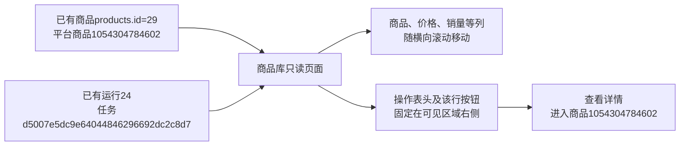

# 商品库操作列固定

2026-10-26，用户明确要求操作栏固定、其他列继续滑动后实施。仅修改商品库样式：操作表头及各行操作单元格固定在表格横向滚动区域右侧，初始位置即可查看详情、查看采集历史和补采。其他七列正常横向滚动，未固定整张表或影响其他页面。

固定区域采用不透明背景、左侧分隔和轻微阴影，保留整行悬停高亮；表头和行按钮层次分开，滚动文字不会透出或抢占按钮点击。商品库使用独立单元格边框以保持固定边界，不改字段、链接、查询、任务或数据库。

沿用并扩充现有商品库窄屏交互验证，未新建仅检查CSS声明的测试。5项相关浏览器检查通过：固定列场景最终复测通过，其余4项初轮通过。实际检查390、900、1320、2048像素宽度，在横向滚动开头、中间和末尾，表头与每行操作右边界均保持在容器可见右侧；其他列仍实际位移，悬停背景一致，滚动后点击按钮进入正确商品。日志为workspace/output/reports/catalog_sticky_browser.log及catalog_sticky_browser_final.log。

核对原Web进程归属和启动时间后自动重启，保持127.0.0.1:8000。真实1280像素页面只允许本机GET：商品1054304784602（products.id=29）的操作区域，在三种滚动位置右边界均为1237像素；“查看详情”按钮可见且实际命中，普通列横移200像素，按钮进入该商品。初始和中间截图catalog_sticky_initial.png、catalog_sticky_middle.png及结果catalog_sticky_live.json保留在同目录。没有点击补采或发起真实采集。

前后19张业务表累计数量相同，15张采集资料及来源表全记录哈希一致；数据库新增、修改、删除均为0。基线仍为29个商品，未修改表结构、字段取值、JSON或文件原件。完整时点和对照见catalog_sticky_before.json、catalog_sticky_after.json、catalog_sticky_compare.json。

商品身份、任务及运行均为既有记录，分别表示商品、一次执行和该商品一次模块运行；本轮只改变显示布局，没有更改这些关联。实现与本地验证完成，等待用户查看，不代替人工验收。
