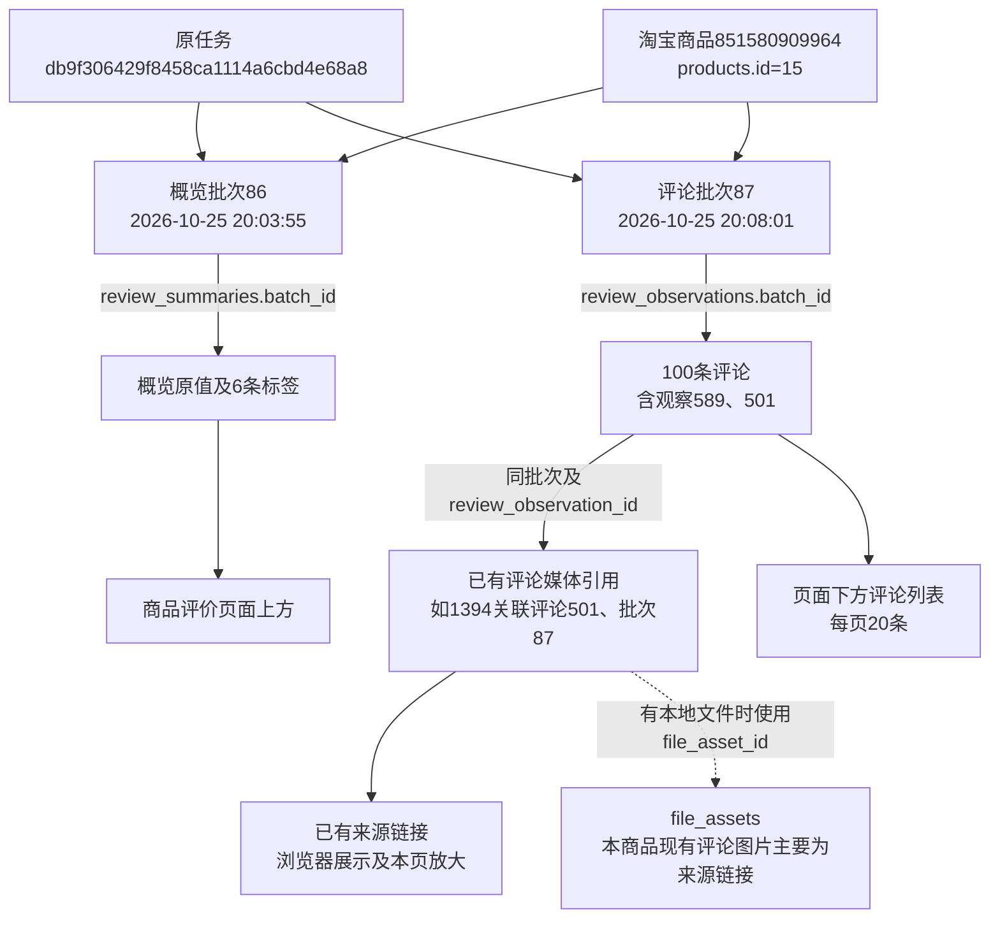

# 商品评价合并展示

2026-10-25，用户最终确认并执行第一版展示方案，补充概览四列信息。合并商品页的“评价概览／评价明细”页签为“商品评价”，不扩展关键词、日期、媒体筛选或统计功能。

2026-10-26后续调整：评价标签已改为浅橙色圆角样式、全部展示，取消标签表格、排序和分页。当前交互见[评价标签圆角展示](评价标签圆角展示.md)，本文保留首次合并的验证记录。

## 展示及来源

页面上方是评价概览：评价总数、好评率、好评率统计周期、概览采集时间；之后按“顺序／评价标签／数量”逐行展示标签。总数保留1万+等原文，百分比来自positive_rate_percent，周期来自period_raw，时间来自概览批次。标签名称取label，数量显示count_raw等已保存原文，排序使用已保存数值，缺失数量不当成0。

下方逐行展示“顺序／用户／评价内容／商品规格／评价时间”，并单独标明明细批次的采集时间和本批保存条数。评价时间使用date_raw展示、已保存payload.date排序，默认从新到旧，缺失置后并显示未记录，不使用采集时间补缺。长评论默认3行，可展开全文和收起。已有追评跟随原评论，不增加未采集的回复等信息。

概览标签、评论各自排序和20条页码分页，无下一页时禁用；两部分各自选择历史资料，不拼接多个批次。概览和明细仍是两个模块，CLI、任务及入库流程不变。明确列表来源的关联运行缺少某部分时，不用其他运行资料补齐；显式选择历史批次时说明来源差异。

已有图片、视频按media_references.batch_id及review_observation_id与本页评论同时匹配。追评媒体使用原payload.append_index定位，不以商品主图代替评论图片。优先使用校验通过的本地文件，否则显示已有来源链接；图片仅允许img.alicdn.com的HTTPS链接，视频仅允许cloud.video.taobao.com的HTTPS链接，页面媒体策略同步限定这两个来源。媒体加载失败明确提示，不下载、不回填媒体或索引。图片使用现有本页放大，关闭后恢复位置与焦点。

缺少有效资料时，各自提供“采集概览／采集明细”，沿用当前商品的原单模块派发和人工处理弹窗。已确认无评价与尚未采集分别提示，原商品页module=review_summary、module=reviews及batch入口继续可用。未修改通用独立批次页的展示结构。

## 本轮验证

- 39项相关单元检查通过，包含7项新评价检查及既有资料、参数、SKU图片回归。7项评价最终复核也通过。
- 19项既有隔离浏览器检查通过：Web采集、参数点击复制、全站图片预览。
- 4项新评价浏览器检查最终通过：指标及双列表、独立分页排序、全文展开与媒体、历史选择、当前商品单模块派发和人工弹窗。
- 首轮新浏览器检查对失败图片提示的定位包含了正常图片旁隐藏提示，已将检查定位到失败图片本身，4项复核全部通过；没有用此检查失败推断业务失败。
- 最终模板复核保留任务日志标记，避免后台任务刷新重复添加日志按钮。

隔离检查使用临时SQLite、合成媒体和模拟派发，不启动真实平台任务；真实资料核对仅执行本机GET和已保存媒体链接的GET。

日志位于workspace/output/reports：product_reviews_unit_checks.log、product_reviews_unit_final.log、product_reviews_browser_checks.log、product_reviews_browser_final.log。前一浏览器日志保留首轮定位失败，最终新检查结果以final日志为准。

## 真实资料核对

2026-10-25 21:09:44（北京时间），只读核对淘宝商品851580909964，内部商品products.id=15。原任务db9f306429f8458ca1114a6cbd4e68a8；概览批次86采集于20:03:55，评论批次87采集于20:08:01。

概览实际显示1万+、99.6%、近3个月及原采集时间；6条标签分别为使用体验很好22、商家服务好5、便利使用4、粘性很好2、可以下单1、能伸缩1。评论共100条，每页20条、共5页；首条按评价时间倒序为观察589，原位置89，评价日期原文2026年10月20日，评论全文与原记录一致。首屏5张已有来源图片均成功加载，真实图片本页放大、关闭已核对；末页20条，下一页禁用，概览仍显示6条标签。

平台编号识别淘宝商品；内部商品编号用于本库关联；任务是原采集执行；两个批次是两个模块的一次保存结果；评论观察是该批具体评论；媒体引用记录该评论的来源链接及可选文件资产，不表示已经下载。本轮沿用这些关联读取，没有创建新任务、批次、观察或媒体文件。

数据库结构和字段含义未改变；业务数据新增0、修改0、删除0，19张业务表数量前后一致。概览、全部100条评论、相关媒体和两份批次完整快照指纹前后均为cb0fb25b83314c18936d7a856f4d6cc2704046547916e57ce83ef0d7f777fbe2。

详细只读证据：workspace/output/reports/product_reviews_live_20261025.json，包含编号、概览原值、首条评论快照、各表数量及指纹。截图：product_reviews_preview.png、product_reviews_overview_preview.png、product_reviews_comments_preview.png。没有重启用户原Web进程；重启并刷新后供人工查看，不替代用户验收确认。
