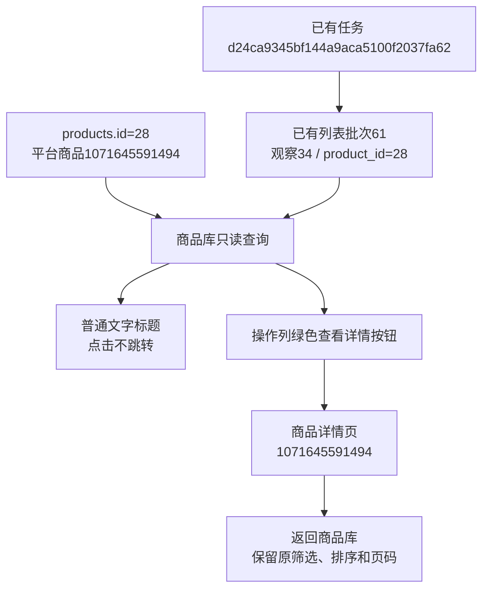

# 商品详情统一按钮入口

2026-10-26，用户确认执行后完成。商品库标题改为普通文字，原操作列绿色“查看资料”按钮改为“查看详情”，继续打开对应商品详情。查询规则、来源判定、数据库、图片放大和补采业务不变。固定操作列、标题悬停提示是后续建议，本轮没有实施。

调整仅涉及商品库模板和标题布局选择器。详情按钮沿用原商品路由及return_to，返回保留筛选、排序、页码；标题不再包含详情链接。商品图片仍独立链接原件，沿用本页放大。

8项相关单元检查、5项现有商品库隔离浏览器检查通过，日志为workspace/output/reports/catalog_title_unit.log、catalog_title_browser.log。没有新写低价值的独立测试；在原导航验证中核对标题无详情链接、操作按钮和返回排序。

自动核对归属后重启Web，原本机8000端口保持。对真实商品1071645591494（products.id=28）仅允许本机GET验证：点击标题不跳转，点击图片放大并再次点击恢复，绿色按钮进入正确商品，返回后完整保留keyword、origin=list、sort=sales、order=desc、page=1。截图catalog_title_live.png及逐项结果catalog_title_live.json保留在同目录。

本轮基线29个商品，前后19张业务表数量一致，15张来源与采集资料表全记录哈希一致；数据库新增、修改、删除均为0，没有表结构或字段取值变更。快照catalog_title_before.json、catalog_title_after.json及catalog_title_compare.json保留完整核对时点。

图中任务、批次和观察均为本轮读取的已有来源；任务是一轮采集执行，批次61是一页列表结果，观察34保存该商品当次展示，product_id关联商品身份。本轮只改变入口呈现，没有新建采集任务，也没有改写这些关联。完整源链沿用商品库实施记录。本轮实现完成，等待用户查看，不代表用户已验收。
