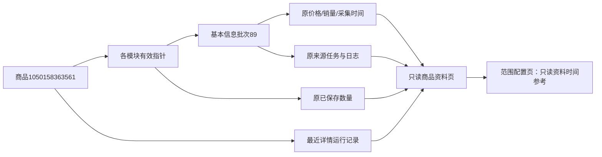

# 商品资料页整理

2026-10-31用户批准整理商品资料页，并补充状态、数量、复制、来源及采集范围选择的显示优化。

## 显示和操作

页头商品索引标题最多两行，长标题可展开/收起，复制使用完整原文。ID可复制，剪贴板拒绝时明确提示手动复制；无脚本时完整标题可读。店铺、ID与操作分区，淘宝外链保留安全属性。补采规则不变；无待补模块改为“所选模块无需补采”，避免把有效资料、确认无内容或无入口误解为平台全量已采完。

已有资料覆盖9模块与最近详情运行独立展示：历史资料齐全不等于最近运行完成。最近运行沿数据库记录显示状态/时间，不依据资料数量推断任务成功，任务与历史入口保留。搜索来源及关联运行说明折叠，手动切到其他运行批次的警告仍直接显示。

导航数量复用已有record_counts，默认取当前有效指针资料，搜索上下文只取关联运行；不跨运行填补缺失。媒体计已保存引用，评价计原评价而非追评，问大家计问题而非回答。确认无内容、无入口、异常、未采分别显示，缺失不伪装为零。导航注明默认范围，历史批次以模块内实际范围为准；鼠标提示带批次/时间。

基本信息以价格原文、销量原文、信息采集时间三卡排列，保留优惠前/起等限定，不作实时成交价。完整详情标题、店铺、来源批次、拆分来源说明、列表参考及模块概况按需展开。原列表观察不替代详情，索引标题不替代详情标题。正常采集成功后的长消息收在“采集详情”，失败/暂停/待核实等仍完整可见；静态最近失败或部分结果也直接提示。

本批资料、日志始终绑定已读取基本信息批次的task_id。data-fixed-source仅阻止采集轮询改写这些入口；最近任务的真实状态继续更新；与原来源不同的任务日志提供独立入口，同任务不重复展示。新任务成功不自动将旧页面替换成新来源，可刷新后读取最新有效资料或打开采集历史。

重新采集复用原配置页，不引入自动提交。更新基本信息预选该模块；由已存在商品ID进入时补充每模块有效资料时间及较新尝试参考。更改商品输入立即隐藏旧参考，改回才恢复；陌生商品仍可配置，不伪造历史，参考读取失败明确说明，不当作零条。勾选已有资料仍新建批次并保留历史。

## 数据和验证

业务层product_view.module_summaries为纯读派生；没有数据库结构、备注、JSON持久语义、原稿、分析提示或收费规则变化。结构保持0019_question_analysis/schema_v19。

相关单元覆盖覆盖率与运行中并存、价格限定原文、已有来源固定、只读不写、旧有效资料与新失败并存、已确认空和缺失不同、关联运行隔离，以及配置参考读取失败/陌生商品。原评价标签导航断言适配数量徽标，原数据口径不变。

实际商品1050158363561只读核对：有效基本信息批次89，采集于2026-10-26 09:41:05，价格“优惠前 ￥3.35 起”、销量“已售10万+”；导航主图5、SKU5、评价100、问大家5均来自各自范围已保存记录。最近详情运行记录仍显示执行中，不将9/9资料覆盖当成运行完成。桌面1440与手机390/320核对复制完整值、标题、折叠、无横向溢出、原批次入口、模拟成功长消息折叠和失败直接显示、配置预选基本信息/改输入隐藏参考；无脚本展开来源可用。54项相关单元、新增tests/browser_product_overview.py隔离三视口回归、原问答及评价明细隔离三视口回归通过。新增回归固定验证超长标题完整复制、同来源日志不重复、新任务日志独立及失败不改原来源。证据在workspace/output/reports/product_overview及对应workspace日志，均不提交Git。

两库各32业务表前后完整行数/SHA256不变，0019保持；真实AI0、采集申请0、正式业务写入0。仅隐藏重启本项目8000端口Web，保留采集进程。用户Ctrl+F5查看，人工样式验收待确认。

图中是已保存资料的读取关系；没有创建新的采集、分析或报告数据。

## 补充修复：展开后的按钮文字颜色

用户反馈资料概况绿色按钮无文字。实际文字节点和链接均存在，ui-report-fold-body a的通用绿色覆盖了公共按钮的白色；按钮背景也为绿色。此前仅核对默认折叠，遗漏了展开后的计算颜色。

公共折叠正文与报告正文的普通链接选择器改为排除所有公共按钮类（button/ui-button/sa-button/sa-detail-btn/range-button/sa-reset/reset-link/sa-group-submit）。按钮保留原action-text、悬停/键盘焦点/禁用规则，普通文字链接继续绿色；没有通过全局白字或新增!important掩盖问题。只改公共CSS，不改按钮文案、URL、采集任务、数据库、AI或报告原稿。

新增tests/browser_fold_controls.py，用静态样例核对独立折叠及报告内折叠的主按钮、公共主按钮、次按钮、日志、禁用链接和普通链接。修复前明确复现预期白色rgb(255,255,255)却得到rgb(20,100,91)，修复后1440/390/320均通过。原tests/browser_product_overview.py增加展开概况后文字非空、实际白色、悬停和键盘focus-visible检查，三视口通过；范围配置断言先等待脚本初始化，避免未初始化即读取预选值。

实际商品1050158363561：展开后八个模块主按钮在1440/390/320均显示白字，悬停及键盘选中可读；首次进度初始化后原文案/链接核对一致。视频卡片截图已查看；仅允许本地GET/HEAD，未提交任何采集或AI请求。证据保存在workspace/output/reports/fold_buttons，修复前后日志为workspace/fold-buttons-*.log。仅隐藏重启本项目Web，数据库结构0019及业务规则不变，人工样式确认待用户查看。
