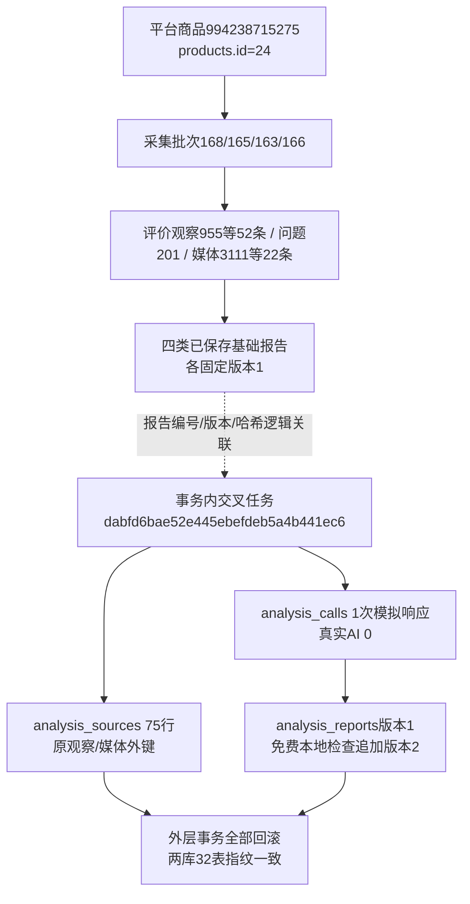

# 四类交叉分析实施记录

2026-11-03。用户确认最终方案后实施。原综合分析入口升级为交叉分析，旧综合/旧联合图片报告不再进入新页面，不删除、恢复、转换或迁移旧行。真实AI与淘宝采集均为0。

## 行为与代码

- `modules/cross_analysis`独立业务，kinds.py固定类别顺序及六种两类关系，三四类组合围绕议题综合；prompts/report.txt为公共及报告提示，group.txt为组稿提示。选择2～4类、每类一份，11种组合。
- store.py按采集时间优先、批次及报告保存时间读取具体版本候选（最近100份，可明确指定更早有效编号）；不让旧批后重查抢最新默认。缺失类别分别提示无采集/待分析/分析中；最新批无报告保留此前可用候选并提示。已结束可读主报告可带限制使用，只有组稿无主报告不接受。
- 文本相关原文复用原校验，评价编号加类别前缀；独立图片仅对应规则，固定已发布同商品/模块/角色与媒体快照。原图字节不重新发送，图片已有图号可定位不等于本次又看图。冻结input存正文、报告编号/版本/内容哈希/采集范围/规格线索/待核对限制；每类不同批次可以组合，但不直接判为同款矛盾。
- 复用composite_analysis.planner的容量/预算核心（新增可选消息/单元构造注入，旧默认不变），直接优先1次、超容完整章节优先切分后N＋1；超长单章再带坐标拆片，全文不丢字。汇总上界不足先拒绝，无静默截断/自动增加层级/重试/扩额。
- 复用原runtime及通用五表/独立worker，新增analysis.cross分派。商品行锁内重核固定输入；活动互斥、成功明确选择、失败另建，force不能绕过活动任务。预算先预留、返回先持久，unknown保留额度；查看/下载/本地检查不调用AI。
- 新报告七项建议章，只有总体判断、关键交叉发现、下一步行动与分析限制必需，缺可选章不判失败。原始响应、生成完整性与定位检查分开；report/image/text三类检查仅说明归属/已有图号/连续文字，不证明语义、宣称或性能。
- Web沿原module=composite及/analysis/composite URL，新页面四类行式选择、中文组合、时间数量及缺失状态，统一公共控件/搜索下拉/确认弹窗/金额或无单价提示/发送预览/费用勾选。来源、模型或输出改变清确认。新历史仅cross-v1，Markdown/HTML/JSON均保留类别和版本。依据默认折叠逐条；报告标识可进入来源检查再看来源报告。
- 评价/问答/独立图片来源均有受控返回；同商品/固定版本/站内白名单，sessionStorage只恢复滚动/折叠/非付费选择，费用不恢复。不足两类的只读设置仍可返回，但启动拒绝；失效来源回商品交叉页。旧基础分析原入口保留。

## 数据库

新增`0024_cross_analysis/schema_v24`，更新analysis_tasks的analysis_type/rule_version/source_count/rules/parameters，analysis_sources的snapshot/scope/media_id及analysis_reports.content共九条原生COMMENT。无业务表列或索引/外键/检查约束增删，32业务表、1技术表、387字段（含版本列）、68外键保持；0023及以前迁移和引用模型冻结。正式与验证库显式升级，两个schema_errors均为空，字段字典/取值/关系同步。

analysis_sources沿review_id/question_id/media_id三选一，原FK/唯一及RESTRICT不变。input.reports中的报告编号/版本/哈希是程序逻辑关联，不是新外键。source_count是相关原观察/媒体去重冻结行数，processed_count=0；不是报告份数、切片数、独立人数或语义通过数。

## 验证结果与证据

- 全量`.venv\Scripts\python.exe -m unittest discover -s tests -q`：1538项通过，571项依原条件跳过；输出full_tests.log。其后补充“旧批后来重查不抢默认”“可读不完整及媒体角色篡改”两项，最终相关41项通过（related_tests_final.log）；最后展示调整18项相关通过（final_ui_tests.log）；最终不足两类返回设置6项导航及组稿提示覆盖1项回归通过。没有把跳过项标为已验证。
- 新CrossTests覆盖全部11组合、只发所选类别、费用/哈希/跨商品跨类型守卫、版本冻结、默认排序、缺来源、活动/成功/失败、unknown额度、缺章可读、三类定位、安全渲染、导出/免费检查、N＋1全文完整与精确次数。客户端与派发模拟，不发真实AI。
- tests/browser_cross_analysis.py在隔离环境1440/390/320通过；实际商品1050158363561三类可用/详情缺失，以及994238715275四类齐全，三视口全部GET检查通过。选择、重新规划、输出4096/清费用、来源往返恢复弹窗、四类来源返回固定交叉报告、布局无横向溢出；真实页面不创建报告。脚本阻断POST/外站，页面错误0、阻断计数0。最后补充来源时间/数量/规格与金额后，隔离三视口再次通过。
- 内置Browser启动因插件缺失browser-service.mjs失败，未改插件或浏览器资料；沿已读技能使用项目独立Playwright回退。隔离浏览器由环境审批允许启动，测试不读取用户浏览器会话。
- 正式MySQL使用外层事务、真实存储/预算/版本写入和模拟客户端，商品994238715275（products.id=24）四类一次计划、75来源（52评价、1问题、22原媒体）、1次模拟调用、2版报告，所有写入回滚并查证任务不存在；详见mysql-mock.json。不是正式付费分析，也不宣称模型质量验收通过。
- workspace/output/reports/cross_analysis/before.json与after.json：两库各32业务表行数及全行SHA均一致，无业务新增/修改/删除。仅结构版本与九条COMMENT改变。配置密钥、正文、浏览器会话和验证快照均不提交Git。
- 本地Web8000按进程归属及创建时间核对后重启，仅Web；最终监听进程20220/启动器26800，GET 200，见web_restart.json。首次PowerShell脚本编码及读取方式未通过就绪判断，已改UTF-8 BOM及UseBasicParsing；后续重启成功。未停止采集/工具worker。

## 本轮实际来源及回滚链路

以下编号为本轮正式库读取的真实来源；交叉任务编号为模拟事务内实际创建，随后全部回滚，不可在正式页面查看该模拟任务。

| 类别 | 采集批次 | 基础分析编号 | 报告编号 | 版本 |
|---|---:|---|---|---:|
| 评价 | 168 | `5150307cd9d94f3a80214a7b7b86f39b` | `0f61bdc5f2f14e26a7aabbae9a8b7154` | 1 |
| 问大家 | 165 | `2ade53a752f54546b797470e51118b55` | `208027714ac04bc38a344c9bf01e4cdf` | 1 |
| 主图 | 163 | `929d68cbbba54d2497fb58b3234b8da9` | `2c87bd585d444d0cbc7054ee0164ebf7` | 1 |
| 详情图 | 166 | `5c261671dbd14fccb8eda3b4c99416cc` | `4dca3cf8e16f49b2a24974c0f7f30de3` | 1 |



平台商品编号是淘宝身份；products.id是本地商品主键。采集批次表示某次某模块的来源范围，不是报告版本；评价/问题观察与媒体行是具体原始依据。基础报告版本是上游固定分析产物；交叉任务将其正文与限制固定，sources再绑定原观察/媒体身份。模拟调用及报告版本只存在于本轮回滚事务，不是已上线真实报告。

只读核对可用：

```sql
SELECT analysis_type, rule_version, COUNT(*) AS task_count
FROM analysis_tasks GROUP BY analysis_type, rule_version;
SELECT id, platform_product_id FROM products WHERE id=24;
SELECT id, analysis_id, version, created_at FROM analysis_reports
WHERE id IN ('0f61bdc5f2f14e26a7aabbae9a8b7154','208027714ac04bc38a344c9bf01e4cdf',
             '2c87bd585d444d0cbc7054ee0164ebf7','4dca3cf8e16f49b2a24974c0f7f30de3');
```

## 待用户验收

真实付费调用、实际分析语义质量/引用含义、选品建议价值及人工视觉体验尚未验收。本轮只完成获批实现、离线模拟和实际GET检查。正式测试需用户明确选定来源、模型和费用；不会为补缺自动执行基础分析。
