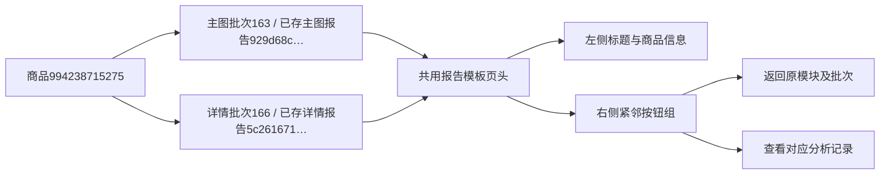

# 图片报告页头按钮分组

2026-11-03，用户指出主图和详情图报告的“返回模块”在中间、“查看分析记录”在最右，确认统一修改两种页面。

## 修改

原因是共享模板把标题区和两个按钮放成三个直接子项，使用space-between分散排列。现将两个按钮包在同一个公共按钮操作区，页头使用两列布局：左侧标题/商品名/编号模型版本，右侧按钮组。小眉题独占上方一行，按钮与大标题顶部对齐，组内间距12px；长商品名只在左侧换行。

900px及以下改为上下布局，按钮组移到标题信息下方，空间不足时自动换行。仅在image_analysis_result.html与image_analysis.css调整结构/布局，按钮颜色、尺寸、圆角等仍使用form_controls公共组件。返回地址、分析记录的模块和批次参数保持原样，未修改报告正文或生成逻辑。

## 验证与数据

14项独立图片分析现有回归通过。隔离长商品名及实际报告均在1440/1024/768/390/320五视口检查：桌面紧邻靠右且顶部对齐，窄屏位于标题下方；按钮边界、长文字、原链接参数及无页面脚本错误。实际详情正文在1024px已有宽表横向溢出；临时恢复旧页头对照后宽度相同，确认本次页头没有增加溢出，本轮未扩大到正文改造。浏览器严格阻断POST和外站，仅GET；查看1440/1024/320截图确认布局。

真实只读目标为平台商品994238715275：

| 报告 | 已保存分析编号 | 来源批次 | 验证内容 |
|---|---|---|---|
| 主图 | 929d68cbbba54d2497fb58b3234b8da9 | 163 | 页头两按钮、长名称与窄屏排列 |
| 详情图 | 5c261671dbd14fccb8eda3b4c99416cc | 166 | 同一公共布局与原返回/历史链接 |

分析编号指已存在的独立报告任务，批次指该报告原图片采集范围，商品编号为淘宝平台身份；本轮没有创建分析任务或报告版本。

结构版本保持0023，无DDL、字段、JSON或状态口径变化。验证库32业务表指纹一致。正式库同时完成了另一份主图分析：analysis_id=f8caddcb719640e9b61357cb5557c00a，执行任务b2ef22416e2742f7b922234e0d8972d2，平台商品1050158363561；tasks+1、task_events+4、analysis_tasks+1、analysis_sources+5、analysis_calls+1、analysis_reports+1。布局测试全程禁止POST，不是本次浏览器检查发起的分析，保留该独立运行结果。排除上述新记录后，tasks及四张分析表的旧行指纹一致；task_events旧行指纹仍有变化。初始快照只保留全表摘要，不能还原旧事件字段前后值；未回写或恢复这些并行变化。结果见filtered_audit.json，不能将正式库描述为完全未变化或全部旧行一致。核对结果及浏览器截图保存在Git忽略目录`workspace/output/reports/image_report_header/`。仅重启本项目8000端口Web，本次布局测试未调用真实AI或采集；最终数据核对见该目录after.json。人工视觉体验待用户确认，自动检查不能代替人工验收。
