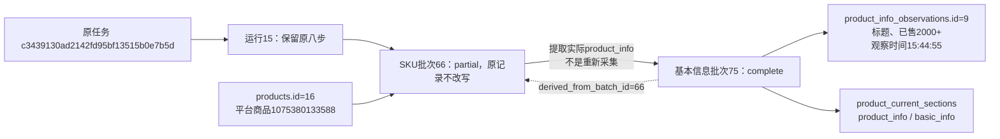

# 基本信息与SKU拆分实施记录

日期：2026-10-25。状态：代码、两库迁移、历史提取及本地验证完成；未发起真实淘宝采集，等待用户实际验收。

当前版本0007_basic_info，运行时schema_v7。默认详情/列表带详情由八模块扩展为九模块，新增--basic-info；--skus只采规格、价格、可售状态和图片。基本信息和SKU共用浏览器和任务机制，分别保存、判断完整性并维护有效分区。

## 数据库与历史数据核对

正式库和验证库均升级为19张业务表、1张技术表、262字段、43外键；原生表/字段备注、复合归属、CHECK、唯一键及索引与模型一致。新增product_info_observations十二列，每批一条，批次/商品/模块受复合外键保护。冻结旧迁移及版本模型不改写。

| 表 | 升级前 | 升级后 | 本轮新增 | 本轮修改/移除 |
|---|---:|---:|---:|---|
| collection_batches | 66 | 75 | 9 | 修改0 / 移除0 |
| product_info_observations | 0 | 9 | 9 | 修改0 / 移除0 |
| product_current_sections | 47 | 51 | 7 | 修改0 / 移除3 |
| tasks | 24 | 24 | 0 | 修改0 / 移除0 |
| task_events | 5301 | 5301 | 0 | 修改0 / 移除0 |
| collection_runs | 15 | 15 | 0 | 修改0 / 移除0 |
| collection_steps | 120 | 120 | 0 | 修改0 / 移除0 |
| sku_observations | 107 | 107 | 0 | 修改0 / 移除0 |
| products | 28 | 28 | 0 | 修改0 / 移除0 |
| list_observations | 34 | 34 | 0 | 修改0 / 移除0 |
| file_assets | 415 | 415 | 0 | 修改0 / 移除0 |
| media_references | 1271 | 1271 | 0 | 修改0 / 移除0 |

移除的是3个旧product_info/skus发布指针，新增7个基本信息独立指针，不删除旧SKU资料。旧66个批次、107条SKU观察及其余原业务行逐行哈希核对一致。新增9批为9个历史SKU信息的证据转换，不是9次新淘宝采集；保留旧task_id/run_id，step_id为空。没有生成新任务、运行或步骤，也没有改写原SKU JSON、原始文件和日志。验证过程仅操作隔离临时样例，验证库归属数据按测试范围清理。

完整行数、旧行哈希、变更计数及真实编号保存在[本地核对报告](../../workspace/output/reports/basic_info_split_20261025_f749e3e5.json)。迁移基线和结论为本轮快照，后续正常采集会增加记录。

## 真实来源例子

平台商品1075380133588对应products.id=16。原任务c3439130ad2142fd95bf13515b0e7b5d、运行15的SKU批次66仍为partial；其实际保存的标题和“已售2000+”按独立条件提取成基本信息批次75、观察9，status=complete。基本信息实际观察时间仍为2026-10-25 15:44:55（UTC+08:00），没有使用迁移时间。旧来源未保存店铺及页面展示价格，所以新行相应字段为NULL，未取列表29.99补齐。



任务代表原执行过程；运行是该商品一次模块流程汇总；批次代表某模块的一次保存；商品内部编号统一身份；观察9是本批的基本信息明细。原SKU文件和文件索引仍由旧批次关联，基本信息通过派生来源追溯，不冒充新下载文件。

用户示例996877163053（内部商品1）的原SKU批次9也为partial，实际标题及“已售7万+”提取到基本信息批次67、观察1，保留2026-10-24 12:25:12观察时间。9个新增批次完整来源如下：

| 基本批次 | 原SKU批次 | 商品内部ID | 平台商品编号 | 基本观察ID | 状态 |
|---:|---:|---:|---|---:|---|
| 67 | 9 | 1 | 996877163053 | 1 | complete |
| 68 | 25 | 19 | 684759154250 | 2 | complete |
| 69 | 33 | 20 | 759806771408 | 3 | complete |
| 70 | 42 | 21 | 960701301736 | 4 | complete |
| 71 | 50 | 22 | 988382163891 | 5 | complete |
| 72 | 59 | 23 | 726498424551 | 6 | complete |
| 73 | 64 | 16 | 1075380133588 | 7 | complete |
| 74 | 65 | 16 | 1075380133588 | 8 | complete |
| 75 | 66 | 16 | 1075380133588 | 9 | complete |

## 验证范围

320项单元测试通过；37项隔离浏览器检查通过，覆盖基本信息无SKU区域/无点击/无额外网络请求、标题不唯一保留部分结果、可选字段缺失、网页独立派发与刷新、默认九模块、停止和SKU价格/图片/恢复回归。MySQL验证覆盖独立观察、幂等补写、跨商品/模块约束、部分结果不覆盖有效指针、旧部分SKU独立提取、保留原时间及未记数据不捏造；统一任务内基本信息成功、随后SKU部分完成时基本信息仍可读取。

真实淘宝端到端采集尚未执行。本轮没有停止或重启用户8000服务；代码生效需用户在原终端Ctrl+C后重新启动并刷新网页。

## 使用

```cmd
python main.py taobao detail --input "996877163053"
python main.py taobao detail --input "996877163053" --basic-info
python main.py taobao detail --input "996877163053" --skus
```

第一条默认九模块，第二条仅基本信息，第三条仅SKU。评价100条和问答50题的默认限制继续沿用。详情字段未展示如实留空，不替换为搜索列表数据。字段值及JSON规则统一见[取值说明](../数据库字段取值说明.md#product_info_observations商品基本信息观察表)。

最终复核：MySQL共25项检查执行，24项通过，1项需要联用浏览器的既有检查未在该命令中启用；独立浏览器另完成37项及核心7项复核。两库原生备注/约束均无差异，验证库所有19张业务表为0行。正式库重复执行历史提取新增0条，确认幂等；只读页面已核对商品996877163053的基本信息批次67及1075380133588的批次75。
