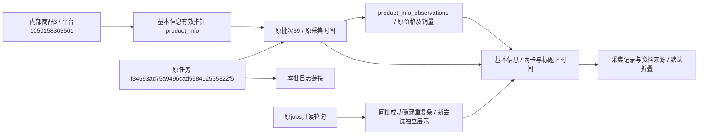

# 基本信息区域排版整理

2026-11-01按用户确认的方案整理商品基本信息区域，未增加用户暂缓的额外显示字段、历史批次功能或资料距今天数。

## 最终布局

- 标题与“资料已保存/待采集”同行，批次及完整北京时间在下方；右侧统一排列查看本批资料、更新基本信息、本批日志。更新入口用原公共主按钮，其余用公共描边样式；手机端移到标题下自动换行。
- 价格和详情销量原文两张卡并排，手机单列。采集时间不再占独立大卡，原价格限定词、销量口径、原说明和精确时间保留。
- 原“查看采集详情”与“标题与资料来源”合并成默认关闭的“采集记录与资料来源”，内部保留详情标题/复制、店铺、批次、来源说明及最近基本信息成功任务的长说明。“最近列表参考”独立折叠。
- 只有已结束、已确认成功且job.batch_id等于当前已展示info_batch_id时隐藏重复任务条；不同批次的新成功、新尝试失败、暂停/排队/待确认/执行中仍显示。查看新资料/本次尝试单独放任务条，当前价格、销量、本批资料及本批日志链接始终固定，不在轮询中切换。
- 更新入口原本只进入预选basic_info的配置页。已有活动任务时改成“查看当前任务”；尚无实际task_id时为“查看申请进度”，不会用申请号拼接不存在的任务。任务结束后恢复原配置入口，不自动发起采集。
- 删除product_basic尾部遍历其他模块异常的旧提示，问大家等异常统一在采集概况和各自模块查看；保留基本信息自身最新尝试提示。

## 实现边界

仅修改product_basic模板、product_detail布局和collection.js中data-fixed-source基本信息分支。指标、按钮和折叠外观继续复用公共组件，未新增独立按钮颜色规则。原批次/观察/返回链接、来源守卫、复制及默认折叠保持；其他模块状态渲染沿原分支，采集概况接口及规则不变。

没有新增业务API或读取字段，没有更改数据库表、字段、COMMENT、持久JSON、状态含义、配置、采集与AI规则，结构仍0019_question_analysis/schema_v19。无自动重采、原数据修复或AI调用。

## 本轮检查

- 42项相关单元通过：商品资料/采集概况/批次范围，包括跨运行隔离、旧有效资料保留及异常入口。原测试中“基本信息附加其他模块异常”断言按批准方案改为基本信息不显示、概况仍可见；来源日志断言兼容按钮增加title属性，不再依赖属性紧贴顺序。
- 隔离浏览器1440/390/320通过：两卡、采集时间、按钮顶部位置与白色主按钮文字、来源/日志不换批次、新成功结果入口、同批成功去重、合并折叠内容、活动任务/未建任务排队/失败后恢复更新、来源复制与配置预选。页头停止状态轮询和原配置参考仍通过。全部请求由临时样例或模拟状态响应，不提交真实任务。
- 本机真实商品1050158363561（内部商品3）三视口只读通过：基本信息批次89，采集于2026-10-26 09:41:05，价格原文“优惠前 ￥ 3.35 起”、销量“已售 10万+”保留；同批成功任务条隐藏，原问大家橙色提醒移除，合并折叠内原文和长说明可展开。更新入口正确带入本商品且仅预选basic_info，没有点击开始采集。
- 本批日志仍关联原任务f34693ad75a9496cad558412565322f5。正式库和验证库各32业务表本轮前后行数/全行SHA256完全相同，新增0/修改0/删除0，迁移版本均0019。没有更改任务、批次、详情运行或历史分析；所有实际网页检查仅允许本地GET/HEAD，外部与写请求禁止。
- 证据：workspace/output/reports/basic_layout的before/after指纹、isolated和actual截图，workspace/basic-layout-*.log。已核对并隐藏重启本项目8000 Web，未停止采集进程。上述是自动检查，人工体验仍待用户刷新确认。

图中商品是跨批次统一身份；89是本次展示的实际基本信息来源，任务是该批采集的执行身份。新状态只控制显示和入口，不回写这些历史记录，也不会改成问大家尝试的数据。
