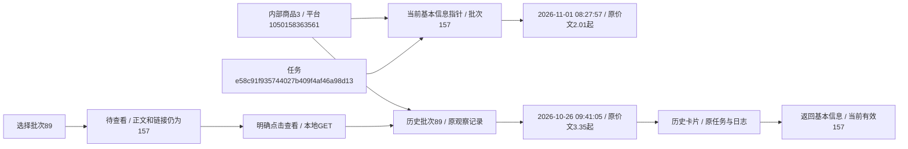

# 基本信息批次明细卡片整理

2026-11-01按用户确认方案，将商品页“查看本批资料”进入的基本信息单批明细改为卡片，保留批次来源和原采集内容。

## 排版及交互

标题为“基本信息采集记录”，下方清楚显示当前查看批次、完整北京时间和“最近有效批次／历史批次／采集尝试”。最近有效指加载时完整批次仍在current_ids中，不把最近部分尝试误作最新有效资料。右侧为返回基本信息、查看任务、采集日志；无task_id不造任务或日志链接。

选择框改称“选择采集批次”，全部候选为该商品已发布的基本信息批次，按原采集时间/id倒序，状态使用中文。复用公共搜索下拉框，选择后显示待查看提示，只有明确点击“查看”才GET加载。待切换期间标题、价格、任务及日志继续对应原已加载批次；无脚本可使用原生选择和表单提交。表单防重复提交，浏览器返回可恢复按钮。

正文“本批保存内容”直接显示本批详情标题、店铺及价格/销量两卡，保留平台价格限定词和销量原文。取消单条基本信息的通用表格、排序及分页。来源与采集说明默认折叠，批次/时间、观察时间、已存source_url原文、来源任务及旧SKU基本信息拆分说明按记录展示。来源URL作为文本转义展示，不把任意来源字符串变成可执行链接。

部分、失败、停止等状态在标题旁明确显示，简短原因为已保存消息的前160字及省略号，完整说明留在折叠来源。没有原因则明确提示查看关联任务日志，不猜故障原因；未保存观察时保留批次及来源，不借当前有效资料填空。页面没有采集或分析提交动作，最近任务轮询不会改变已加载批次正文。

## 实现及数据边界

product_basic_batch.html/basic_batch.js与只读basic_batch_presentation负责此模块，外观复用公共控件及form_controls.css的新公共批次组件，product_detail.css只安排布局。原商品归属校验在明细查询前完成，其他商品批次仍404。默认基本信息摘要、采集概况、其他模块和通用/CLI批次查询保持原路径与规则。

基本信息有uq_product_info_batch唯一约束，每批一条。该卡片固定读取kind=basic_info、after=0、limit=1，不继承旧链接的page/sort/order或其他kind/question_id；其他列表仍按原参数分页。

records新增内部可选with_batch_note=false，显式开启且基本信息时从已读取原result_payload.record提取message/error.message或字符串error/reason中的首个非空字符串，返回临时batch_note；默认查询不增加键，完整原快照不向页面展开。该字段与basic_batch_view均只读，详见字段取值说明。没有DDL、表列/原生备注变更、持久JSON改写或新业务状态，仍0019_question_analysis/schema_v19。没有恢复旧分析或发起真实平台采集/AI。

## 本轮核对

- 714项全量单元及40项相关回归通过。新增3项批次边界覆盖历史资料与任务不借当前批、不同参数仍固定本批、最近部分尝试不替代有效指针、默认records契约、原消息安全转义、无明细/失败原因及跨商品拒绝。原其他模块查询与分页回归保持。
- 隔离1440/390/320通过：公共批次搜索、候选中文、选择后待查看且无页面导航、正文/任务/日志未换、明确GET切换、当前与历史标签、两卡和无表格/分页、来源折叠、部分尝试原文和返回基本摘要。1440另核对禁用JavaScript时原生选择可GET查看；所有请求来自隔离样例或模拟只读进度。
- 实际平台商品1050158363561（库内商品3）三视口核对：当前有效基本信息批次157，采于2026-11-01 08:27:57，任务e58c91f935744027b409f4af46a98d13；价格原文“优惠前 ￥ 2.01 起”、销量“已售 10万+”。选中89未点查看时仍显示157的内容与链接。
- 明确查看历史批次89后显示2026-10-26 09:41:05的资料、价格“优惠前 ￥ 3.35 起”和原任务f34693ad75a9496cad558412565322f5。最新任务轮询返回200后，正文仍保持89；“返回基本信息”回到157对应的当前有效内容。未执行真实采集或AI，仅允许本地GET/HEAD。
- 正式库和验证库各32业务表本轮前后逐表行数及全行SHA256完全相同，新增0/修改0/删除0，迁移版本均0019。before/after指纹、隔离及实际截图、实际批次元信息位于workspace/output/reports/basic_batch_layout；日志workspace/basic-batch-*.log。仅隐藏重启已核对的项目8000 Web，不停止采集进程。人工体验待用户刷新确认。

批次是一份独立采集存档，商品是跨批次统一身份，任务是采集执行身份。图中编号和价格均来自本轮实际只读核对，不代表实时价格或价格变动分析。
