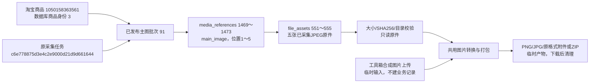

# 工具箱与主图格式下载

2026-11-01，用户确认实施；人工体验待用户确认。

## 已实现行为

左侧增加工具箱（`/tools`），首个工具为图片格式转换（`/tools/images`）。支持多选、拖入、移除、清空、显示数量及上传/处理中提示；单图附件、多图ZIP。输入静态JPEG/PNG/WebP，输出PNG/JPG/original，首次PNG；工具箱与主图分别在当前浏览器记住格式，不保存图片列表。下载后保留当前列表，刷新清空。

真正解码与编码，PNG保留透明度、JPG质量95且透明区域合成白底，不改尺寸；EXIF转正时宽高可交换。original逐字节保留，同编码且无需转正时复用字节。动图、不支持或损坏内容明确拒绝；首个失败文件有名称及原因，不返回残缺包；原件完整但目标编码失败时可尝试original，缺失或损坏原件不能绕过检查。

主图页紧凑批次/任务/日志区，明确点击查看后切换。画廊完整展示、原编号不随正倒序改变，桌面3列/宽屏5列、手机2列或窄屏1列；缺失保留卡片。每张预览和下载，顶部整批下载不受20条分页影响；格式弹窗共用记忆逻辑，整批始终ZIP，文件名包含商品、批次、原位置和媒体编号避免覆盖。预览沿全站对话框增加本页画廊前后切换、方向键及原尺寸放大/恢复；其他图片入口仍沿旧行为，滚动/焦点恢复及人工采集弹窗优先保留。来源默认折叠。

## 分层与临时输出

- `infrastructure/images`只处理字节，包含Pillow转换与结果/异常定义，不依赖Flask、商品或数据库。
- `modules/image_tools`负责受限输入、批量/命名/ZIP、主图归属与原件校验；两个界面共用，不新增CLI或服务。
- `infrastructure/storage/main_image_export.py`只读指定商品/已发布main_images批次及main_image文件关联，同一读取事务内核对归属。单张直接限定media_id，整批只读最多201条用于200张限额判断，不读原始JSON。
- Web负责页面与输入输出，工具箱模板在`web/templates/tools/`，随包发布。公共控件外观在form_controls，image_tools.css只安排布局。

上传1～20张，单张10 MiB、合计50 MiB、单图2500万像素，输出总计150 MiB；主图整批最多200张，其余输入/输出限制相同。multipart仅该路由上限51 MiB（含表单开销）、25 parts；全站原1 MiB限制不变。上传不写入商品或文件索引。输出最多8 MiB在内存，超过转workspace/output/temp/image_tools内临时文件，请求/响应关闭后清理，失败关闭，不保存历史。

POST沿本机Host、同源Origin及页面令牌守卫；主图额外核对已发布商品/批次/role、workspace/output根目录、availability、文件大小和SHA256，读取的同一份字节核对后才转换。不得接收任意服务器路径。下载名净化并对大小写同名去重。原视频download=1及其他素材预览契约不变。

## 本轮验证证据

- 全量单元729项通过；后续边界调整完成后45项相关单元通过，资源检查无未关闭警告。Pillow13.0.0已安装，pip check无冲突；本地无依赖构建wheel成功，已核对工具公共模块及嵌套模板均被打包。
- 隔离浏览器1440/390/320通过：多选、多图PNGZIP、单图JPG、文件保留、损坏文件提示、两入口独立记忆、历史批次待应用及明确切换、画廊、预览和下载。
- 更新后的真实本机Web1440/390/320全部通过，同样测试合成上传并下载已有主图91批。原格式与对应本地原件逐字节相等，ZIP内PNG逐张实际解码；实际来源五张均为JPEG，未假定原格式为WebP。窄屏预览按钮可换行，已查看截图。
- 全站既有图片预览6项浏览器回归通过，覆盖商品/搜索/采集批次/SKU、动态图片、鼠标键盘、焦点/滚动恢复、人工提示优先。旧测试将当前商品库唯一的图片链接误当标题，已按现有标题文本和独立资料入口修正，不改商品库行为。
- 正式库taobao_automation与验证库各32业务表：前后行数及全行SHA256完全相同；结构0019_question_analysis不变。新增/修改/删除业务行均0，未改COMMENT/持久JSON，未执行真实采集、AI、旧记录恢复或数据迁移。

原始验证产物位于本机Git忽略的`workspace/output/reports/image_tools/`：before/after/source JSON、unit.log、resource_check.log、页面与下载/预览截图及Web重启记录。隔离浏览器脚本`tests/browser_image_tools.py`，`--real`仅允许本机只读页面和图片工具POST，不提交采集或AI。

## 本轮真实来源数据流

商品编号是平台身份，内部商品3用于批次归属；91表示该次主图采集，原任务记录执行来源；1469～1473保存主图顺序及文件关联，551～555是原件索引。文件字节不存进MySQL。以上均为本轮实际读取的已有编号，转换不产生新的任务、批次或file_assets记录。
