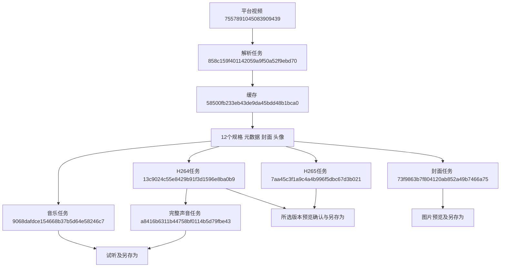

# 抖音素材工作台

2026-11-02，用户批准按参考卡片完善单条抖音素材工具：先解析资料与实际版本，再准备所选视频，同时提供音乐、封面和完整声音。沿用初版“预览所选版本、人工确认无抖音水印，再另存为”的口径。一次一个链接，items继续保留多条扩展结构。

## 页面和流程

- `/tools/douyin`展示左侧封面、右侧标题/头像/作者、时长与赞/评论/收藏/分享，以及版本选择和素材操作。桌面左右、手机上下。标题可展开，原链接与编号可复制，发布时间和解析时间采用北京时间；互动数字是解析时快照，缺失显示“—”，真实零值保留0。
- 点击“解析素材”只读取信息并准备封面/头像，不下载视频或音乐。版本按来源实际宽高、编码、码率和大小展示，同规格CDN地址合并；默认优先H.264兼容版本，提供实际H.265选项。尺寸或大小缺失标为未知，不拿全局尺寸冒充某个码流的分辨率，不升采样或转码视频。
- 选择版本→“下载视频”→展开预览→勾选当前版本无水印确认→选择位置保存。切换版本清除确认、暂停旧预览。所选版本不能在浏览器预览时禁止确认保存，并提示换H.264或浏览器；不自动改下另一个规格。
- “背景音乐”准备平台音乐文件，可试听并保存原格式；它的时长可能与视频不同。“封面”支持原格式、PNG、JPG，复用公共图片转换能力，保留平台图片尺寸。“提取完整声音”在所选视频已准备后启用，从第一条音轨提取完整时长，AAC 192 kbps输出M4A。视频/音乐/原声播放互相暂停，避免声音重叠。
- 每类素材准备和另存为分开，已有完整缓存直接复用。背景音乐、转换或提取失败不会使之前的视频失效。只有浏览器写入流close成功后记录已保存；取消/中途停止会abort。每类素材使用稳定的另存为id记忆目录，实际文件名和成功时间仅记录在本浏览器；清理服务器缓存后仍保留该浏览器保存摘要。
- 历史展示封面、标题、创建时间、最新操作状态和真实任务链接，支持重新打开、再次保存、删除缓存、清理过期缓存及占用统计。索引摘要保留，因此清理后占用可能仍有少量索引字节。过期为闲置1小时，读取完整文件或新准备任务会续期。正在处理的记录不删除；Windows文件占用时明确提示停止播放后重试。

## 实现与接口

`platforms/douyin/video.py`负责来源过滤、规格合并与元数据；`modules/video_tools/studio.py`复用旧服务执行器和缓存基础，新增解析/资源任务；`media.py`负责有界资源获取、图片转换与FFmpeg音频处理。新记录version=2，旧缓存由原服务只读兼容，不转换旧任务和事件。旧记录可预览仍有效的原缓存，其他素材需要重新解析。

新增依赖`imageio-ffmpeg>=0.6,<0.7`，本机已安装0.6.0的Windows运行组件；音频处理不依赖系统PATH。新环境通过`.venv\Scripts\python.exe -m pip install -r requirements.txt`安装。无新增配置项，更新后重启网页。视频最大1 GiB、图片10 MiB/2500万像素、音乐100 MiB，音频处理限180秒。FFmpeg只接收本地文件路径、无shell参数拼接，后台运行支持停止。

来源域名与每次跳转按视频/图片/音乐分别校验，拒绝显式平台下载水印源、下载源重合地址及未知来源。临时签名地址只在workspace内私有catalog.json保存，不进入页面响应、数据库事件或Git。地址过期可刷新同一个视频的来源；原规格不再存在则提示重选。视频编号、规格ID和缓存目录三级绑定。原生另存为、本机限定、Origin及页面令牌守卫继续保留。

API沿用`GET/POST /api/tools/douyin`（查询/解析）及`GET/POST /<cache_id>`（状态/操作），操作包括cancel、prepare、delete_cache。prepare接收kind=video/music/cover/audio、视频或原声format_id、封面output_format=original/png/jpg，严格校验类型与归属。`GET/POST /<cache_id>/assets/<asset_id>`分别预览/导出，视频导出必须reviewed=true，其他素材save=true。`POST /cleanup`只清理过期缓存。旧`/<cache_id>/media`仅用于旧缓存。

## 真实样例与数据库记录

样例为用户提供的视频`7557891045083909439`，作者张师父、时长15.082秒。资料解析时点为北京时间2026-11-02 12:03:55；赞6374、评论149、收藏3466、分享485，表示这一快照，不能当作后续实时数据。得到12个可选规格，解析结束时没有视频文件。

实际缓存编号：`58500fb233eb43de9da45bdd48b1bca0`。以下是本轮真实任务，不是示例编号：

| 操作 | 任务编号 | 实际产物 |
|---|---|---|
| 解析 | 858c159f401142059a9f50a52f9ebd70 | 元数据、12规格、封面47432字节、头像2958字节 |
| H.264视频 | 13c9024c55e8429b91f3d1596e8ba0b9 | 1080×1920，3236000字节，规格49800b879142fd83a800 |
| H.265视频 | 7aa45c3f1a9c4a4b996f5dbc67d3b021 | 1080×1920，1327141字节，规格d3c6e61632ce0012a06e |
| 背景音乐 | 9068dafdce154668b37b5d64e58246c7 | MP3，241717字节 |
| PNG封面 | 73f9863b7f804120ab852a49b7466a75 | PNG，353020字节 |
| 完整声音 | a8416b6311b44758bf0114b5d79fbe43 | M4A，368318字节 |

MySQL正式库前后计数：tasks 87→93（新增6），task_events 12607→12627（新增20）；其他30张业务表数量一致。没有本功能对旧业务记录的更新/删除、没有采集批次、商品观察或file_assets写入；tasks这6条新记录按原机制更新进度/终态。结构保持0019，database check为32业务表、386字段、67外键、原生备注完整、schema_errors为空。本轮没有做全表内容指纹比较，不据数量声称所有旧行内容一致。

平台编号标识抖音视频；缓存编号标识本机临时目录；规格ID标识该记录中的宽高/编码/码率/大小组合；task_id是统一tasks主键。task_events.task_id继续使用既有外键；catalog/资源与任务之间是程序维护的逻辑引用，不新增数据库外键，不关联淘宝商品或采集批次。任务成功代表该操作完成，不代表已保存到用户目录或自动确认画面无水印。

## 验证与限制

30项相关隔离测试通过：来源/编号、规格合并与缺失数据、先解析后下载、缓存复用、规格刷新不替换、资源失败不污染视频、文件校验、错误内容、过期/清理/占用反馈、旧缓存兼容、真实本地音轨提取等。全套1444项OK，571项按条件跳过。浏览器检查覆盖1440/1024/390/320，无横向溢出、无脚本错误；切换规格重置确认，刷新恢复及取消/中止保存通过。

用模拟另存为句柄接收真实视频/音乐/PNG/完整声音，四份字节数和SHA256均与缓存一致。视频SHA256为`0bbd5513d5889bb5a7d95d2195bd10e6be3ab2ba2da31df621816442fa8775cb`；其余校验与所有表计数保存在Git忽略的`workspace/douyin_studio_integration.json`。截图在`workspace/output/reports/douyin_studio`，全套测试输出在`workspace/douyin_studio_full.log`。

原生文件选择窗口的实际点选、人工登录/验证码、完整观看和真人听音仍待用户体验。H.265能否预览取决于实际浏览器播放能力，不能预览时不允许跳过视频核对保存。不得将“来源过滤通过”宣称为自动去水印；初版的首条带水印样例仍是反例。

可复现页面检查（缓存需有效且已准备默认视频、音乐、PNG封面、完整声音）：`.venv\Scripts\python.exe tests\browser_douyin_studio.py 58500fb233eb43de9da45bdd48b1bca0`。取消/中止与视频字节检查：`.venv\Scripts\python.exe tests\browser_douyin.py 58500fb233eb43de9da45bdd48b1bca0`。两者均在隔离浏览器模拟文件句柄，不替代原生窗口验收。
