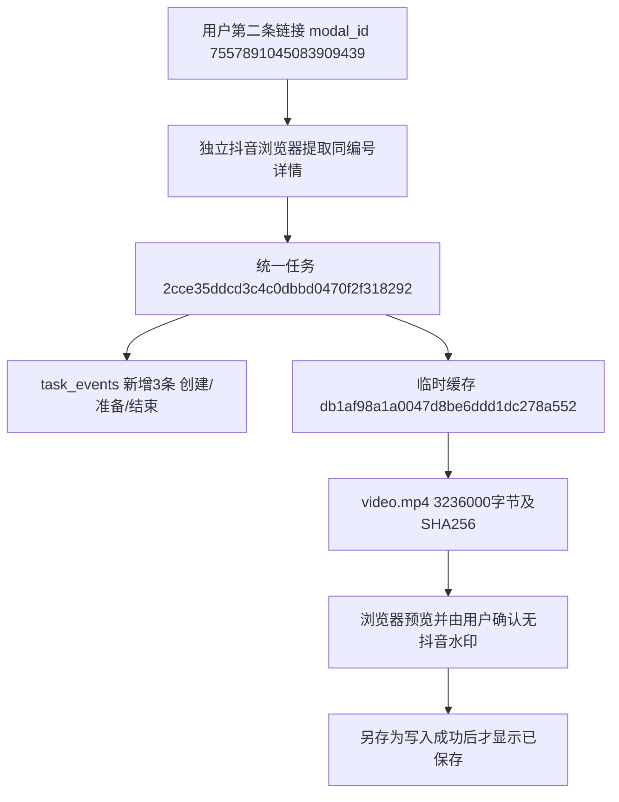
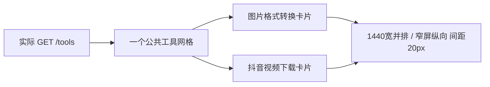

# 抖音视频下载

2026-11-02，用户授权实施单条下载、自选位置、无水印要求及批量预留。真实验证发现播放文件可能已有水印；用户随后明确接受“先预览，由用户确认画面无抖音水印，再保存”。此人工核对是当前功能的必要步骤。

## 使用与边界

入口：工具箱 → 抖音视频下载（`/tools/douyin`）。支持详情链接、短链接、分享文案、个人页带modal_id链接，编号冲突或多个不同链接明确拒绝。抖音使用独立profile与session，通过统一任务执行器持锁；默认无头解析，登录模式打开可见Chrome窗口，等待人工登录/验证码，最长180秒。普通解析最长60秒，导航另限45秒。没有自动破解验证。

平台适配返回播放候选，只允许HTTPS官方视频域名，拒绝显式logo/watermark地址、下载源及与下载源相同的地址；跳转重新检查，最多尝试3个候选。无可靠候选则失败。下载最大1 GiB，流式写part，校验MP4文件头、长度、元数据大小及SHA256，完成后原子替换。来源过滤不能证明原画面没有烧录水印；页面要求视频可预览及用户勾选确认，POST导出还核对确认值。

后台“succeeded”仅表示视频已准备好。只有浏览器写入流close成功才显示“已保存”。取消与失败中止写入；同一缓存可以重新另存为。文件名清理Windows非法字符，标题限80字符，加视频编号。Chrome/Edge的showSaveFilePicker由点击直接触发，固定id记忆目录；不支持时提示更换浏览器。

缓存按MySQL主机、端口、库名隔离，默认闲置1小时过期；预览和导出续期。新建/读取最近记录时惰性清理过期视频，活动线程的缓存保留，小型索引留作最近20条记录展示。用户最终保存的文件不参与缓存清理。重启后按数据库成功任务和文件大小/哈希校验恢复；运行中断时要求重新解析。原始候选URL不进入页面响应或任务日志；登录状态与临时文件均在Git忽略的workspace。

## 实际验证

- 首个视频 `7437582846610509092`：时长223.213秒。720×1280播放文件15,552,502字节，另一档实际576×1024文件13,778,307字节，两个文件的抽查画面都有抖音标志及抖音号。无水印验收不通过，不能宣称仅选择play_addr就解决水印。
- 第二视频 `7557891045083909439`（张师父）：时长15.082秒，1080×1920，文件3,236,000字节；开头、中间、结尾抽查未见抖音标志或抖音号；MP4存在AAC音轨结构。抽查不能代替整段人工核对，尚未做真人听音验收。
- 第二文件SHA256：`0bbd5513d5889bb5a7d95d2195bd10e6be3ab2ba2da31df621816442fa8775cb`。
- 第一次统一后台准备：任务 `f40ff9322b624f34869bd23e0793eb81`，缓存 `cbd80999bd5c48658901afe742e296ce`；第二次最终命名空间验证：任务 `2cce35ddcd3c4c0dbbd0470f2f318292`，缓存 `db1af98a1a0047d8be6ddd1dc278a552`。均succeeded，仅表示待预览文件准备完成。第二条缓存保留供用户体验。
- 两次正式准备合计tasks从82到84、task_events从12592到12598；各新增2/6条，原有记录未通过此功能更新/删除，其余30表数量一致。没有采集批次、商品数据库身份或正式file_assets记录；视频编号是抖音平台身份，缓存编号是临时文件目录身份，task_id是统一任务主键。表结构保持0019。本轮未做全表行内容指纹核对。

缓存manifest中的task_id是程序维护的逻辑引用，不是数据库外键。任务/事件复用既有关系；视频不关联淘宝商品或采集批次。

## 验证状态

19项相关隔离测试通过：输入归属、编号冲突、多链接拒绝、水印源排除、跨域跳转拒绝、错误页面/残缺媒体、令牌/Origin、本机限定、重复提交、取消、升级锁排除运行中的抖音浏览器、缓存复用、重启恢复、过期和篡改拒绝。全套1433项，571项依条件跳过，执行结果OK。

实际页面1440/390/320无横向溢出，预览成功后确认才能保存；取消、保存完成后刷新恢复通过，无页面脚本错误。验证使用模拟文件句柄接收真实媒体字节，保存得到的大小及SHA256与真实缓存一致。原生另存为弹窗的真实点选、磁盘空间不足、人工登录/验证码、整段画面与听音仍待用户体验；未将这些标为通过。

本地证据在workspace：`douyin_integration_first.json`、`douyin_integration.json`为数据库前后计数和任务结果；`douyin_sample*.mp4/png`为实际媒体及抽查画面；`douyin_ui_1440.png`、`douyin_ui_390.png`、`douyin_ui_320.png`为页面截图；`douyin_full_test.log`为全套测试输出。登录资料、媒体、日志和带签名原始响应不提交Git。

可复现的只读本机页面验证入口：`.venv\Scripts\python.exe tests\browser_douyin.py db1af98a1a0047d8be6ddd1dc278a552`。需先启动本机8000服务，并保证该编号的缓存尚未过期；过期后先在页面准备视频，再替换为新的缓存编号。该脚本模拟文件句柄，覆盖选择窗口取消、传输中途停止（确认未close且已abort）、成功保存字节一致和刷新恢复；截图在workspace/output/reports/douyin。

## 工具箱布局修复（2026-11-02）

用户截图指出两个工具卡片上下紧贴。原因是新增视频工具时使用第二个独立it-tool-grid，grid的20px间距无法作用于两个容器之间。现将两个article合并到同一网格，卡片内部以纵向flex排列，操作栏自动靠底并保留24px内容间隔，继续复用公共卡片与按钮外观。

真实GET `/tools`检查：1440宽为两列；1024、768、390、320宽在实际侧栏/内容可用宽度下为一列，卡片间距均20px。桌面按钮同高，五种宽度均无横向溢出、无脚本错误，图片转换与抖音下载入口均返回200。只允许GET/HEAD，检查中POST等写请求为0，没有创建任务、采集批次、商品观察或文件资产记录，未执行数据库行指纹比较。网页服务已重新启动；人工视觉体验待用户确认。

截图在`workspace/output/reports/toolbox_layout/actual-1440.png`及对应1024/768/390/320文件。本轮只修改工具箱模板与其布局样式，未新增自动测试；原有图片工具及视频工具共19项相关回归通过。
