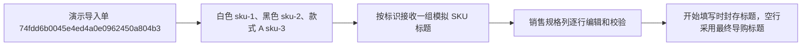
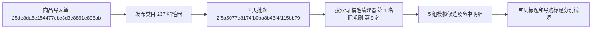

# 搜索排行生成商品标题

在「商品策划与上架」导入商品文件夹并通过自检后，展开「用搜索排行生成标题」。

1. 默认读取当前千牛类目、7 天周期下最新且已有数据的采集批次。可在「生成设置」改选周期或历史批次。摘要显示本批有哪些词、缺哪些词，展开来源可查看实际统计类目、日期、批次编号和各类页数。统计类目与发品类目不同时，需在预览前确认这批数据适用。
2. 系统按商品名称、已有标题、属性和规格的文字匹配优先推荐排行词。可筛选本批词条、取消或增加词条、指定各标题必须使用的词，并补充已确认的商品事实。
   列表分为可折叠的「已勾选」和「未勾选」，各自显示符合筛选条件的数量。选择全部类型时，两个区域都按搜索词、趋势词、核心词、修饰词分组，每类按原榜单排名升序排列。未勾选区在全部视图先显示每类 5 条，单类视图先显示 20 条，可展开更多。选满 40 条后，先取消一条再选择新词。
3. 点击「预览本次请求」核对资料、SKU 数量和预计费用。发送内容包含类目、品牌、Excel 属性、完整规格列表、原有标题、当前标题、补充事实和选中的排行词。确认后用一次 AI 请求生成 5 组宝贝和导购候选，以及每规格一条的 SKU 搜索标题。相同输入已有结果时可直接打开，失败后的重新生成需再次确认费用。
4. 候选直接编辑，超长时仍显示 AI 原文。浅灰「AI 初始标题」保留原文和字数，浅绿「当前填入预览」显示去掉分隔空格后的文字、字数、修改标记及红色排行词高亮。宝贝标题目标为 56～60 字符，导购标题目标为 28～30 字符。宝贝标题最多 60 字符，导购候选须为 20～30 字符，汉字等非 ASCII 字符计 2。每个候选单独校验字符数、重复多字排行词、必用词及同类型候选重复。单字命中只在词条明细中提示次数。
5. 「填入」将合格候选去掉分隔空格后覆盖对应的正式输入框，可跨组选用。候选和正式标题可继续手动编辑。本次导入的草稿在当前浏览器标签页刷新后可恢复。重新生成后可切换已保存的候选，查看各批对应的手改草稿。
6. 首次打开最新保存结果或生成新结果后，按规格标识把 AI 搜索标题去掉分隔空格，自动填入正式 SKU 搜索标题。超长的完整填入并显示超限提示，正式值须改到 30 字符以内才能开始填写。对应规格下显示原稿及当前预览。历史切换用于查看对应原稿，正式值以当前输入框为准。刷新和重新生成会保留手改及主动清空的规格。该行留空时预览并使用正式导购标题，两者都为空则跳过。
7. 启动填写前由前端和服务端核对正式标题。宝贝标题必填，最多 60 字符，导购标题可留空，填写时须为 20～30 字符，SKU 搜索标题最多 30 字符。标题需为单行文本。页面在开始按钮旁汇总问题并提供对应输入框的定位。入仓前读回千牛的标题及本次要写入的 SKU 标题，有差异须修正并复核一致才能继续。

词条读取沿用现有搜索排行 MySQL 快照。一次请求固定一个类目、周期和采集批次，采集较少或部分完成的批次按其实际页数展示。生成输入、批次和词条编号、费用预览及候选保存在对应商品导入目录的 `title-generation.json`。发送意图先保存，再调用模型。现有任务执行入口读取标题覆盖值，商品 Excel 继续作为原始导入资料。

自动验证环境可预览请求和查看已保存的候选。真实 AI 生成通过人工测试环境中的费用确认启动。

## 本轮验证

自动验证库的粘毛器类目编号为 `237`。7 天周期默认选中批次 `2f5a5077d8174fb0ba8b43f4f115bb79`，实际包含搜索词、趋势词各 2 页。桌面 1440 和移动端 390 视口验证了历史批次切换、费用预览、红色标记、分别填入、编辑后重算以及刷新恢复。演示使用脱敏商品资料和模拟候选，排行词、词类型和排名读取自原始快照。

版式和填入规则调整后，以同一导入单和采集批次在 1440、390、320 像素视口复测。第 1 组保留展示空格，字数按填入文字显示 `54 / 60` 和 `28 / 30`，排名引用「猫毛清理器」搜索词第 1 名和「除毛刷」搜索词第 9 名。连续试填验证两个输入框各自整条覆盖，分别确认 60／30 可填入、61／31 禁用。第 4 组提示字面相近和标题偏短，仍可填入。第 5 组的宝贝标题因重复排行词禁用填入，导购标题仍可选。17 项相关单元测试通过，费用预览使用 v3 生成规则，真实生成待付费验收。

v4 演示导入单 `74fdd6b0045e4ed4a0e0962450a804b3` 仍读取采集批次 `2f5a5077d8174fb0ba8b43f4f115bb79`。在 1440 和 390 像素视口验证了按标识接收乱序结果、逐行编辑、保留人工清空、30／31 字符边界以及开始填写的封存值。独立千牛仿真页面的 9 项 SKU 素材测试通过，其中包括按名称定位后优先写专属标题、留空写导购标题并回读。真实生成仍待费用确认后的联调。

2026-11-07 用 8001 导入单 `eec13b1fa838494ea200bcaf23ff79a7` 和已保存的请求 `f375d064d3544087934bdd471fb8535a` 验证候选编辑。首组原稿为 72／60 和 38／30，首条 SKU 为 37／30。1440、390、320 像素视口通过超限拦截、修改、填入、刷新恢复、排行词高亮、SKU 回退预览和正式字段错误定位。已保存候选切换用第二组模拟记录验证。50 项相关单元测试、10 项本地浏览器回归及 SKU 精确回读复测通过。入仓差异复核使用模拟商品页，测试复用已有 AI 返回。

排行词分区调整后，在 8001 的同一导入单使用现有批次 `c68963ffbe8f4ea399a1ededf7f550f6`，通过 1440、390、320 像素视口的四类排名顺序、勾选移动、浏览位置、搜索、上限提示和恢复推荐检查。16 项相关单元测试通过。

原稿对照和 SKU 自动填入在 8001 的可编辑导入单 `eec13b1fa838494ea200bcaf23ff79a7` 验证。1440、390、320 像素视口通过 58／60 标题的单字判定、多字重复拦截、原稿对照、37／30 自动填入及超长拦截、手改和清空刷新恢复。历史切换和新生成的浏览器验证使用本地响应替身，旧导入单 `9444168b816946758c609f2dfacb7e2e` 的 33／30 原稿在隔离编辑态复测。51 项相关单元测试通过。

