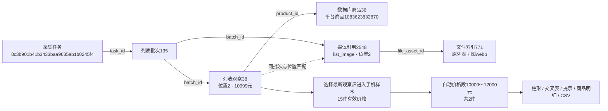

# 搜索词价格自动分段

2026-10-28。用户指出手机等高价商品全部进入“50元及以上”，固定区间失去参考意义；确认自动分段、尾部单列、实际价格摘要、柱形提示和联动筛选方案后授权执行。本轮覆盖单搜索词分析，复用现有公共控件，不新增手动区间或多词对比。

## 计算与边界

计算顺序仍为：确定搜索词/日期/采集范围 → 每商品选择完整观察 → 排除已识别广告 → 用全部有效入口价生成分段 → 最后筛选明细。明细搜索、排序、关注、店铺、数量口径和分页不改变价格图的基础分段。

1. 有效价格沿用非负有限Decimal及人民币口径。零元有效，缺失、非法或明确非人民币价格不补零、不进入分母，商品本身继续保留。
2. 无有效价格时显示空状态；不超过6种有效价格时按实际价位分别计数；完全同价显示一档。
3. 其他样本计算线性插值Q1/Q3和四分位距IQR，低于 `Q1−1.5×IQR` / 高于 `Q3+1.5×IQR` 的价格单列低价/高价尾部。此处“尾部”描述样本位置，不判断来源价格错误，不删除商品。IQR为零时中心价单列，其余价格仍归入两侧尾部。
4. 主体目标约6段，尾部占用对应段数。段宽从 `1、2、2.5、4、5 × 10的整数次幂` 中选择，使实际段数接近目标，并向外取整；最终最多7段。存在尾部时，主体首尾按主体实际端点收齐，避免主体与尾部重叠。
5. 普通段左闭右开，最后主体段包含上限；低价尾部包含实际最低价、不包含主体最低价，高价尾部不包含主体最高价、包含实际最高价；同价组为精确等值。提示中给出每段具体不等式，尾部标签给出尾部实际价格范围。

所有比较使用Decimal，不先转浮点数。程序核对每个不同价格恰好属于一段，并核对各段商品数合计等于有效价格商品数，防止重计和漏计互相抵消。占比保留一位小数，显示舍入后的合计可能略有尾差；柱宽不表示价格跨度。

## 页面、链接与复用

图上显示实际最低价、最高价、中位数、有效价格/商品数；柱形显示数量、占比，悬停和键盘聚焦显示边界及该段实际最低/最高价。最多价位使用强调色，尾部使用区分色；并列最多如实显示并列，不任意称某一档唯一最集中。结果仅说明当前采集样本，不推断最佳定价、利润或市场全量。

图形、价格交叉表、集中价位卡片、点击明细与CSV均使用同一份分段结果。切换搜索词、日期、采集范围、广告条件会重新计算；明细搜索、排序、分页及数量口径切换保留分段。`price_scale` 是由范围、价格和实际边界生成的临时链接校验标识，不是数据库字段；旧固定分段链接或数据已变化的链接清除旧选择，并显示恢复全部价位的提示。CSV元数据写入真实区间标签、不等式、分段方式及筛选状态。

公共计算入口为 `modules/analysis/prices.py`；`service.py` 在选择观察、排除广告之后调用它，其余页面只消费结果。没有前端另算统计，也没有新增数据库表、字段、迁移或持久JSON契约。输入、日期、复选与操作按钮继续复用现有公共模板和设计变量。

## 本轮正式样本

范围均为日期不限、每商品取最新、包含广告。手机15件，实际最低1599元、最高10999元，中位数4499元；原来15件全部进入“50元及以上”，现在按2000元段宽生成六档：

| 价格段 | 手机商品数 | 占比 |
|---|---:|---:|
| 0～2000元 | 2 | 13.3% |
| 2000～4000元 | 5 | 33.3% |
| 4000～6000元 | 2 | 13.3% |
| 6000～8000元 | 1 | 6.7% |
| 8000～10000元 | 3 | 20.0% |
| 10000～12000元 | 2 | 13.3% |

粘毛器16件，实际最低3.35元、最高59.90元；自动按10元段宽生成0～10、10～20、20～30、30～40、40～50、50～60元六档，对应6、4、2、2、1、1件。当前两个样本均未触发尾部分组；尾部、同价、缺价等边界使用隔离样例验证，没有向正式库补造样例。

正式页面点击手机10000～12000元得到2件，CSV也为2件；点击粘毛器50～60元得到1件，CSV也为1件。各词排除已识别广告后均为9件，旧价格段选择已清除。

## 实际来源关系

本轮只读重新核对的手机记录如下，编号来自正式采集记录，本次未创建这些任务或批次：

任务是一次执行的身份，批次是其中某页保存结果，观察是某商品在该页位置的展示；数据库商品主键与平台商品号分别表示本地身份和淘宝身份。观察38的原价格文字为“¥10999 补贴后”，分段使用当时结构化入口价，不代表已核对SKU或补贴适用条件。媒体与观察按批次/位置匹配，不是观察到媒体的数据库外键。原主图文件索引771的SHA256为 `d814807ab7e2fac44ad1f841787bf4541456bd7fa04b8a95f37de85b5ec60850`，仍按原批次追溯，此次只更新只读分析展示。

## 验证与数据影响

495项完整单元测试、17项隔离浏览器测试通过，最终4项价格交互复核通过。单元覆盖普通/两侧尾部、零元、空值、同价、四分位距为零、分界值、最高值、七段选择、小数精度、确定性随机覆盖、并列集中价位、范围改变和CSV一致性；浏览器覆盖提示/键盘、点击后搜索、广告/搜索词切换、旧链接、下载与公共控件回归。

正式手机/粘毛器页面在390/768/1480px通过只读GET检查，脚本错误0，最多价位强调色、交叉表、点击数量和CSV数量一致；桌面/手机截图已查看。内置Browser运行组件连接失败，本轮使用项目现有独立Chromium验证，未操作用户登录资料或访问真实平台。仅重启核对过启动路径的本项目8000端口Web进程，独立采集进程未操作。

正式库全部业务表行数，以及商品、批次、列表观察、文件索引、媒体引用五类源记录的完整内容SHA256前后一致；新增/修改/删除均为0，数据库结构变更0。全库累计仍为商品53条、批次144条、列表观察55条、文件索引808条、媒体引用2585条。上述原主图实际文件的SHA256与登记值一致。

证据保存在不入Git的 `workspace/output/reports/price_distribution/20261028/`：`before.json`、`after.json`、`result.json`、`actual.json`、`real-before.json`、`real-after-analysis.json`、`browser-real.json`、桌面/手机PNG及带独立时间戳的CSV。人工验收只在[功能逐项验收清单](../功能逐项验收清单.md)记录，本轮保留正式页面供用户查看确认。
