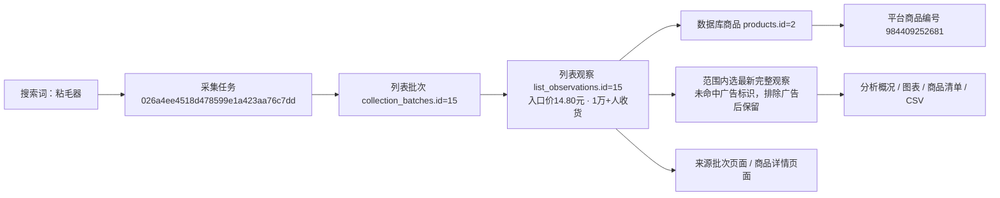
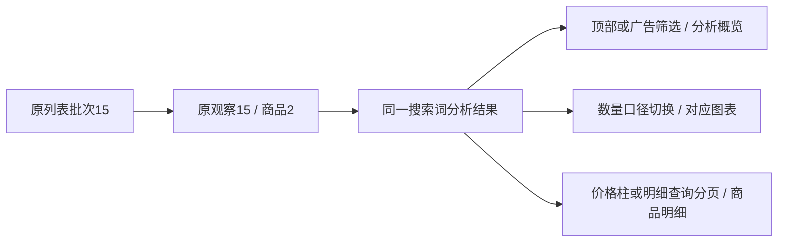
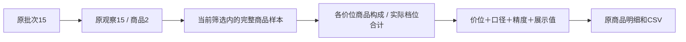

# 搜索词分析首版实施记录

日期：2026-10-28。范围：将已确认的本地Demo接入现有工作台和MySQL采集记录，包含广告排除。页面及本地验证已完成，人工验收待用户查看；未启动真实淘宝采集。

## 使用及能力

工作台侧边栏“搜索词分析”：`http://127.0.0.1:8000/analysis/searches`。搜索词商品页可进入当前词与日期范围分析；来源任务页可进入本次采集分析。

- 范围：明确为关键词搜索、已发布的列表批次；暂存、隔离、以图搜图及无关键词来源不混入。默认日期范围汇总，每件商品取最新观察，与搜索列表商品汇总一致；可手动选最近一次任务或指定任务；无任务批次独立选择；同任务的不同词仍隔离。日期范围结束日包含在内。
- 商品：单次采集取首次观察；日期范围汇总取最新观察，按采集时间、批次及观察编号破同值。所有字段来自同一观察。未确认商品身份按观察分别保留，不按标题合并。
- 广告：先确定商品观察，再排除 `ad_status=identified`；不以旧的非广告观察补位。`not_identified`、`unconfirmed`、空值均保留，不声称一定为非广告。概况、价格图、数量图、样本发现、交叉表、店铺、关注和导出共享同一范围。
- 价格：人民币入口价分布、中位数和线性插值四分位数。首版固定的5元以下至50元及以上六档已由[自动价格分段](搜索词价格自动分段.md)替代：按当前样本自动分段、尾部单列、同价合并，准确边界见柱形提示。缺价或明确为其他币种的记录不计入人民币图表，占比分母为有效入口价数。
- 数量：使用已有五个结构化销量字段，按口径与周期分组，保留精确、下界及近似标记。缺失不当0，零值可绘制。达到1万的分析仅以精确值、已达到1万的下界作为可判断样本；低于1万的下界无法证明实际低于1万，近似值也不进入门槛比例分母。不计算跨口径总量或实际销售额。
- 明细：全范围统计后分页，每页20项。价格柱、样本发现、店铺均可下钻；支持标题/编号/店名、数量口径和价格排序。图表最多绘制1000点并提示，其他统计和CSV不截断。
- 店铺：优先使用受信任淘宝/天猫公开路由中的店铺或用户身份参数；缺少时按店名近似分组并提示。缺店名不造店铺，样本占比不称市场份额。
- 产品类型：原标题初分规则已按用户要求移除。页面、依据侧栏、店铺和导出均不再推测或展示产品类型；旧类型链接会清理该条件并保留其他筛选。
- 关注：当前浏览器标签页的 `sessionStorage`，不是数据库收藏；保存上限200项。CSV含筛选条件，导出全部当前明细，保护公式式文本和平台长编号。

## 实现边界

业务入口：`modules.analysis.service.analysis_page`；只读数据源：`infrastructure.storage.search_analysis`；Web蓝图：`web.routes.analysis`。图表脚本只展示服务端统计，所有业务统计与明细筛选在业务层复用。

没有新增或修改数据库表、字段、持久JSON、迁移或原始采集文件；当前数据库版本保持0009。分析产物不写回采集表。原字段解释仍以[数据库字段取值说明](../数据库字段取值说明.md)为准。

非法筛选返回400，不属于当前搜索词/日期的快照或越界页返回404；数据库未启用409，数据库故障沿用503，不伪造空数据。页面标题及JSON安全转义，来源和返回链接仅走站内地址。未实现经营流量、推广或真实利润分析。

## 本轮真实样本核对

范围：正式库关键词“粘毛器”，`snapshot=range`，未限制日期。5个已发布批次、22条列表观察，去重后16件商品；所选最新观察含7件已识别广告，排除后9件商品、14条原始位置记录。

排除后入口价中位数5.90元；9件具有可用的收货人数展示，周期未说明；5件展示数量达到1万（含下界）。这些数字仅描述本轮采集样本。

下图中的编号均来自本轮只读核对：

任务是一次执行的身份；批次是某页已保存的列表结果；观察是商品在该批某个位置的展示。平台商品编号用于淘宝商品身份，`products.id` 是本地数据库身份。观察的 `batch_id` 关联批次、`product_id` 关联商品；批次的 `task_id` 关联任务。本例观察在当前范围出现3次，仅保留所选观察的字段，3次不解释为平台曝光量。来源主图按同批次和原始位置关联原有媒体/文件索引，缺图不借用其他批次素材。

正式库本轮基线：商品53条、模块批次144条、列表观察55条、文件索引808条、媒体引用2585条。前后证据保存在 `workspace/output/reports/search_analysis/20261028/`，不纳入Git。

## 验证

单元验证覆盖全范围统计、分页、来源隔离、先选观察再排广告、缺值与零值、数量周期与精度、门槛分母、CSV安全、空数据、非法输入、XSS、来源链接、店铺分组、旧类型链接兼容及关注广告排除。浏览器验证使用临时Flask/SQLite和独立Chromium，所有请求仅进入临时应用，覆盖广告全局联动、散点键盘操作、依据侧栏、关注跨刷新、价格下钻、口径切换、店铺及390/768/1480像素布局。

最终验证：479项完整单元测试通过，4项隔离浏览器测试通过；正式8000端口的390/768/1480像素只读页面验证通过，脚本错误0，真实CSV排除广告后导出9项。已人工查看桌面和手机截图。

正式库所有业务表行数前后一致；商品、批次、列表观察、文件索引、媒体引用五类源记录的完整内容SHA256前后一致，新增/修改/删除均为0，表结构变更0。未修改登录资料或启动采集。仅重启经完整启动参数核对的本项目8000端口网页进程，独立采集进程未操作。

证据目录包括 `before.json`、`after.json`、`result.json`、`browser-real.json`、`desktop.png`、`desktop-exclude-ads.png`、`mobile.png`。应用脚本检查及Git空白检查通过。集成浏览器为独立临时Chromium，不依赖当前不可连接的内置浏览器工具。

人工验收记录只在[功能逐项验收清单](../功能逐项验收清单.md)维护；本轮保留页面供用户查看，不自行标记人工通过。

## 2026-10-28 默认范围与搜索列表统一

按用户要求，默认范围改为 `range`（日期范围汇总、每件商品取最新），未指定或留空 `snapshot` 均使用此范围。下拉框将此项置于首位；切换搜索词、修改日期和重置恢复该默认。最近一次任务仍可通过 `snapshot=latest` 手动选择，具体任务/批次链接继续保持明确选择。单次任务取首次观察、范围汇总取最新观察的原规则不变。

12项分析单元和5项隔离浏览器验证通过。正式8000端口未带snapshot参数时，“粘毛器”默认22条记录/16件商品，与搜索列表商品汇总相同；手选最近一次为9件，再通过默认入口进入恢复16件。正式浏览器脚本错误0。数据流及实际任务、批次、观察编号仍见上面的真实关系图；本轮只改变分析入口默认选择，所有数据库表行数及五类源数据内容前后一致，新增/修改/删除0、结构变更0。

证据保存在 `workspace/output/reports/search_analysis/20261028-default-range/`，包括 `before.json`、`result.json`、`browser-real.json`、`default-range.png`。只重启经归属核对的8000端口Web进程，未操作独立采集进程；人工验收仍待用户确认。

## 2026-10-28 移除产品类型

用户指出标题推测不准确，要求移除产品类型。现已删除分类常量与判定函数、类型筛选及统计字段、商品和店铺类型列、依据侧栏类型标签、待分类发现卡片，以及两类CSV中的类型元数据和字段；发现卡片改为两列布局。价格、数量口径、广告、店铺、来源、关注及默认最新商品汇总继续保留。

分析页面和CSV旧链接含 `category` 或 `finding=unclassified` 时自动清理并跳转，保留其他筛选；业务入口也不再应用旧类型筛选。兼容处理仅限分析蓝图，搜索列表中表示搜索词的 `category` 参数保持原含义。没有数据库迁移或采集数据修改。

验证：14项分析单元、26项既有列表查询回归、6项隔离浏览器通过。正式8000端口只读核对商品明细6列、店铺5列，依据和筛选无类型标签；默认粘毛器16件、广告排除后9件；旧类型URL正常清理，CSV为21字段/9件，无类型字段，浏览器脚本错误0，已查看桌面截图。所有数据库表行数和五类源记录完整内容哈希前后一致，新增/修改/删除0。来源关系沿用上方真实任务/批次/观察图，不改变任何外键或原件。

本轮证据：`workspace/output/reports/search_analysis/20261028-remove-product-type/`，包含 `before.json`、`result.json`、`browser-real.json`、`desktop.png`、`mobile.png`。8000端口已仅重启确认归属的Web进程，未启动采集或操作独立采集进程；人工验收待用户查看。

## 2026-10-28 可搜索关键词选择框与样式

用户先要求方案、补充美化要求并明确确认执行后，将分析页“搜索关键词”升级为可检索的选择控件：展开后顶部输入，实时本地模糊匹配、高亮文字及匹配数量；列表限高滚动，当前项显示浅绿底和勾选；支持清空、无结果、方向键、回车、Esc、点击外部关闭以及中文输入法组合。搜索框不新增关键词，不提前修改表单已选值；点击选项后仍由“应用筛选”更新分析，采集范围恢复为每件商品取最新。

使用独立 `searchable_select.js/css` 增强原生select，原生控件继续提交值，脚本未运行时保留原生选择。候选浮层使用Popover顶层及视口定位，避免被卡片裁切；窄屏宽度和高度随视口调整，手机输入字号16px。候选文本及高亮通过文本节点构建，特殊内容不执行HTML。所有匹配均在已加载选项中完成，无新增接口、数据库字段或依赖。

验证：14项分析单元、10项隔离浏览器通过，覆盖222个候选滚动、选中后再应用、无结果/清空不改原选择、焦点、键盘、中文组合输入、安全文字及390px窄屏。正式8000端口只读核对输入“手机”得到“手机/手机壳”两个候选，选择后地址不变，点击应用后手机壳为4件、仍使用最新商品汇总。桌面1480px与手机390px截图已查看，浏览器错误0；正式库所有表行数及五类源记录完整内容哈希前后一致，新增/修改/删除0。未修改采集流程、登录资料或启动采集，仅更新归属核对后的本机Web服务。

数据来源与真实编号仍沿用上文的任务/批次/观察关系图，控件只改变搜索词输入方式。证据保存在 `workspace/output/reports/search_analysis/20261028-searchable-keyword/`：`before.json`、`result.json`、`browser-real.json`、`desktop-open.png`、`desktop-search.png`、`mobile-search.png`。用户人工验收待查看确认。

## 2026-10-28 筛选与明细定位

用户确认修复顶部“应用筛选”更新后滚动到下方商品明细的问题。原因是顶部及数量口径表单未指定action，继承当前地址中的`#sa-products`。现明确顶部/广告提交至`#sa-overview`，数量口径提交至`#sa-quantity-analysis`；明细查询和价格柱仍定位`#sa-products`。公共分页新增默认空的可选anchor参数，仅分析页启用，翻页/跳页定位明细，其他页面默认地址保留。

本轮只改两份模板和定位专项测试；专项验证覆盖1480/390px从明细区再次应用、广告自动提交、数量口径、价格柱、明细查询、下一页、页码跳转及公共分页默认地址。正式只读复核和数据对照见不入Git的`workspace/output/reports/analysis_navigation/20261028/`，没有启动真实采集或修改业务计算。

2项定位专项通过；正式8000端口1480/390px的应用、广告、口径切换、价格柱和明细查询定位复核通过，脚本错误0。五类表数量及观察15完整原值前后一致。仅重启确认归属的Web进程；本轮未执行整套单元回归或原始文件全量哈希检查，验证限于定位及公共分页默认兼容。

本轮核对沿用真实观察15（批次15、商品2/平台984409252681），页面更改只影响下面展示定位链路，采集来源及字段保留：

详细来源任务、商品身份及原文件对应仍见本记录上方真实来源图；本次没有新采集任务或批次。人工验收仍待用户查看。

## 2026-10-28 各价位商品构成表

用户明确仅优化原交叉分析表，并确认实际档位分布、合计、统一色标、点击档位及价格边界提示方案。只替换该折叠表，默认开合沿用原行为；概况、价格图、散点、发现卡片和原统计保持原口径。用户未提交的散点图标题“价格与收货人数有什么关系？”原样保留且不纳入本轮提交。

新表按既有价格段统计商品数、当前数量口径的展示档位、仅1/2件样本及暂无商品提示。精确1000人、下界1000+人和近似约1000人分别成档，同一档位在各行及合计使用相同颜色。没有当前数量口径的商品单独提示，不补0，也不据此判断广告；合计限有效入口价商品，缺价另外提示。每行档位数量加未提供数量等于该行商品数，合计与价格图有效价格数一致。

新增临时URL条件`quantity_tier=指标:周期:精度:展示整数`，限定当前口径、精度、数值及有效价格；不新增持久字段。价位色块附带原bin/price_scale，点击时清除旧的明细搜索/店铺/观察筛选并进入现有商品明细，避免清单数量与色块数量不符。合计色块跨全部有效价位，明细查询/分页/CSV保留档位，CSV仅在有档位条件时补充筛选说明；清除明细筛选、点击其他价格柱或价格分段已变化时清理旧档位。原数据导出列不变。

样式复用公共`data_chip`模板和公共色标变量；只有构成表的标题、行距、合计、边界提示和样本提示使用该表局部排版。正式粘毛器排除广告后的9件汇总为1000+人2件、2000+人2件、1万+人5件；0～5元3件中，1000+人1件、1万+人2件，点击应得到对应2件。

验证与正式页面证据保存在不入Git的`workspace/output/reports/price_composition/20261028/`。本轮只读核对真实观察15及其原批次15、商品2/平台984409252681；与上文来源图保持一致：

专项验证：22项单元测试、3项网页交互测试通过，未执行无关全量回归。正式页面在1480px和390px宽度核对无页面横向溢出，窄屏表内可横向滚动；0～5元的1万+档位得到2件明细及2行CSV，合计1万+档位得到5件。桌面/手机截图、导出及结果保存在上述证据目录。重启本项目8000端口Web服务并只读核对成功；53件商品、144批次、55条列表观察、808文件及2585媒体引用数量未变，55条完整列表观察与修改前一致。

没有新采集、数据库迁移或采集记录写入；人工验收仍待用户查看确认。
