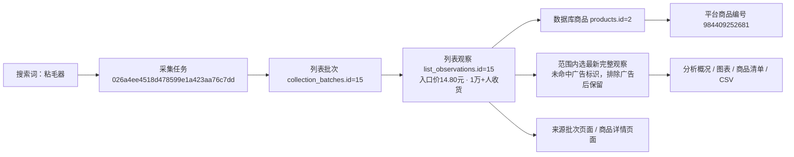

# 搜索词分析首版实施记录

日期：2026-10-28。范围：将已确认的本地Demo接入现有工作台和MySQL采集记录，包含广告排除。页面及本地验证已完成，人工验收待用户查看；未启动真实淘宝采集。

## 使用及能力

工作台侧边栏“搜索词分析”：`http://127.0.0.1:8000/analysis/searches`。搜索词商品页可进入当前词与日期范围分析；来源任务页可进入本次采集分析。

- 范围：明确为关键词搜索、已发布的列表批次；暂存、隔离、以图搜图及无关键词来源不混入。默认日期范围汇总，每件商品取最新观察，与搜索列表商品汇总一致；可手动选最近一次任务或指定任务；无任务批次独立选择；同任务的不同词仍隔离。日期范围结束日包含在内。
- 商品：单次采集取首次观察；日期范围汇总取最新观察，按采集时间、批次及观察编号破同值。所有字段来自同一观察。未确认商品身份按观察分别保留，不按标题合并。
- 广告：先确定商品观察，再排除 `ad_status=identified`；不以旧的非广告观察补位。`not_identified`、`unconfirmed`、空值均保留，不声称一定为非广告。概况、分类数量、价格图、数量图、样本发现、交叉表、店铺、关注和导出共享同一范围。
- 价格：人民币入口价分布、中位数和线性插值四分位数；价格段左闭右开，分别为5元以下、5～10、10～20、20～30、30～50、50元及以上。缺价或明确为其他币种的记录不计入人民币图表，占比分母为有效入口价数。
- 数量：使用已有五个结构化销量字段，按口径与周期分组，保留精确、下界及近似标记。缺失不当0，零值可绘制。达到1万的分析仅以精确值、已达到1万的下界作为可判断样本；低于1万的下界无法证明实际低于1万，近似值也不进入门槛比例分母。不计算跨口径总量或实际销售额。
- 明细：全范围统计后分页，每页20项。价格柱、样本发现、店铺均可下钻；支持标题/编号/店名、数量口径和价格排序。图表最多绘制1000点并提示，其他统计和CSV不截断。
- 店铺：优先使用受信任淘宝/天猫公开路由中的店铺或用户身份参数；缺少时按店名近似分组并提示。缺店名不造店铺，样本占比不称市场份额。
- 类型：标题规则初分，明确标注未核对SKU；整机与耗材混写、无法识别的形态保留待分类。支持粘毛器与手机相关类型，其余信息不足时待分类。
- 关注：当前浏览器标签页的 `sessionStorage`，不是数据库收藏；保存上限200项。CSV含筛选条件，导出全部当前明细，保护公式式文本和平台长编号。

## 实现边界

业务入口：`modules.analysis.service.analysis_page`；只读数据源：`infrastructure.storage.search_analysis`；Web蓝图：`web.routes.analysis`。图表脚本只展示服务端统计，所有业务统计与明细筛选在业务层复用。

没有新增或修改数据库表、字段、持久JSON、迁移或原始采集文件；当前数据库版本保持0009。分析产物不写回采集表。原字段解释仍以[数据库字段取值说明](../数据库字段取值说明.md)为准。

非法筛选返回400，不属于当前搜索词/日期的快照或越界页返回404；数据库未启用409，数据库故障沿用503，不伪造空数据。页面标题及JSON安全转义，来源和返回链接仅走站内地址。未实现经营流量、推广或真实利润分析。

## 本轮真实样本核对

范围：正式库关键词“粘毛器”，`snapshot=range`，未限制日期。5个已发布批次、22条列表观察，去重后16件商品；所选最新观察含7件已识别广告，排除后9件商品、14条原始位置记录。

排除后入口价中位数5.90元；9件具有可用的收货人数展示，周期未说明；5件展示数量达到1万（含下界）。这些数字仅描述本轮采集样本。

下图中的编号均来自本轮只读核对：

任务是一次执行的身份；批次是某页已保存的列表结果；观察是商品在该批某个位置的展示。平台商品编号用于淘宝商品身份，`products.id` 是本地数据库身份。观察的 `batch_id` 关联批次、`product_id` 关联商品；批次的 `task_id` 关联任务。本例观察在当前范围出现3次，仅保留所选观察的字段，3次不解释为平台曝光量。来源主图按同批次和原始位置关联原有媒体/文件索引，缺图不借用其他批次素材。

正式库本轮基线：商品53条、模块批次144条、列表观察55条、文件索引808条、媒体引用2585条。前后证据保存在 `workspace/output/reports/search_analysis/20261028/`，不纳入Git。

## 验证

单元验证覆盖全范围统计、分页、来源隔离、先选观察再排广告、缺值与零值、数量周期与精度、门槛分母、CSV安全、空数据、非法输入、XSS、来源链接、店铺分组、标题冲突及关注广告排除。浏览器验证使用临时Flask/SQLite和独立Chromium，所有请求仅进入临时应用，覆盖广告全局联动、散点键盘操作、依据侧栏、关注跨刷新、价格下钻、口径切换、店铺及390/768/1480像素布局。

最终验证：479项完整单元测试通过，4项隔离浏览器测试通过；正式8000端口的390/768/1480像素只读页面验证通过，脚本错误0，真实CSV排除广告后导出9项。已人工查看桌面和手机截图。

正式库所有业务表行数前后一致；商品、批次、列表观察、文件索引、媒体引用五类源记录的完整内容SHA256前后一致，新增/修改/删除均为0，表结构变更0。未修改登录资料或启动采集。仅重启经完整启动参数核对的本项目8000端口网页进程，独立采集进程未操作。

证据目录包括 `before.json`、`after.json`、`result.json`、`browser-real.json`、`desktop.png`、`desktop-exclude-ads.png`、`mobile.png`。应用脚本检查及Git空白检查通过。集成浏览器为独立临时Chromium，不依赖当前不可连接的内置浏览器工具。

人工验收记录只在[功能逐项验收清单](../功能逐项验收清单.md)维护；本轮保留页面供用户查看，不自行标记人工通过。

## 2026-10-28 默认范围与搜索列表统一

按用户要求，默认范围改为 `range`（日期范围汇总、每件商品取最新），未指定或留空 `snapshot` 均使用此范围。下拉框将此项置于首位；切换搜索词、修改日期和重置恢复该默认。最近一次任务仍可通过 `snapshot=latest` 手动选择，具体任务/批次链接继续保持明确选择。单次任务取首次观察、范围汇总取最新观察的原规则不变。

12项分析单元和5项隔离浏览器验证通过。正式8000端口未带snapshot参数时，“粘毛器”默认22条记录/16件商品，与搜索列表商品汇总相同；手选最近一次为9件，再通过默认入口进入恢复16件。正式浏览器脚本错误0。数据流及实际任务、批次、观察编号仍见上面的真实关系图；本轮只改变分析入口默认选择，所有数据库表行数及五类源数据内容前后一致，新增/修改/删除0、结构变更0。

证据保存在 `workspace/output/reports/search_analysis/20261028-default-range/`，包括 `before.json`、`result.json`、`browser-real.json`、`default-range.png`。只重启经归属核对的8000端口Web进程，未操作独立采集进程；人工验收仍待用户确认。
