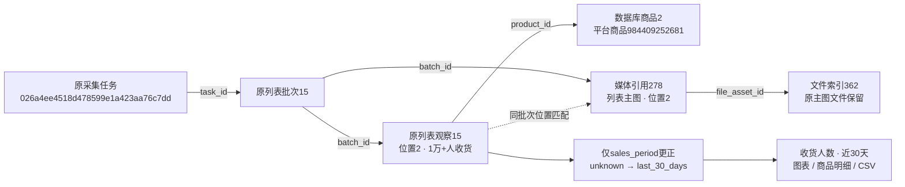

# 收货人数近30天口径更正

2026-10-28。用户明确确认搜索列表“收货人数”统计近30天，并授权统一周期识别、图表分组、商品明细、CSV以及经来源核对的历史记录。本轮以用户确认的来源口径为依据，没有将其描述为独立核实的全平台规则。

## 范围与规则

- 通用文本解析`parse_sales`仍为V1，不按任意“人收货”文字猜测周期。淘宝关键词搜索列表新采集使用`parse_taobao_list_sales`规则V2：完整解析为received_people、状态parsed且原周期unknown时，使用已有枚举last_30_days。
- 原文明示本月/月售/月销的monthly、累计的cumulative及近30天的last_30_days保留；付款人数、已售件数、缺数量、无法识别、冲突文本和其他来源不套用本次规则。近30天与自然月分别解释，不补造精确起止日期。
- JSON格式继续为6，新items/payload的sales_parser_version为2，同名五字段周期为last_30_days；新CSV周期显示“近30天”。V1原件按V1验证，V2按V2验证，混用或未知版本拒绝。原始人数、加号/缩写含义、价格、采集时间不变。
- 规范快照仍保持格式1和原哈希。写入器只在核对platform=taobao、module=list、search_method=keyword且关键词非空后，对与V1原文五字段完全一致的未知收货周期作派生规范化。旧完整快照和缺结构化字段的旧快照均已验证；历史payload和原件不随派生列更正重写，其他不可变字段仍严格核对。
- 网页默认分组、数量提示、明细和分析CSV读取实际sales_period。旧链接请求received_people:unknown时，仅在旧组确实已不存在且新last_30_days组存在时转换图表/明细组并提示；其他真实未知或明确月度组继续保留。

本轮没有新增列、状态或数据库迁移，原生COMMENT、默认值、检查约束以及0001～0009冻结迁移/模型保持原定义。更新后的生成条件及payload规则统一登记在[字段取值说明](../数据库字段取值说明.md#list_observationssales_period)，字典和关系说明同步补充。

## 历史更正结果

先保存完整观察、全表数量、五类源记录哈希及原JSON/CSV/规范快照哈希，再列出候选清单。执行时在事务中加锁重查并逐项比对清单；清单、数量或来源变化则拒绝。只更新list_observations.sales_period，不在查询或程序启动时自动执行历史维护。

正式55条列表观察中，27条符合更正条件，其他28条保留。实际更正编号为：

`2, 3, 5, 7, 8, 10, 11, 12, 15, 16, 18, 19, 21, 22, 24, 26, 28, 30, 32, 34, 39, 41, 46, 48, 49, 53, 55`。

| 搜索词 | 更正观察数 |
|---|---:|
| 粘毛器 | 14 |
| 手机 | 5 |
| 猫抓板 | 3 |
| 纸巾 | 2 |
| 手机壳 | 2 |
| 羽毛球 | 1 |

每条均为`unknown → last_30_days`；新增0、删除0、结构变更0。观察数是历史位置记录数，不是去重商品数，也不是人数合计。没有重采淘宝、修改登录资料或重写原文件。

## 本轮真实来源关系

任务代表原执行，批次代表一页保存结果，观察代表商品当时在某位置的展示。平台商品号与数据库主键分别表示淘宝身份和本地身份，图片通过同批次/位置逻辑匹配，再由媒体引用关联文件。观察15的数量10000、精度lower_bound和原文保留，仅周期列更正；原payload/JSON中的旧解析值及快照哈希继续作为来源证据。本轮没有新建这些任务、批次、商品或文件。

## 验证与证据

501项完整单元测试、18项隔离浏览器测试通过；原始JSON/CSV周期导出最后单独复核通过。MySQL专项4项通过，采集/列表详情关联回归16项中15项通过、1项按既有配置跳过（需额外启用本地浏览器守卫测试）。验证覆盖清单变化拒绝、来源隔离、仅周期修改、明确周期保留、新旧解析版本核验、旧完整/缺字段快照补写、人数下界和CSV一致性。

正式粘毛器排除广告后仍为9件，默认组及旧组链接均显示“收货人数 · 近30天（9）”，明细9件及CSV9件周期一致；手机组为“收货人数 · 近30天（5）”。390/768/1480px页面无整页横向溢出，浏览器脚本错误0，桌面/手机截图已查看。仅重启核对过启动路径的8000端口Web进程，未操作独立采集进程或登录资料。

全表行数前后一致；55条完整列表观察逐列比较，仅上述27条的sales_period变化，其余列（含原文、payload和快照指纹）一致。商品、批次、文件索引、媒体引用的完整内容哈希一致；1580份原JSON/CSV/规范快照文件哈希一致。全库仍为商品53条、批次144条、列表观察55条、文件索引808条、媒体引用2585条。原生sales_period列备注与冻结模型核对一致，无DDL变更。

证据目录为不入Git的 `workspace/output/reports/received_period/20261028/`：`observations-before.json`/`observations-after.json`、`reviewed-candidates.json`、`correction-result.json`、`changes.json`、`baseline.json`、`result.json`、`source-files-before.json`、`actual.json`、`browser-real.json`、正式截图及带时间戳的CSV。人工验收状态只在[验收清单](../功能逐项验收清单.md)维护，本轮页面保留待用户查看。
