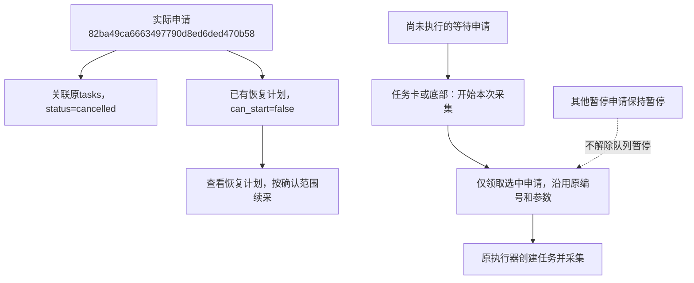

# 暂停申请直接开始采集

2026-10-27，用户反馈点击“加入采集队列”后申请仍暂停，当前任务卡和底部状态栏只有停止按钮；继续队列位于长历史列表下方，难以找到。用户确认修改，范围为明确的单次开始入口、必要接口、文档和隔离验证。

## 使用方式

- 尚未执行的暂停或等待申请，在最近任务卡及底部状态栏显示“开始本次采集”。点击沿用原申请编号和参数，只派发选中的申请，其他暂停申请及队列暂停状态保持原样。
- 当前浏览器正执行其他采集时，开始按钮禁用并提示等待；后台也核对占用，繁忙时保留原申请并返回原因。重复点击正在启动的同一申请不重复派发。
- 表单在队列暂停且没有采集运行时显示“保存采集申请”，保存反馈明确指向任务卡及底部开始入口；实际有采集运行时才显示“加入采集队列”。
- 队列控制移到最近历史记录上方。“继续队列”仍用于恢复整条队列，单次开始不调用该操作。
- 已经执行或取消的申请不重新使用同一编号创建执行；已停止且有恢复计划的任务继续通过“查看恢复计划”续采。

## 接口与存储

新增`POST /api/collection-jobs/<id>/start`，请求体只接受空对象`{}`，沿用本机来源、页面令牌及资源归属校验。拒绝覆盖商品、模块或数量范围；数据库故障返回503，不从旧派发文件启动。

公开状态新增`can_start`布尔值，不是数据库列。它要求申请处于waiting/paused、task_id为空、没有停止请求、旧配置不存在待核对标记。浏览器资源繁忙和网络请求在途由界面进一步禁用，执行前仍由数据库领取和浏览器锁核对。

业务规则复用现有`dispatch_next(identifier=原申请, manual=True)`及领取令牌，不新增表、列或迁移，0001～0009及冻结模型保持不变。单次开始将该申请领取为claimed，之后仍由原执行器同事务创建tasks并关联申请。未解除资源暂停，后续暂停项不会被自动启动。

## 本轮核对

单元448项、统一作业MySQL验证22项、隔离网页24项通过，包括从卡片/底部启动、连点不重复、只启动选定项、保留队列暂停、请求参数与来源拒绝、繁忙反馈及断库不派发。全部浏览器测试请求进入临时本地服务，正式页面只读核对，不点击真实开始。

当前正式申请`82ba49ca6663497790d8ed6ded470b58`已经在12:14:15开始执行，并于12:14:47因采集页面关闭结束为cancelled。它具有恢复计划，应显示恢复入口，can_start为false；本次修改不把已执行记录改回待启动。原申请及商品资料保留，未由助手启动真实采集。

网页已在原8000端口重启并完成只读页面核对：队列位于历史上方，暂停时表单显示“保存采集申请”，上述已停止记录显示“查看恢复计划”。重启前后原申请字段、队列完整记录和任务41条、采集批次131条、商品34条、文件登记760条均未改变；本机无活动采集，独立验证库业务表为空。桌面及390像素手机截图已核对，未发生横向溢出。

本轮原记录和页面核对保存在`workspace/output/reports/paused_job_start_20261027/`。本地验证不替代真实平台人工验收，不改变原39项验收结论。
