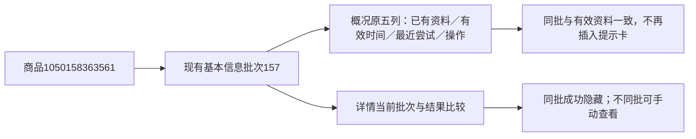

# 更新结果提示布局修复

2026-11-01，用户确认修复采集概况中橙色“更新完成”提示卡重复且挤入下一行第一列的问题。

## 原因与修改

公共更新界面原本将每个模块的结果卡追加到最近的section或overview-row。采集概况每行只有五列，追加卡片成为第六个网格项；概况按钮没有加载批次（loaded-id=0），完整的有效结果因而被当成未查看的新批次重复提示。

- 公共更新界面识别采集概况，不生成独立结果卡。状态、有效批次和异常原因继续由概况原五列及原轮询展示。
- 最近尝试日志移至操作列，补充不同于资料来源任务的更新任务入口；进行中仍沿真实任务或申请进度入口。任务与来源相同时不重复展示相同日志。
- 模块详情仍按当前加载批次与结果批次比较，同批完整成功隐藏，不同批显示“有新批次可查看”；采集中、部分完成或失败继续保留。
- 正常进度和完整新结果使用公共浅色重点样式，异常用原提示样式；补充grid-column:1/-1和整宽布局，避免进入窄列。默认说明区分进行中、已完成与待核对，不把所有状态称为新资料。
- 公共确认、提交、范围、资源锁、任务执行和数据保存均未修改。用户真实采集与人工体验仍待确认。

## 验证

17项相关单元检查通过。新增浏览器布局回归在1440/390/320视口使用真实本机页面与浏览器内存状态覆盖：概况与有效资料一致、排队、运行、部分完成、失败、无内容、无入口时始终9行、每行5列且无独立结果卡；详情同批隐藏、不同批整宽新资料提示、部分/运行状态保留且原加载批次不变。全部POST与外站请求拦截，正式POST 0、真实采集/AI 0。

桌面概况行和手机详情提示截图已目视检查；证据在workspace/output/reports/update_notice_layout。Web按本项目专用启动器与监听子进程身份核实后重启，仍http://127.0.0.1:8000，启动器8356、监听24024，通过只读查询。

两库各32业务表前后行数及全行SHA一致，数据库版本仍0019，无表/字段/COMMENT/持久JSON变化。Web概况只读展示模型新增attempt_task_url（真实不同来源任务的站内入口，无则空），不写数据库。

平台商品编号标识商品，157是现有模块批次，日志和任务入口指向实际原执行。此次只读取既有身份，浏览器内存中的模拟新批次不写库、不打开为真实结果，不产生新的正式任务、批次或观察。
